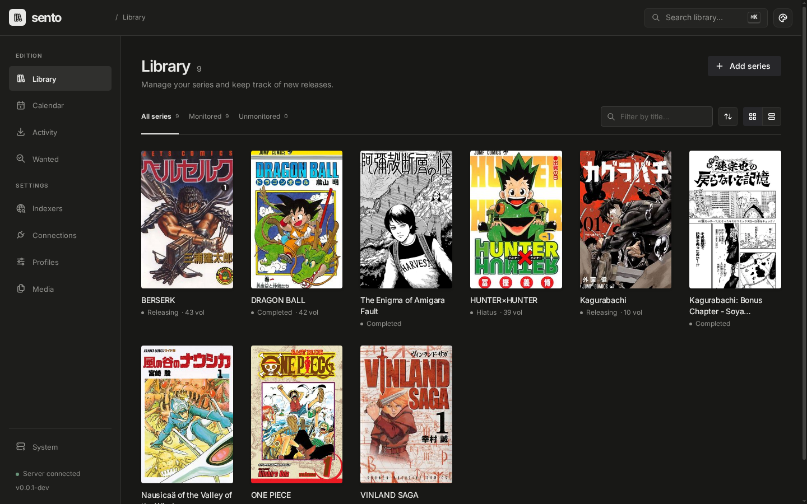
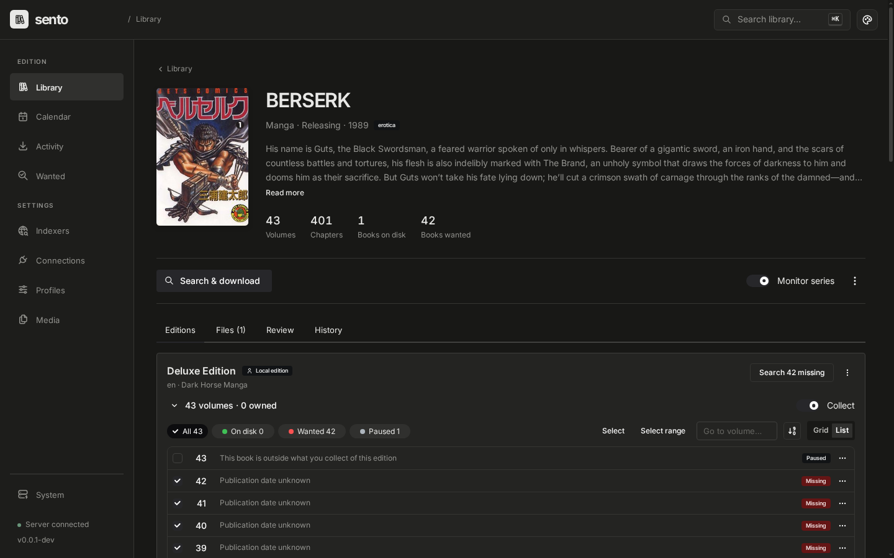

# Sento

[](https://github.com/h-wb/sento/actions/workflows/ci.yml)

Sento finds, downloads and organizes manga. If you use Sonarr or Radarr,
with Komga or Kavita for reading, the idea should feel familiar: add a series,
choose the editions you want, and let Sento keep track of the missing books.

It is early software, built around my own library and used daily. Much of the
code was written with AI assistance. Bug reports, suggestions and contributions
from people with different setups are welcome.

| Library | Series |
| --- | --- |
| [](docs/screenshots/library.png) | [](docs/screenshots/series.png) |

## What it does

- Gets series and edition metadata from [MangaBaka](https://mangabaka.org).
- Searches Torznab indexers such as Prowlarr or Jackett and downloads torrents
  through qBittorrent. Mihon-compatible extension sources provide another way
  to download volumes and chapters through the bundled extension sidecar.
- Keeps editions separate, including translations, omnibus and color editions.
  Release profiles control which formats and groups to prefer or refuse.
- Imports CBZ files with ComicInfo.xml into a library for
  [Komga](https://komga.org) or [Kavita](https://www.kavitareader.com).
  Torrent payloads are never modified, so the originals keep seeding.
- Names files and folders from templates, sets the series name each edition
  shows under in a reader, and applies a change to the files you already
  have after a preview.
- Shows why a release was accepted or rejected, and lets you review files
  whose edition or contents could not be identified safely.

## Run it

You need Docker Compose. Torrent indexers and qBittorrent are configured
separately; Sento does not bundle them.

```sh
git clone https://github.com/h-wb/sento.git
cd sento/deploy
docker compose up -d
```

Open **http://localhost:8484**. Add your connections and indexers, then a series.
For extension sources, add a Mihon-compatible repository URL under Connections;
no extension repositories are bundled.

The Compose file defaults to the development image (`edge`). To use a published
release, set the same version for both containers:

```sh
SENTO_VERSION=0.1.0 docker compose up -d
```

Use a version that exists on the [releases page](https://github.com/h-wb/sento/releases).
Server binaries are also attached there for Linux and macOS on amd64 and arm64.
See [installation and configuration](docs/installation.md) for paths, PostgreSQL,
binary setup, backups and upgrades.

**Sento has no working built-in authentication yet.** Keep it on a trusted
network or use an authenticating reverse proxy. The extension sidecar should
only be reachable by Sento.
See the [security policy](SECURITY.md) for deployment limits and private reports.

## Development

Install [mise](https://mise.jdx.dev), then:

```sh
mise trust
mise install
mise run web:install
mise run dev
```

`mise daemons urls` shows the web URL. Stop the stack with `mise run dev:stop`;
Ctrl-C only stops the log view. The first build includes the JVM sidecar and
can take several minutes.

[Contributing](CONTRIBUTING.md) covers setup, pull requests and commit messages.
The [development guide](docs/development.md) and [testing guide](docs/testing/README.md)
cover the daily workflow. The [documentation index](docs/README.md) links to the
architecture and domain rules.

## Credits

The extension sidecar uses [Suwayomi-Server](https://github.com/Suwayomi/Suwayomi-Server)
to run Tachiyomi/Mihon extensions outside Android. Its notices and MPL-2.0
terms are in [extensions/NOTICE.md](extensions/NOTICE.md). Metadata comes from
MangaBaka; the web UI uses [Mantine](https://mantine.dev).

## License

Sento's original code is licensed under [GPL-3.0-only](LICENSE). Third-party
code retains its own license; see [the sidecar notices](extensions/NOTICE.md).
