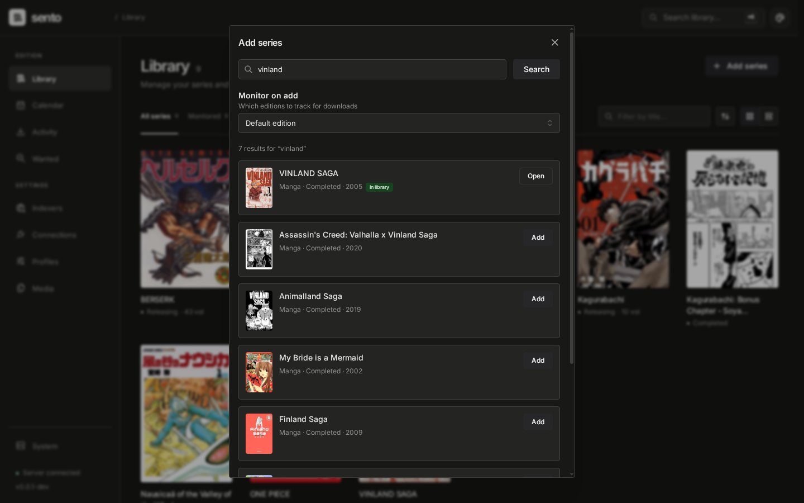
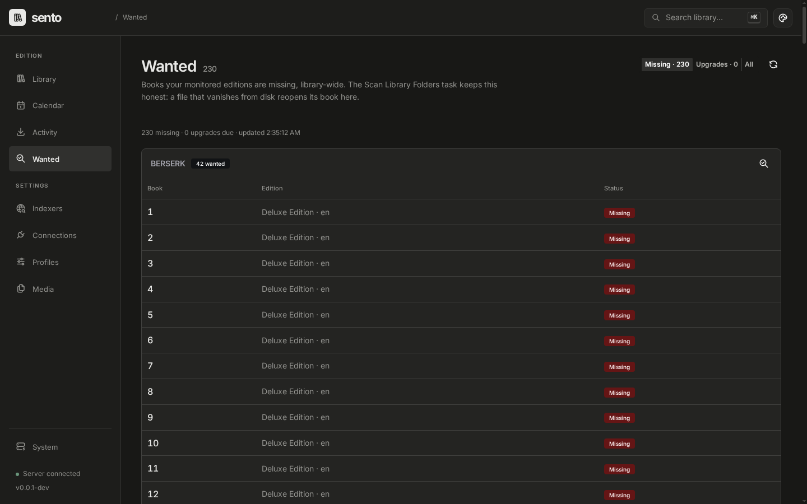

# sento

Sonarr/Radarr-style automation for manga: monitor series, find releases on
torrent indexers and Tachiyomi/Mihon sources, download, and organize
everything into a clean CBZ library ready for Komga/Kavita.

[](https://github.com/h-wb/sento/actions/workflows/ci.yml)

> **A note on how this is built.** Sento has pretty much been coded and
> iterated on with AI. It was first thought out and built to fit my own
> needs, and it shows: the workflows and defaults are the ones I use every
> day. Any contributions and suggestions to adapt the software to fit
> everyone's needs are of course welcome — issues and pull requests are
> open, and there is no house style to learn before you start.

**Status: early development — the core loop works end-to-end.** Working
today: a MangaBaka-backed library (series, collections, volume and chapter
ledgers), chapter search/download/import from Tachiyomi/Mihon extension
sources through the bundled `sento-extensions` sidecar, a Torznab +
qBittorrent path for volumes with a scored decision funnel and release
profiles, a regression-tested release parser, background automation loops,
existing-library import, and a Mantine web UI for desktop and mobile.

## Screenshots

| | |
|---|---|
| [](docs/screenshots/library.png) | [](docs/screenshots/series.png) |
| [](docs/screenshots/add-series.png) | [](docs/screenshots/wanted.png) |
| [](docs/screenshots/connections.png) | |

## How it works

- **Catalog and monitoring** — series and book metadata come from
  [MangaBaka](https://mangabaka.org); monitored editions drive the search
  and download automation.
- **Two kinds of sources** — torrent indexers (any Torznab endpoint:
  Prowlarr, Jackett) for volumes; Tachiyomi/[Mihon](https://mihon.app)
  extension sources for chapters, run outside Android by the bundled
  sidecar built on [Suwayomi](https://github.com/Suwayomi/Suwayomi-Server).
- **A scored decision funnel** — release names are parsed and scored
  against per-series release profiles (required/refused formats, editions,
  language), so the queue shows not just *that* a release was picked but
  *why*.
- **qBittorrent** for torrent downloads, with per-indexer client routing
  (e.g. a VPN client for one tracker, the regular one for the rest).
- **A clean CBZ library** — imports land as organized CBZ books with
  ComicInfo.xml, hardlinked from qBittorrent's download folder so seeding
  continues, ready for [Komga](https://komga.org) or
  [Kavita](https://kavitareader.com).

## Quick start

```sh
git clone https://github.com/h-wb/sento.git   # or just grab deploy/docker-compose.yml
cd sento/deploy && docker compose up -d       # then open http://localhost:8484
```

[`deploy/docker-compose.yml`](deploy/docker-compose.yml) runs Sento and the
`sento-extensions` sidecar. Torrent indexers and qBittorrent are services you
already run: add them on the Indexers and Connections pages. Neither image
ships extension repos — add a Mihon-compatible repo URL on the Connections
page, then add sources on the Indexers page; Sento installs the extensions
they need.

Things worth knowing before the first run:

- **No authentication yet.** Anyone who can reach port 8484 can use the
  API. Keep it on a trusted network or behind an authenticating reverse
  proxy.
- **Paths.** The image keeps its database in `/config`, writes the library
  to `/library` and stages source downloads in `/downloads`.
- **Torrent imports hardlink** from qBittorrent's download folder. Mount
  that folder into the Sento container on the same filesystem as the
  library, and tell Sento where it is with `SENTO_PATH_MAPPINGS`
  (`remote=local`) if the two containers see it under different paths.
- **SQLite by default**; set `SENTO_DB_URL=postgres://…` for PostgreSQL.

Configuration is a YAML file (`/config/config.yml`, optional) overridden by
`SENTO_*` environment variables — see
[`internal/config/config.go`](internal/config/config.go). Connection
settings saved in the UI are stored in the database and win over both.

## Releases

Releases follow [semantic versioning](https://semver.org); see
[docs/releases.md](docs/releases.md) for the full process — pushing a
`vX.Y.Z` tag publishes everything:

- **Container images** on GHCR for `linux/amd64` and `linux/arm64`:

  ```sh
  docker pull ghcr.io/h-wb/sento:latest
  docker pull ghcr.io/h-wb/sento-extensions:latest
  ```

- **Binaries** on the [releases page](https://github.com/h-wb/sento/releases)
  (`linux/amd64`, `linux/arm64`, `darwin/amd64`, `darwin/arm64`), each
  packaged with the prebuilt web UI, plus `checksums.txt`.

## Documentation

| Where | What it answers |
|---|---|
| [`docs/architecture.md`](docs/architecture.md) | **Where** — package map, dependency graph, invariants |
| [`docs/spec/`](docs/spec/) | **What & why** — product behavior, release parser, decision engine, and the decision log |
| [`docs/domain/`](docs/domain/) | **How** — the domain model as it works today |
| [`docs/dogfooding.md`](docs/dogfooding.md) | **Usability** — friction notes from actually using Sento |
| [`docs/releases.md`](docs/releases.md) | **Releasing** — semver rules and the tag process |

## Development

Tooling is pinned with [mise](https://mise.jdx.dev):

```sh
mise install        # Go, Node, Java, Gradle, vendir, linters — all pinned
mise run dev        # build and run the whole dev stack, then follow its logs
mise run build      # build bin/sento (version-stamped from git)
mise run test       # go test ./...
mise run ci         # everything a pull request runs: lint, types, tests, e2e
```

The dev stack is three mise daemons (`web`, `api`, `extensions`) that each
build what they need and restart on changes; `mise run dev:stop` stops
them. Ports are per-checkout, so linked worktrees run side by side.
`mise run e2e` boots deterministic stand-ins for MangaBaka, the sidecar,
Prowlarr and qBittorrent alongside a real `sento`, so the Playwright suite
exercises the whole Go stack without touching the network. See
[AGENTS.md](AGENTS.md) for the day-to-day conventions, and
[docs/architecture.md](docs/architecture.md) for the code map.

## Contributing

Issues and pull requests are welcome — see
[CONTRIBUTING.md](CONTRIBUTING.md) for the short version. Sento also gets
exploratory correctness passes against a controllable offline harness
([docs/exploratory-testing.md](docs/exploratory-testing.md)); findings from
those passes are filed as regular issues with reproduction steps.

## Credits

Extension sources run in the `sento-extensions` sidecar, built on
[Suwayomi-Server](https://github.com/Suwayomi/Suwayomi-Server) (MPL-2.0):
its fake Android runtime and extension loader are what make
Tachiyomi/Mihon extensions run outside Android. What is used and under
which terms is in [`extensions/NOTICE.md`](extensions/NOTICE.md). Series and
book metadata comes from [MangaBaka](https://mangabaka.org). The web UI is
built with [Mantine](https://mantine.dev).
