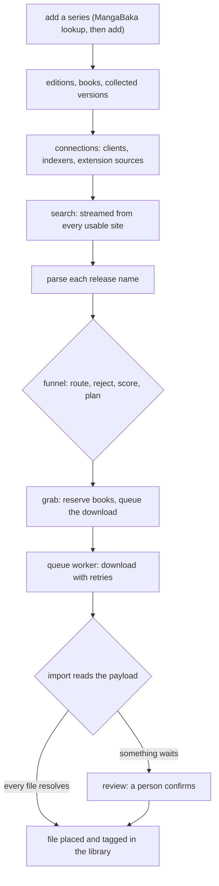

# Documentation

## How Sento works

From adding a series to a file sitting in the library, in ten steps:

1. **Add a series.** The add dialog searches MangaBaka (`GET /api/v1/lookup?q=`)
   and `POST /api/v1/series/` adds the series; a refresh pulls its collections
   and works, which become its editions and books. See [Editions, books,
   collected versions, and files](domain/editions.md) and [the HTTP
   API](api.md).
2. **Choose what to collect.** Each edition is collected as one or more
   collected versions, each with a release profile, monitoring, a chapter
   cutoff and extras. See [editions](domain/editions.md) and [profiles and
   acquisition state](domain/profiles-ledger.md).
3. **Connect the outside world.** Download clients, Torznab indexers and
   extension sources (through the sidecar) are configured once and probed by
   the health checks. See [connections](domain/connections.md), [the
   extensions sidecar](extensions.md) and [installation](installation.md).
4. **Search.** `POST /api/v1/series/{id}/search` streams results from every
   usable indexer and bound source; bindings auto-resolve, nested listings are
   discovered and new chapters are observed. See [acquisition](domain/acquisition.md).
5. **Parse.** Every release name is turned into facts: title, numbers, the
   edition claim, language, group and flags. See [parsing and title
   matching](domain/parsing.md).
6. **Decide.** The funnel routes each release to the collected versions it
   fits, rejects the rest with a reason and owner, scores what survives and
   builds the download plan. See [the funnel](domain/acquisition.md#routing-and-the-funnel)
   and [profiles](domain/profiles-ledger.md).
7. **Grab.** A grab reserves the books transactionally and queues the
   download: a torrent to its download client, or chapter pages fetched
   through the sidecar. See [grabbing](domain/acquisition.md#grabbing).
8. **Download.** The queue worker advances every job each minute: progress,
   retries with backoff, and blocklisting of dead releases. See [the queue
   lifecycle](domain/acquisition.md#the-queue-lifecycle).
9. **Import.** The finished payload is read file by file: each archive is
   fingerprinted, mapped to books, placed at its templated path and tagged
   with `ComicInfo.xml`. See [import, review and
   settlement](domain/import-review.md), [naming](domain/naming.md) and
   [file metadata](domain/metadata.md).
10. **Settle.** Files whose names do not resolve wait in review; confirming
    them settles the job and the file sits in the library. Scans, presence
    checks, cleanup and trash keep the library honest afterwards. See [the
    review inbox](domain/import-review.md#the-review-inbox-and-proposals) and
    [library files](domain/library-files.md).

This flowchart shows the same path end to end:

### Words used throughout

Each word means one thing on every page. This table gives the short meaning
and the page that defines it.

| Word | Meaning | Defined in |
| --- | --- | --- |
| Edition | What is collected: MangaBaka's edition of one series in one language and type, or a local one. An edition is a numbering | [editions](domain/editions.md#catalog-identity-and-local-editions) |
| Book | A volume, chapter, extra, special or revision within an edition, known by its local ID, never by its displayed number | [editions](domain/editions.md#catalog-identity-and-local-editions) |
| Collected version | One way of collecting an edition: the edition with a release profile and the books it wants | [editions](domain/editions.md#collected-versions-and-profiles) |
| Card | The layout's word for one collected version on the series page; the interface names the edition | [editions](domain/editions.md#collected-versions-and-profiles) |
| Ledger | One of the two bookkeeping axes, volumes or chapters, kept apart everywhere; the ledger view is the computed state of every book of a series | [editions](domain/editions.md#numbers-and-chapter-discovery), [shared ledger](domain/profiles-ledger.md#shared-ledger) |
| Profile | Reusable release eligibility, scoring and upgrade policy, set on a collected version, a series or the instance | [profiles](domain/profiles-ledger.md#profiles-scores--funnel-knobs) |
| Custom format | A named list of conditions on a release's facts; a profile scores, requires or refuses formats | [profiles](domain/profiles-ledger.md#custom-formats-sonarrs-matching-semantics) |
| Release candidate | One search result a provider returns (`provider.Candidate`), before the funnel judges it | [acquisition](domain/acquisition.md#the-search-run) |
| Funnel | The stages every candidate passes: read the release, route it to collected versions, reject with a reason, score, plan | [acquisition](domain/acquisition.md#routing-and-the-funnel) |
| Binding | A series' match on an extension source listing (`source_bindings`); the interface calls it a source match | [acquisition](domain/acquisition.md#binding-auto-resolution) |
| Observation | A chapter a source listing reported, recorded before the funnel runs; accepting it adds one book | [acquisition](domain/acquisition.md#chapter-observation-and-discovery) |
| File asset | One physical archive with observed facts and a content fingerprint (`files`) | [library files](domain/library-files.md#files-and-fingerprints) |
| Coverage | A file's selection of a book inside one collected version (`asset_coverage`), apart from the books the file holds (`asset_contents`) | [data model](domain/data-model.md#files) |
| Fulfillment | Whether a present, verified file asset meets a collected version's current rules; derived, not stored | [editions](domain/editions.md) |

## Index

### Run it

- [Installation and configuration](installation.md): containers, binaries, storage, configuration, moving the library, backups and upgrades.

### Work on it

- [Development](development.md): local setup, dev services, finding the code, developer tools and checks.
- [Testing](testing/README.md): choosing and running the Go, PostgreSQL, harness and browser checks.
- [Browser tests in the Paseo agent image](testing/paseo.md): the hidden `e2e:paseo` task and its shared dependency cache.
- [Exploratory testing](exploratory-testing.md): offline sessions, controlling upstreams, recording findings.
- [Exploratory missions](testing/exploratory-missions.md), [upstream scenarios](testing/exploratory-scenarios.md) and [report template](testing/exploratory-report.md): the mission list, the fixture controls and the report form.
- [Releases](releases.md): Conventional Commits, version policy, maintainer setup and publishing.

### How it works

- [Backend architecture](architecture.md): system context, package map, service internals, startup, background tasks and persistence.
- [Web app](web.md): providers, routes, server state, streaming search, dialogs and styling.
- [Domain guides](domain/README.md), one page per area:
  - [Editions, books, collected versions, and files](domain/editions.md): identity, collection and ownership.
  - [Acquisition planning](domain/acquisition.md): search, decisions, downloads, the queue and recovery.
  - [Profiles and acquisition state](domain/profiles-ledger.md): format matching, scoring and book states.
  - [Parsing and title matching](domain/parsing.md): turning release names into structured facts.
  - [Naming, folders and names in readers](domain/naming.md): where a file lands, templates and tokens, organizing existing files.
  - [File metadata](domain/metadata.md): ComicInfo fields, the `Notes` line and rescanning files.
  - [Import, review and settlement](domain/import-review.md): what a finished download becomes, proposals and the choices protocol.
  - [Library files](domain/library-files.md): fingerprints, scanning, presence, bulk import, cleanup, trash and removal.
  - [Data model and persistence](domain/data-model.md): the database schema, store conventions, JSON columns and state values.
  - [Connections, indexers, extensions and health](domain/connections.md): service settings, indexer entries, the extension reconcile and the health checks.

### Reference

- [HTTP API](api.md): every route, the conventions, errors and health checks.
- [Extensions sidecar](extensions.md): the sidecar HTTP contract: routes, keys, errors, retries and page fetching.

### Specifications

- [Specification (v1 draft)](spec/spec.md): product decisions.
- [Release parser & matcher specification](spec/parser.md): the parser contract and decisions.
- [Decision engine & release profiles specification](spec/decision-engine.md): the funnel's contract and decisions.

`domain/` describes implemented behavior. `spec/` records intent and decisions.
If a spec disagrees with current code, verify the behavior and document the
correction. Code comments cite spec filenames, section numbers and decision
IDs; preserve those identifiers when editing. Append new decisions and mark
superseded ones with a link to their replacement.

Track bugs and proposals in GitHub issues. Keep setup instructions in the
guides above and behavior rules next to their domain documentation.
