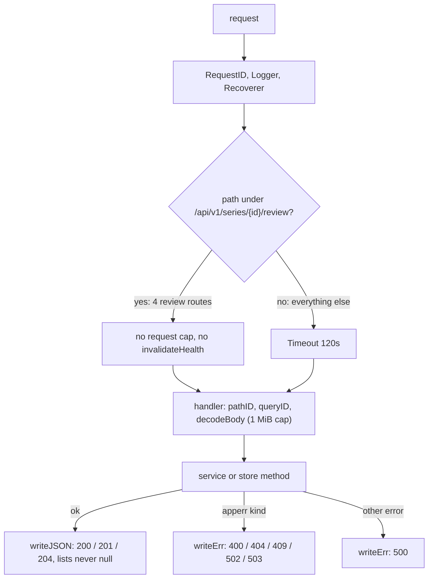

# HTTP API

Sento's backend serves one JSON API under `/api/v1` plus the built web UI.
The router is chi; every handler decodes a request, calls one service or store
method, and writes one JSON response or error. Request/response DTOs live in
`internal/server/types.go` and feed tygo (`tygo.yaml`), which generates the
TypeScript types the web app imports from `web/src/types`.

## In the code

| File or package | What it holds |
| --- | --- |
| `internal/server/server.go` | `Server` struct, `New`, `Handler` (router, middleware, static SPA, registers the four long review routes), `/system/health` and `/system/status` |
| `internal/server/api.go` | `mountAPI`, system tasks and health-check handlers, request helpers (`pathID`, `queryID`, `queryIDs`, `decodeBody`, `respondList`, `writeError`, `writeErr`), health invalidation middleware |
| `internal/server/api_series.go` … `api_profiles.go` | one mount function and the handlers per area (series, editions, books, files, review, queue, search, indexers, settings, profiles) |
| `internal/server/types.go` | the DTOs; tygo turns them into `web/src/types/server.ts` |
| `internal/apperr/apperr.go` | the error sentinels mapped to HTTP statuses |
| `tygo.yaml` | which packages become which TypeScript files |

## Conventions

All API routes live under the `/api/v1` prefix. The router applies
`RequestID`, `Logger` and `Recoverer` middleware to everything, then routes
`/api/v1` in two groups:

- The four `POST /series/{id}/review/*` routes sit outside the request cap:
  reviewing a large pack runs long by design, and each file's fingerprint is
  recorded as it is read, so a retry after a disconnect makes progress.
- Every other route sits in a group with `middleware.Timeout(120s)`. Searches
  fan out to live sources and may auto-resolve bindings, so they get two
  minutes; everything else finishes far inside that.

Request bodies are JSON, capped at 1 MiB (`maxBodyBytes`, `decodeBody` wraps
the body in `http.MaxBytesReader`); the largest legitimate body is a profile
import. A body that fails to decode is a 400 `{"error": "invalid body: ..."}`.

Responses:

- Lists are never null: `respondList` writes `[]` for an empty list.
- Creates answer 201 with the created record; updates and deletes answer 204
  with no body when they carry no result. The two exceptions are
  `POST /series/{id}/versions` and `POST /series/{id}/books`, which answer
  200 with the saved record (`handleSaveVersion`, `handleSaveBook`).
- Every error is `{"error": "<message>"}`, mapped from `apperr` sentinels in
  exactly one place, `writeErr`:

| Error kind | When raised | HTTP status |
| --- | --- | --- |
| `apperr.ErrInvalid` | bad input | 400 |
| `apperr.ErrNotFound` | no such row or release | 404 |
| `apperr.ErrConflict` | state refuses the change | 409 |
| `apperr.ErrUpstream` | a dependency failed | 502 |
| `apperr.ErrUnavailable` | a dependency is not configured | 503 |
| anything else | unclassified | 500 |

Handlers match kinds with `errors.Is` and never inspect error strings. ID
path and query parameters are parsed by `pathID` / `queryID` / `queryIDs`:
path IDs reject non-positive or non-numeric values with a 400; query IDs
accept `0` (absent parameter, or explicitly `0`, meaning "all") and reject
only negative or non-numeric values.

Two query conventions recur:

- `?preview=1` on `POST .../editions/{eid}/merge`, `POST .../editions/{eid}/catalog-link`
  and `POST .../series/{id}/review/match` returns what the action would do,
  without doing it. `?decline=1` on catalog-link declines the proposed link.
- `POST /series/{id}/search` with `{"stream": true}` answers
  `application/x-ndjson`: one `SearchEvent` per provider batch, flushed after
  each line so fast sources render before slow ones finish; `stream` implies
  `dryRun`, and a failure is reported in-band as a final
  `{"type": "error", "error": "..."}` line.

Writes to `/indexers`, `/settings/connections` or `/extensions` pass through
`invalidateHealth`, which marks the cached health report stale so the next
`GET /system/checks` re-runs the probes instead of serving the old report.

This diagram shows one request's path through the router to its response or
error:

Outside `/api/`, `mountStatic` serves the built SPA: files that exist are
served directly (`/assets/` cached forever, everything else `no-cache`), any
other path falls back to `index.html`, and `/api/*` misses answer a JSON 404.
The HTTP server itself sets a 10s `ReadHeaderTimeout` against slow clients;
bodies and responses stay unbounded because searches stream for minutes.

Sento enforces no authentication on the API. `SENTO_API_KEY` / `server.api_key`
is logged as not enforced at startup; put the API behind an authenticating
reverse proxy. See [installation](installation.md#configuration).

## Routes

125 routes, grouped by area as mounted in `mountAPI` and `Server.Handler`.
"Behind it" names the main service or store call; handlers are the
`handle*` methods in the named file.

### System

| Method | Path | What it does | Handler file | Behind it |
| --- | --- | --- | --- | --- |
| GET | `/system/health` | liveness probe, `{"status": "ok"}` | `server.go` | none |
| GET | `/system/status` | app version, commit, database ping | `server.go` | `db.PingContext` |
| GET | `/system/checks` | cached health report, re-runs when stale | `api.go` | `HealthService.Report` |
| POST | `/system/checks` | run all health checks now | `api.go` | `HealthService.Check` |
| GET | `/system/tasks` | every background loop's schedule state | `api.go` | `Scheduler.Tasks` |
| POST | `/system/tasks/{slug}/run` | trigger one loop now (202; 404 unknown slug, 503 no scheduler) | `api.go` | `Scheduler.Run` |

### Series and library

| Method | Path | What it does | Handler file | Behind it |
| --- | --- | --- | --- | --- |
| GET | `/calendar` | dated volume releases, 14 days back to `?days` ahead (default 60) | `api_series.go` | `Library.Calendar` |
| GET | `/wanted` | missing and upgrade-eligible books across monitored series | `api_series.go` | `Library.Wanted` |
| POST | `/library/import/scan` | propose MangaBaka matches for a folder's subfolders (`root` defaults to the library) | `api_series.go` | `Library.ProposeImports` |
| POST | `/library/import` | confirm one proposal: add the series and link its files in place (55s handler cap) | `api_series.go` | `Library.ImportFolder` |
| GET | `/library/organize` | preview organizing every series, or `?series=1,2,3` | `api_series.go` | `Importer.PlanOrganizeLibrary` |
| POST | `/library/organize` | queue a library organize and trigger the task (202) | `api_series.go` | `Importer.QueueLibraryOrganize`, `Scheduler.Run` |
| GET | `/library/organize/status` | progress of the running organize | `api_series.go` | `Importer.LibraryOrganizeStatus` |
| GET | `/library/progress` | per-series owned/wanted counts for posters | `api_series.go` | `Library.Progress` |
| GET | `/series/` | list all series | `api_series.go` | `store.ListSeries` |
| POST | `/series/` | add a series from a MangaBaka id (55s handler cap) | `api_series.go` | `Library.AddSeries`, 201 |
| GET | `/series/{id}/` | series detail with editions and publishers | `api_series.go` | `store.GetSeries`, `store.ListEditions`, `Library.SeriesPublishers` |
| PUT | `/series/{id}/` | patch monitored / profile, 204 | `api_series.go` | `Library.UpdateSeries` |
| DELETE | `/series/{id}/` | remove the series; `?deleteFiles=true`, `?removeDownloads=true` opt in | `api_series.go` | `Importer.RemoveSeries` |
| POST | `/series/{id}/refresh` | re-fetch metadata from MangaBaka | `api_series.go` | `Library.Refresh` |
| POST | `/series/{id}/import` | scan the series folder, link existing files in place | `api_series.go` | `Scanner.ScanAndAdoptCutoff` |
| GET | `/series/{id}/bindings` | the series' source bindings | `api_series.go` | `store.ListBindings` |
| POST | `/series/{id}/bindings` | add a binding (`sourceId`, `sourceMangaKey` required), 201 | `api_series.go` | `store.AddBinding` |
| PUT | `/series/{id}/bindings/{bid}` | patch trust/edition/state, 204 | `api_series.go` | `Library.UpdateBinding` |
| DELETE | `/series/{id}/bindings/{bid}` | remove a binding, 204 | `api_series.go` | `store.DeleteBinding` |

### Editions, versions and coverage

| Method | Path | What it does | Handler file | Behind it |
| --- | --- | --- | --- | --- |
| GET | `/catalog/editions` | the catalog's edition names | `api_editions.go` | `Library.CatalogEditions` |
| GET | `/series/{id}/edition-overview` | everything one series' editions show | `api_editions.go` | `Library.EditionOverview` |
| GET | `/series/{id}/versions` | the series' collected versions | `api_editions.go` | `store.ListVersions` |
| POST | `/series/{id}/versions` | create a collected version | `api_editions.go` | `Library.SaveVersion` |
| PUT | `/series/{id}/versions/{vid}` | update a collected version | `api_editions.go` | `Library.SaveVersion` |
| DELETE | `/series/{id}/versions/{vid}` | delete a version, 204 | `api_editions.go` | `store.DeleteVersion` |
| POST | `/series/{id}/editions` | create a custom edition, 201 | `api_editions.go` | `Library.CreateEdition` |
| PUT | `/series/{id}/editions/{eid}` | patch monitored/cutoff/language/reader fields, 204 | `api_editions.go` | `Library.UpdateEdition` |
| DELETE | `/series/{id}/editions/{eid}` | delete a custom edition, 204 | `api_editions.go` | `store.DeleteCustomEdition` |
| PUT | `/series/{id}/editions/{eid}/metadata` | edit edition metadata, 204 | `api_editions.go` | `Library.EditEditionMetadata` |
| POST | `/series/{id}/editions/{eid}/catalog-link` | link to a catalog edition; `?preview=1` previews, `?decline=1` declines, 204 | `api_editions.go` | `store.LinkCatalog` / `PreviewCatalogLink` / `DeclineCatalogLink` |
| POST | `/series/{id}/editions/{eid}/merge` | merge into another edition; `?preview=1` previews | `api_editions.go` | `store.MergeEditions` / `PreviewMerge` |
| POST | `/series/{id}/collections/{cid}/separate` | give one collection an edition of its own | `api_editions.go` | `Library.SeparateCollection` |
| GET | `/series/{id}/coverage` | verified asset coverage per edition | `api_editions.go` | `store.Coverage` |
| PUT | `/series/{id}/coverage/pin` | pin a coverage entry, 204 | `api_editions.go` | `store.PinCoverage` |
| POST | `/series/{id}/reader-names` | render reader-facing names, optionally with unsaved templates | `api_editions.go` | `Library.ReaderNames` |

### Books and observations

| Method | Path | What it does | Handler file | Behind it |
| --- | --- | --- | --- | --- |
| GET | `/series/{id}/books` | books grouped by collected version | `api_books.go` | `Library.BooksByVersion` |
| GET | `/series/{id}/versions/{vid}/books` | one version's books | `api_books.go` | `Library.VersionBooks` |
| POST | `/series/{id}/versions/{vid}/monitor` | bulk monitor/unmonitor books, 204 | `api_books.go` | `store.BulkMonitor` |
| POST | `/series/{id}/books` | create a book | `api_books.go` | `store.SaveBook` |
| PUT | `/series/{id}/books/{bid}` | update a book | `api_books.go` | `store.SaveBook` |
| DELETE | `/series/{id}/books/{bid}` | delete a book, 204 | `api_books.go` | `store.DeleteBook` |
| GET | `/series/{id}/books/{bid}/works` | the catalog works behind one book | `api_books.go` | `Library.BookWorks` |
| POST | `/series/{id}/books/{bid}/catalog-reset` | forget the book's catalog link, 204 | `api_books.go` | `Library.ResetBook` |
| POST | `/series/{id}/books/{bid}/split` | split a box into its volumes | `api_books.go` | `Library.SplitBox` |
| PUT | `/series/{id}/book-monitor` | monitor/unmonitor one book, 204 | `api_books.go` | `store.SetBookMonitored` |
| GET | `/series/{id}/observations` | recorded book observations | `api_books.go` | `store.ListObservations` |
| POST | `/series/{id}/observations` | record an observation, 204 | `api_books.go` | `store.ObserveBook` |
| PUT | `/series/{id}/observations/{oid}` | accept/decline an observation, 204 | `api_books.go` | `store.ResolveObservation` |

### Files, cleanup and trash

| Method | Path | What it does | Handler file | Behind it |
| --- | --- | --- | --- | --- |
| DELETE | `/files/{fid}` | unlink a file and delete it from disk, 204 | `api_files.go` | `Importer.DeleteFile` |
| GET | `/series/{id}/files` | the series' files | `api_files.go` | `store.ListFiles` |
| GET | `/series/{id}/files/cleanup` | preview cleanup candidates (`?editionId=`) | `api_files.go` | `Importer.CleanupPreview` |
| POST | `/series/{id}/files/cleanup` | run cleanup (edition, file ids, retention days) | `api_files.go` | `Importer.CleanupFiles` |
| GET | `/series/{id}/files/trash` | trashed files | `api_files.go` | `store.ListFileTrash` |
| POST | `/series/{id}/files/trash/{fid}/restore` | restore from trash, 204 | `api_files.go` | `Importer.RestoreTrashedFile` |
| DELETE | `/series/{id}/files/trash/{fid}` | purge from trash, 204 | `api_files.go` | `Importer.PurgeTrashedFile` |
| GET | `/series/{id}/files/organize` | preview organizing this series' files | `api_files.go` | `Importer.PlanOrganize` |
| GET | `/series/{id}/versions/{vid}/files/{fid}/score` | one file's score for one version | `api_files.go` | `Library.FileScore` |
| PUT | `/series/{id}/files/{fid}/mapping` | remap a file to books, reporting displaced owners | `api_files.go` | `Importer.ApplySafeFileMapping` |
| POST | `/series/{id}/check-files` | re-check file presence, 204 | `api_files.go` | `service.CheckFilePresence` |

### Review

| Method | Path | What it does | Handler file | Behind it |
| --- | --- | --- | --- | --- |
| GET | `/review` | review inbox items (`?seriesId=`) | `api_review.go` | `Library.ReviewItems` |
| PATCH | `/series/{id}/files/{fid}/facts` | correct one file's facts, 204 | `api_review.go` | `store.CorrectFileFacts` |
| PATCH | `/series/{id}/files/facts` | correct facts on several files, 204 | `api_review.go` | `store.CorrectFilesFacts` |
| POST | `/series/{id}/review/match` | apply one version to a pack of files; `?preview=1` previews. Outside the 120s cap | `api_review.go` | `Importer.MatchReleaseFiles` / `Library.PreviewReleaseFiles` |
| POST | `/series/{id}/review/resolve` | decline a pack of file reviews. Outside the cap | `api_review.go` | `Importer.ResolveFileReviews` |
| POST | `/series/{id}/review/choices/preview` | preview a choices plan. Outside the cap | `api_review.go` | `Library.PreviewReviewChoices` |
| POST | `/series/{id}/review/choices` | apply a choices plan. Outside the cap | `api_review.go` | `Importer.ApplyReviewChoices` |

### Queue, history, activity and blocklist

| Method | Path | What it does | Handler file | Behind it |
| --- | --- | --- | --- | --- |
| GET | `/queue` | active queue items, or all with `?all` | `api_queue.go` | `Importer.QueueView` |
| POST | `/queue/process` | run one queue pass now, answers `{processed: n}` | `api_queue.go` | `Importer.ProcessQueue` |
| POST | `/queue/{qid}/retry` | resume a `needs_review`, `retry_wait` or `dispatch_unknown` item, optionally attaching a client-side ID (`remoteId`), 204 | `api_queue.go` | `store.ResumeQueue` |
| POST | `/queue/{qid}/cancel` | cancel an item and release its reservations (refused while importing), 204 | `api_queue.go` | `store.CancelQueue` |
| POST | `/queue/{qid}/blocklist` | ban the item's release and fail it, 204 | `api_queue.go` | `Importer.BlocklistQueueItem` |
| POST | `/queue/another` | blocklist 1..500 items and search again right away, 204 | `api_queue.go` | `Importer.TryAnother`, then `SearchService.SearchAgain` in a 15-minute goroutine |
| GET | `/activity` | activity feed (`?seriesId=`) | `api_queue.go` | `Library.Activity` |
| GET | `/history` | decision history (`?limit=`), all series or one | `api_queue.go` | `store.ListDecisions` |
| GET | `/series/{id}/history` | one series' decision history | `api_queue.go` | `store.ListDecisions` |
| GET | `/blocklist` | blocklisted releases | `api_queue.go` | `store.ListBlockedReleases` |
| DELETE | `/blocklist` | clear the blocklist (the UI asks first), 204 | `api_queue.go` | `store.ClearBlocklist` |
| POST | `/blocklist/unblock` | unblock by ids/protocol/keys, 204 | `api_queue.go` | `Importer.UnblockReleases` |
| DELETE | `/blocklist/{bid}` | delete one entry, 204 | `api_queue.go` | `store.DeleteBlocklist` |

### Search

| Method | Path | What it does | Handler file | Behind it |
| --- | --- | --- | --- | --- |
| GET | `/lookup?q=` | MangaBaka series search (`q` required) | `api_search.go` | `metadata.Provider.Search` |
| POST | `/series/{id}/search` | unified search: `{ledger, scope, dryRun, picks (1..200), grab, force, stream}`; default grabs the best candidates | `api_search.go` | `SearchService.FindCandidates` + `Grab` / `GrabBest` / `SubmitPlan`; `stream` switches to NDJSON events |

### Indexers and extension sources

| Method | Path | What it does | Handler file | Behind it |
| --- | --- | --- | --- | --- |
| GET | `/sources` | sources on the extensions sidecar | `api_indexers.go` | `Connections.RequireHost` → `Host.Sources` |
| GET | `/sources/{sid}/search?q=` | search one source entry's catalog (manual bind) | `api_indexers.go` | `SiteService.SearchSource` |
| GET | `/indexers` | indexer entries with live reachability | `api_indexers.go` | `SiteService.List` |
| POST | `/indexers` | add an entry, 201 | `api_indexers.go` | `SiteService.Add` |
| POST | `/indexers/browse` | list a Prowlarr's indexers as ready-to-add Torznab endpoints, remembering the credentials | `api_indexers.go` | `Connections.BrowseProwlarr` |
| PUT | `/indexers/{iid}` | replace an entry (protocol immutable) | `api_indexers.go` | `SiteService.Update` |
| PATCH | `/indexers/{iid}` | toggle enabled/volumes/chapters/priority inline | `api_indexers.go` | `SiteService.Patch` |
| DELETE | `/indexers/{iid}` | delete an entry; the last entry of an extension uninstalls it, 204 | `api_indexers.go` | `ExtensionService.DeleteIndexerEntry` |
| POST | `/indexers/{iid}/test` | probe the entry, 204 | `api_indexers.go` | `SiteService.Test` |
| POST | `/indexers/{iid}/search-test` | one raw search query with result count and samples | `api_indexers.go` | `SiteService.TestSearch` |
| GET | `/series/{id}/indexers` | effective entries for a series (globals plus overrides, with bindings) | `api_indexers.go` | `SiteService.Effective` |
| PUT | `/series/{id}/indexers/{iid}` | set or clear (all-null body) a per-series override | `api_indexers.go` | `store.UpsertSiteOverride` |

### Settings and extensions

| Method | Path | What it does | Handler file | Behind it |
| --- | --- | --- | --- | --- |
| GET | `/settings/media` | current media (naming) settings | `api_settings.go` | `LoadMediaSettings` |
| PUT | `/settings/media` | save media settings | `api_settings.go` | `SaveMediaSettings` |
| POST | `/settings/media/preview` | render sample paths, reader fields and validation errors for unsaved settings | `api_settings.go` | `PreviewMediaSettings` and friends |
| GET | `/settings/media/schema` | the naming tokens and reader fields | `api_settings.go` | `MediaSettingsSchema` |
| GET | `/settings/connections` | stored connection settings (file/env seeds until first save) | `api_settings.go` | `Connections.Load` |
| PUT | `/settings/connections` | save connections, rebuild live clients, reconcile extensions | `api_settings.go` | `Connections.Save` |
| POST | `/settings/connections/test` | probe the posted settings (15s cap, parallel) | `api_settings.go` | `TestConnections` |
| GET | `/extensions` | installed extensions with desired state | `api_settings.go` | `ExtensionService.List` |
| GET | `/extensions/{pkg}/sources` | one extension's sources | `api_settings.go` | `ExtensionService.Sources` |
| GET | `/extensions/repos` | repo URLs, per-repo status, whether config manages the list | `api_settings.go` | `ExtensionService.Repos` / `RepoStatus` / `ReposManaged` |
| PUT | `/extensions/repos` | set the repo list | `api_settings.go` | `ExtensionService.SetRepos` |
| POST | `/extensions/{pkg}` | install an extension, 204 | `api_settings.go` | `ExtensionService.Install` |
| GET | `/extensions/sources/{sid}/preferences` | a host source's stored preferences | `api_settings.go` | `ExtensionService.Preferences` |
| PUT | `/extensions/sources/{sid}/preferences` | set one preference (`key` required), 204 | `api_settings.go` | `ExtensionService.SetPreference` |

### Profiles and custom formats

| Method | Path | What it does | Handler file | Behind it |
| --- | --- | --- | --- | --- |
| GET | `/profiles/` | list release profiles | `api_profiles.go` | `ProfileService.ListProfiles` |
| POST | `/profiles/` | create a profile, 201 | `api_profiles.go` | `ProfileService.CreateProfile` |
| POST | `/profiles/import` | import a profile document | `api_profiles.go` | `ProfileService.ImportProfile` |
| GET | `/profiles/default` | the instance default profile id | `api_profiles.go` | `ProfileService.DefaultProfileID` |
| PUT | `/profiles/default` | set the default profile, 204 | `api_profiles.go` | `ProfileService.SetDefaultProfile` |
| PUT | `/profiles/{id}/` | update a profile, 204 | `api_profiles.go` | `ProfileService.UpdateProfile` |
| DELETE | `/profiles/{id}/` | delete a profile, 204 | `api_profiles.go` | `ProfileService.DeleteProfile` |
| GET | `/profiles/{id}/export` | the portable export document | `api_profiles.go` | `ProfileService.ExportProfile` |
| GET | `/formats/` | list custom formats | `api_profiles.go` | `ProfileService.ListFormats` |
| POST | `/formats/` | create a format, 201 | `api_profiles.go` | `ProfileService.CreateFormat` |
| PUT | `/formats/{id}` | update a format, 204 | `api_profiles.go` | `ProfileService.UpdateFormat` |
| DELETE | `/formats/{id}` | delete a format, 204 | `api_profiles.go` | `ProfileService.DeleteFormat` |

## Health checks

`GET /system/checks` serves the last report; it re-runs the checks when none
is cached or the report was invalidated (a write under `/indexers`,
`/settings/connections` or `/extensions`). Each remote probe is bounded by a
10s timeout (`probeTimeout`) and all probes run in parallel. The checks:

the library folder exists, is a directory and accepts a new file; every
download client answers, one exists when torrent indexers need it, and every
torrent indexer's chosen client still exists; the extensions sidecar answers
and still carries the source behind every enabled source entry; every enabled
Torznab entry pings. A warning is raised when no indexer is enabled at all.

Failed background tasks are merged into the report live (not cached) via
`Scheduler.TaskIssues`.
