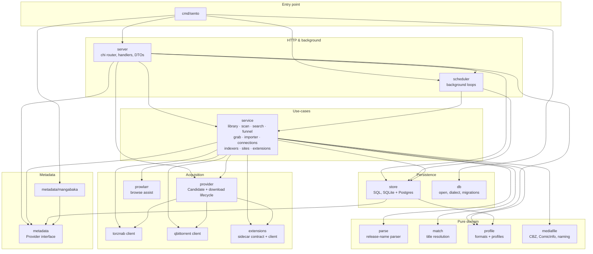

# Backend architecture

The current edition/acquisition model is described in [Editions, units, collected versions, and files](domain/editions.md). Stable work IDs identify memberships, targets express independently collected versions, and verified asset coverage determines ownership. Release evaluations and queue snapshots preserve acquisition decisions.


A map of the Go backend: packages, their dependencies, and the data flows
that run through them. Product behavior is specified in [spec/](spec/)
(`spec.md`, `decision-engine.md`, `parser.md`); this document is about how
the code is organized.

Each major data flow gets its own document under [docs/flows/](flows/) —
see the [index](#data-flows) below.

## Package dependency graph

Edges are real imports, extracted from the module graph. Cross-cutting
leaves (`apperr`, `config`, `version`) are imported broadly and omitted
from the diagram for readability. Regenerate the raw data with:

```sh
go list -f '{{.ImportPath}}: {{join .Imports " "}}' ./cmd/... ./internal/... | grep h-wb/sento
```



The graph is strictly layered (no cycles): entry → HTTP/scheduler →
service → {persistence, acquisition, metadata, domain}.

## Package inventory

Sizes are non-test lines, June 2026 — a proxy for where the complexity is.

| Package | Lines | Role |
|---|---|---|
| `internal/service` | 3385 | All use-cases. Library side (library, scan, bulkimport), acquisition side (search, funnel, grab, importer), configuration (connections, indexers, sites, extensions, profiles, mediasettings) |
| `internal/server` | 1654 | HTTP layer: chi router, JSON handlers, DTOs (`types.go` feeds tygo → TS types) |
| `internal/store` | 1443 | Persistence: hand-written SQL via scany, portable across SQLite and PostgreSQL (`?` rebound per dialect) |
| `internal/parse` | 1160 | Pure release/file/chapter-name parser (spec/parser.md); no I/O, regression corpus |
| `internal/provider` | 872 | Abstraction over release sources + download clients. `TorrentProvider` (torznab + qBittorrent) and `SourceProvider` (extension sources; Sento assembles CBZs itself) |
| `internal/mediafile` | 396 | CBZ import (atomic), ComicInfo.xml merge, naming templates, hardlink-or-copy |
| `internal/extensions` | 343 | Protocol-adapter contract for extension sources + HTTP client for the Kotlin sidecar (`extensions/`). Host keys are opaque; Sento owns all state |
| `internal/metadata/mangabaka` | 334 | The one `metadata.Provider` implementation |
| `internal/scheduler` | 280 | Background loops, crash-isolated; observable via System → Tasks |
| `internal/qbittorrent` | 218 | qBittorrent WebUI API client |
| `internal/match` | 213 | Parsed-title → library-series resolution: normalization, title index, token-set Jaro-Winkler |
| `internal/profile` | 188 | Pure domain: custom formats (Sonarr semantics) + release profiles with funnel knobs |
| `internal/torznab` | 172 | Torznab XML API client |
| `internal/db` | 142 | Connection opening, dialect detection, migrations (SQLite or PostgreSQL) |
| `internal/config` | 141 | YAML + env config; seeds first run only — once saved, the DB wins |
| `internal/prowlarr` | 135 | Prowlarr API client for the Add Indexer browse assist |
| `internal/metadata` | 87 | `metadata.Provider` interface + types (anti-corruption layer, D13) |
| `cmd/sento` | 86 | Wiring: config → db → provider → server → scheduler; graceful shutdown |
| `internal/apperr` | 43 | Error classification sentinels (`ErrNotFound`, `ErrConflict`, …) mapped to HTTP statuses |
| `internal/version` | 8 | Version string |
| `internal/db/dbtest` | 60 | Test helper: per-test database |

## Architectural invariants

- **Slots are computed, never stored.** `ledger` derives them from
  metadata + links; the DB stores facts (series, collections, works,
  file↔slot links, monitoring overrides), not the ledger itself.
- **Providers are uniform.** The funnel and importer never know which
  protocol a candidate came from; only the payload shape differs
  (directory of files vs CBZ stream).
- **The decision engine is pure.** `funnel.go` does parse → hard
  rejections → scoring with no I/O, parameterized by profile + ledger.
- **Settings live in the DB.** YAML/env seeds the first run;
  `connections.go` rebuilds live clients into a shared registry on save —
  the registry pointer never changes, so consumers follow along.
- **The sidecar is stateless cattle.** Sento stores the desired extension
  list; `ExtensionService.Reconcile` re-installs whatever a fresh host is
  missing.

## Data flows

One document per flow, written as guided walkthroughs of the actual code.
Unchecked entries are not written yet.

- [ ] `flows/01-startup.md` — boot & wiring: config → db → registry → server → scheduler
- [ ] `flows/02-add-series.md` — add a series: MangaBaka fetch → store → collections → slot derivation
- [ ] `flows/03-refresh.md` — metadata refresh & reconcile (provider references, local overrides, and stale-state gating)
- [ ] `flows/04-search.md` — search & decision engine: providers → parse → funnel → score
- [ ] `flows/05-grab.md` — grab: slot-coverage greedy selection → provider grab → queue item
- [ ] `flows/06-import.md` — queue processing & import: poll → payload → CBZ/ComicInfo → slot links
- [ ] `flows/07-source-download.md` — extension-source download: binding → pages → CBZ assembly
- [ ] `flows/08-library-scan.md` — existing-library scan & bulk import (in-place, cutoff adoption)
- [ ] `flows/09-settings.md` — connections & indexer entries: DB-backed settings, registry rebuild, extension reconcile
- [ ] `flows/10-scheduler.md` — background loops and their cadences
