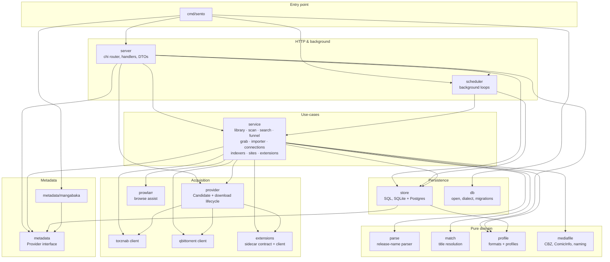

# Backend architecture

The current edition/acquisition model is described in [Editions, units, collected versions, and files](domain/editions.md). Stable work IDs identify memberships, targets express independently collected versions, and verified asset coverage determines ownership. Release evaluations and queue snapshots preserve acquisition decisions.

A map of the Go backend: packages, their dependencies, and the data flows
that run through them. Product behavior is specified in [spec/](spec/)
(`spec.md`, `decision-engine.md`, `parser.md`); this document is about how
the code is organized.

The [domain guides](domain/) describe the implemented data flows.

## Package dependency graph

Edges are real imports, extracted from the module graph. Cross-cutting
leaves (`apperr`, `config`, `version`) are imported broadly and omitted
from the diagram for readability. Regenerate the raw data with:

```sh
mise exec -- go list -f '{{.ImportPath}}: {{join .Imports " "}}' ./cmd/... ./internal/... | grep h-wb/sento
```



The graph is strictly layered (no cycles): entry → HTTP/scheduler →
service → {persistence, acquisition, metadata, domain}.

## Package inventory

| Package | Role |
|---|---|
| `internal/service` | All use-cases. Library side (library, scan, bulkimport), acquisition side (search, funnel, grab, importer), configuration (connections, indexers, sites, extensions, profiles, mediasettings) |
| `internal/server` | HTTP layer: chi router, JSON handlers, DTOs (`types.go` feeds tygo → TS types) |
| `internal/store` | Persistence: hand-written SQL via scany, portable across SQLite and PostgreSQL (`?` rebound per dialect) |
| `internal/parse` | Pure release/file/chapter-name parser (spec/parser.md); no I/O, regression corpus |
| `internal/provider` | Abstraction over release sources + download clients. `TorrentProvider` (torznab + qBittorrent) and `SourceProvider` (extension sources; Sento assembles CBZs itself) |
| `internal/mediafile` | CBZ import (atomic), ComicInfo.xml merge, naming templates and their token list, hardlink-or-copy |
| `internal/extensions` | Protocol-adapter contract for extension sources + HTTP client for the Kotlin sidecar (`extensions/`). Host keys are opaque; Sento owns all state |
| `internal/metadata/mangabaka` | The one `metadata.Provider` implementation |
| `internal/scheduler` | Background loops, crash-isolated; observable via System → Tasks |
| `internal/qbittorrent` | qBittorrent WebUI API client |
| `internal/match` | Parsed-title → library-series resolution: normalization, title index, token-set Jaro-Winkler |
| `internal/profile` | Pure domain: custom formats (Sonarr semantics) + release profiles with funnel knobs |
| `internal/torznab` | Torznab XML API client |
| `internal/db` | Connection opening, dialect detection, migrations (SQLite or PostgreSQL) |
| `internal/config` | YAML + environment configuration; initial connection seeds and enforced extension overrides |
| `internal/prowlarr` | Prowlarr API client for the Add Indexer browse assist |
| `internal/metadata` | `metadata.Provider` interface + types (anti-corruption layer, D13) |
| `cmd/sento` | Wiring: config → db → provider → server → scheduler; graceful shutdown |
| `internal/apperr` | Error classification sentinels (`ErrNotFound`, `ErrConflict`, …) mapped to HTTP statuses |
| `internal/version` | Version string |
| `internal/db/dbtest` | Test helper: per-test database |

## Architectural invariants

- **Book identity is stable.** Acquisition targets are `(version ID, book ID)`.
  The service computes wanted/fulfilled state from stored book, file, policy
  and queue facts; a displayed volume or chapter number is not an identity.
- **Providers are uniform.** The funnel and importer never know which
  protocol a candidate came from; only the payload shape differs
  (directory of files vs CBZ stream).
- **The decision engine is pure.** `funnel.go` does parse → hard
  rejections → scoring with no I/O, parameterized by profiles and the prepared search state.
- **Connections live in the DB.** Initial qBittorrent and Prowlarr settings
  can be seeded by YAML/environment. Extension URL/repository environment
  overrides remain enforced. `connections.go` rebuilds live clients into a
  shared registry on save; consumers keep the same registry reference.
- **The sidecar is replaceable.** Sento stores the desired extension
  list; `ExtensionService.Reconcile` re-installs whatever a fresh host is
  missing.

## Data flows

- [Editions and files](domain/editions.md): metadata, collected versions, book identity and ownership.
- [Acquisition](domain/acquisition.md): search, release decisions, downloads, import and recovery.
- [Naming](domain/naming.md): where files land, templates, names in readers and organize.
- [Parsing](domain/parsing.md): release names and title matching.

Entry-point wiring is in `cmd/sento`, HTTP handlers in `internal/server`, and
background loops in `internal/scheduler`. Read the service handling a flow
alongside its store methods; the package inventory above maps both.
