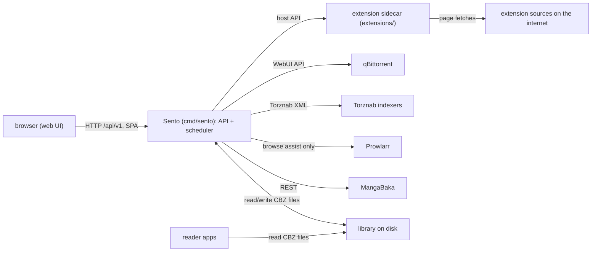
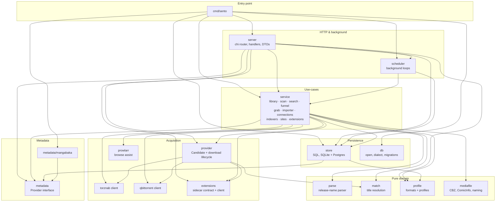
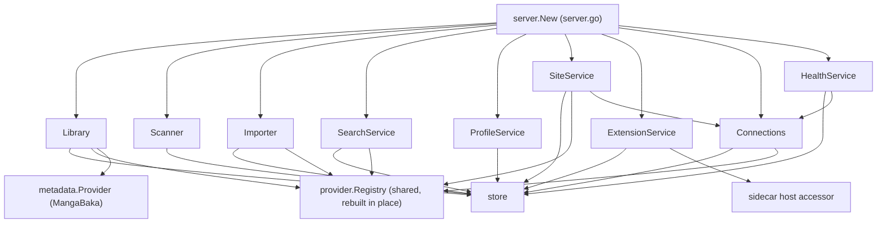
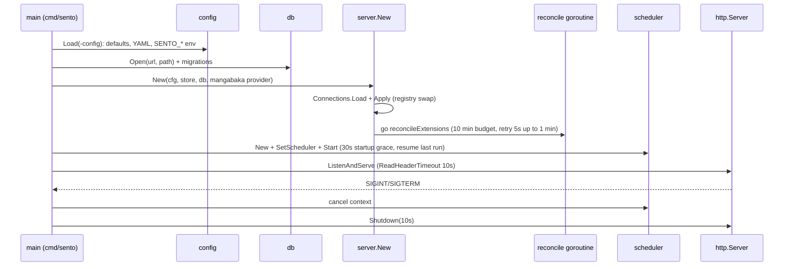
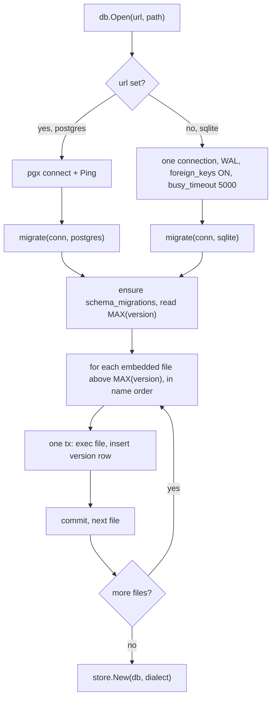
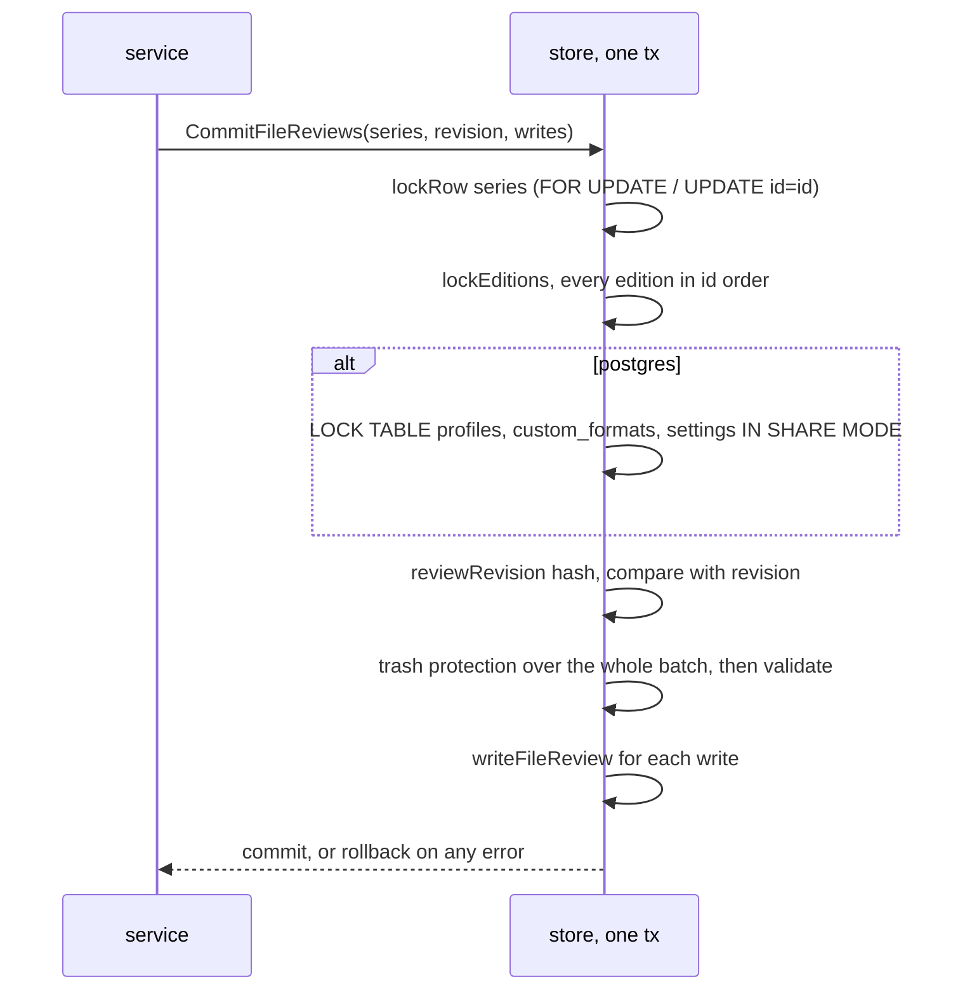

# Backend architecture

Sento is one Go process: an HTTP API and background loops over a SQL
database, talking to external services (a metadata provider, download
clients, indexers and the extension sidecar) and to the library on disk.
This page describes how that process is organized: the system context, the
package dependency graph, the service structs, startup and the background
tasks, and the persistence layer. The browser app that talks to this API is
described in [web.md](web.md). The [domain guides](domain/) describe the
implemented data flows; the [specs](spec/) (`spec.md`, `decision-engine.md`,
`parser.md`) record intent and decisions. The current edition/acquisition
model is described in [Editions, units, collected versions, and files](domain/editions.md).

## System context

Everything Sento talks to, and what flows between them:



The browser only ever talks to Sento. Sento is the single writer to the
library folder; readers only read it. The sidecar fetches pages from
extension sources on Sento's behalf; Sento never talks to those sites
directly. Prowlarr is used only for the Add Indexer browse assist, not for
searching. qBittorrent runs wherever the user runs it; Sento reads its
completed downloads through the path mappings when the storage is mounted
elsewhere.

## Package dependency graph

Edges are real imports, extracted from the module graph. Cross-cutting
leaves (`apperr`, `config`, `version`) are imported broadly and omitted
from the diagram for readability. Regenerate the raw data with:

```sh
mise exec -- go list -f '{{.ImportPath}}: {{join .Imports " "}}' ./cmd/... ./internal/... | grep h-wb/sento
```



The graph is strictly layered (no cycles): entry → HTTP/scheduler →
service → {persistence, acquisition, metadata, domain}.

## Package inventory

| Package | Role |
|---|---|
| `internal/service` | All use-cases. Library side (library, scan, bulkimport, ledger and versions, organize, cleanup and trash), acquisition side (search, funnel, grab, importer), configuration (connections, indexers, sites, extensions, profiles, mediasettings, health) |
| `internal/server` | HTTP layer: chi router, JSON handlers, DTOs (`types.go` feeds tygo → TS types); see [api.md](api.md) |
| `internal/store` | Persistence: hand-written SQL via scany, portable across SQLite and PostgreSQL (`?` rebound per dialect) |
| `internal/parse` | Pure release/file/chapter-name parser (spec/parser.md); no I/O, regression corpus |
| `internal/provider` | Abstraction over release sources + download clients. `TorrentProvider` (torznab + qBittorrent) and `SourceProvider` (extension sources; Sento assembles CBZs itself) |
| `internal/mediafile` | CBZ reading and writing (atomic), ComicInfo.xml merge, naming templates and their token list; the hardlink-or-copy install lives in `service` (`installAsset`) |
| `internal/extensions` | Protocol-adapter contract for extension sources + HTTP client for the Kotlin sidecar (`extensions/`). Host keys are opaque; Sento owns all state |
| `internal/metadata/mangabaka` | The one `metadata.Provider` implementation |
| `internal/scheduler` | Background loops, crash-isolated; observable via System → Tasks |
| `internal/qbittorrent` | qBittorrent WebUI API client |
| `internal/match` | Parsed-title → library-series resolution: normalization, title index, token-set Jaro-Winkler |
| `internal/profile` | Pure domain: custom formats (Sonarr semantics) + release profiles with funnel knobs |
| `internal/torznab` | Torznab XML API client |
| `internal/db` | Connection opening, dialect detection, migrations (SQLite or PostgreSQL) |
| `internal/config` | YAML + environment configuration; initial connection seeds and enforced extension overrides |
| `internal/prowlarr` | Prowlarr API client for the Add Indexer browse assist |
| `internal/metadata` | `metadata.Provider` interface + types (anti-corruption layer, D13) |
| `cmd/sento` | Wiring: config → db → provider → server → scheduler; graceful shutdown |
| `internal/apperr` | Error classification sentinels (`ErrNotFound`, `ErrConflict`, …) mapped to HTTP statuses |
| `internal/version` | Version string |
| `internal/db/dbtest` | Test helper: per-test database |

## Service internals

`server.New` builds one struct per use-case area out of the store, the
metadata provider, the shared provider registry and the connections. Each
owns a set of files in `internal/service`:

| Service struct | Constructor | Owns | Depends on |
| --- | --- | --- | --- |
| `Library` | `NewLibrary` (`library.go`) | series add/refresh, catalog, editions, versions, books views, review inbox, activity, calendar, wanted, progress; caches the fetched editions behind `editionsMu` | store, metadata provider, registry |
| `Scanner` | `NewScanner` (`scan.go`) | existing-library import: links files in place, never renames | store, library root |
| `Importer` | `NewImporter` (`importer.go`) | queue passes plus every file mutation (organize, cleanup, trash, removal, review apply); `mu` serializes queue passes and file changes so decisions and disk operations cannot interleave; `again` lists series to search again after a failed download | store, registry, library root, path mappings |
| `SearchService` | `NewSearchService` (`search.go`) | the unified release search for both ledgers: providers, parse, funnel, grab | store, registry, profiles |
| `ProfileService` | `NewProfiles` (`profiles.go`) | release profiles and custom formats: validation, default, seeding, import/export | store |
| `SiteService` | `NewSiteService` (`sites.go`) | indexer entries with live reachability, per-series overrides | store, connections, registry |
| `ExtensionService` | `NewExtensionService` (`extensions.go`) | extension lifecycle on the sidecar: desired list, install, repos, preferences; the host accessor is indirect because connections can swap the backend at runtime | store, host accessor, managed repos |
| `Connections` | `NewConnections` (`connections.go`) | connection settings in the `settings` table, the live clients, and the shared registry rebuilt in place on save | store, config |
| `HealthService` | `NewHealthService` (`health.go`) | probes of everything Sento depends on, with a cached report | store, connections, library path, task-status source |

This diagram shows how `server.New` wires them: one server, nine services,
and the four shared dependencies underneath.



## Startup

`cmd/sento/main.go` runs in this order; each step fails startup on error:

1. Parse `-config` (default `config.yml`) and `config.Load`: defaults, then
   YAML, then `SENTO_*` environment overrides.
2. Require a library path and make it absolute.
3. `db.Open(cfg.Database.URL, cfg.Database.Path)`: PostgreSQL when a URL is
   set, otherwise one SQLite connection; migrations run inside (see
   [Persistence](#persistence)).
4. Log a warning when `SENTO_API_KEY` is set: the key is not enforced.
5. `store.New`, then `PrepareLibraryRoot` (records the library root and
   rewrites stored paths when it changed), `EnsureDefaults` (seed release
   profiles) and `MigrateCopyRules` (legacy version flags into profiles).
6. `mangabaka.New(cfg.MangaBaka.BaseURL)`, the one metadata provider.
7. `server.New`: builds the services above, loads and applies the connection
   settings, and starts the extension-reconcile goroutine.
8. `scheduler.New` + `SetScheduler` + `Start`: launches the background loops
   (below).
9. `http.Server` with a 10s `ReadHeaderTimeout`, `ListenAndServe` on
   `host:port` (default `0.0.0.0:8484`).

On SIGINT/SIGTERM the scheduler context is cancelled first (no new sweeps
while requests drain), then the HTTP server shuts down with a 10s timeout.



The extension reconcile converges a fresh or replaced sidecar to the desired
extension list. Because the sidecar starts beside Sento and is often not up
yet, a failure is retried with a wait that starts at 5s, doubles to at most
1 minute, and stops after a 10-minute budget.

## Background tasks

`internal/scheduler` runs every loop in its own goroutine; a panic in a tick
is recovered and logged, never fatal. The loops, their intervals and what
each calls:

| Slug | Interval | Condition | What it calls |
| --- | --- | --- | --- |
| `queue-process` | 1 min | always | `Importer.ProcessQueue`, then `SearchService.SearchAgain` for series whose download failed |
| `extension-sync` | 30 min | sidecar configured | `ExtensionService.Reconcile` |
| `metadata-refresh` | 1 h | always | `Library.Refresh` for stale series: releasing or hiatus and older than 24 h, everything else older than 7 days |
| `library-scan` | 12 h | scanner present | `Scanner.ScanSeriesFolder` for every series with a folder |
| `chapter-check` | 2 h | providers registered | wanted-chapter sweep over monitored, active series |
| `volume-sweep` | 12 h | providers registered | wanted-volume sweep over monitored series |
| `library-organize` | on demand only | importer present | `Importer.RunLibraryOrganize` |
| `housekeeping` | 24 h | always | `Importer.PurgeExpiredTrash`, `store.PruneFinishedQueue` (keeps 200), `store.PruneDecisions` (keeps 1000) |
| `health-check` | 15 min | health service present | `HealthService.Check` |

Cadence survives restarts: each task's last-run time is persisted in the
`settings` table under the `scheduler` key (slug to RFC3339), written
best-effort after every tick. On `Start`, a task that never ran waits a full
interval; one that ran resumes the remainder of its interval, with a minimum
of 30s (`startupGrace`) so a restart does not fire every overdue sweep at
once. A manual trigger (`POST /api/v1/system/tasks/{slug}/run`) while a tick
is running makes the loop run once more when the tick finishes; the ticker
cadence is unchanged. The System → Tasks page reads each loop's slug, name,
interval, last run, duration, error, next run and running flag.

## Persistence

`cmd/sento` calls `db.Open(cfg.Database.URL, cfg.Database.Path)` once:
a PostgreSQL URL (`SENTO_DB_URL`) wins, otherwise a SQLite file
(`SENTO_DB_PATH`). The dialect decides only the few things the portable
SQL subset cannot express: placeholder style and constraint-violation
codes. The schema itself, every table, column, key and state value, is
documented in [Data model and persistence](domain/data-model.md).

This diagram shows opening and migrating a database: dialect choice,
then pending migration files applied in one transaction each.



Store conventions (`internal/store/store.go`, `query.go`, `tx.go`):

- Queries are written with `?` placeholders; `q` rebinds them to `$N` on
  PostgreSQL. No query contains a literal `?`.
- Timestamps are TEXT in UTC, `2006-01-02 15:04:05` (`utcNow`), matching
  the column defaults. The two progress columns `progress_at` and
  `observed_at` are the exception: RFC 3339 (`progress.go`).
- Book numbers are integer hundredths (`sequence_num`, `cutoff_num`,
  `book_observations.number`).
- Inserts use `INSERT ... RETURNING id` (`insert`), the portable
  replacement for `LastInsertId`.
- `conflict` maps a unique violation (PostgreSQL `23505`, SQLite
  "UNIQUE constraint") to `apperr.ErrConflict`; `ErrNotFound` maps to 404.
- Rows map to structs with scany (`list`/`get`): columns match snake-cased
  field names or `db` tags. `inTx` runs one transaction; `touch` fails
  with `ErrNotFound` when no row was affected.

Concurrency and locks. All writes that change edition identity or take
reservations lock the affected edition rows in ascending id order:
`SELECT ... FOR UPDATE` on PostgreSQL, `UPDATE id=id` on SQLite (whose
single write transaction already serializes). `CommitFileReviews` locks
the series row first, then its editions, and on PostgreSQL additionally
takes `LOCK TABLE profiles, custom_formats, settings IN SHARE MODE`. It
then re-hashes the review revision and refuses the commit when it
changed. `ReserveQueue` takes `FOR UPDATE` on the active offer row on
PostgreSQL. This sequence shows one review commit taking its locks.



The review revision is a SHA-256 over the JSON-encoded rows of: `series`,
`editions`, `versions`, `books`, `files` (minus volatile columns),
`asset_contents`, `asset_coverage`, `file_trash`, `queue_items` (only
`id`, `books_json`, `snapshot_json`, `release_key`, `external_id`),
`profiles`, `custom_formats`, and `settings` keys `default_profile_id`
and `media`. `refreshed_at` is skipped because a refresh stamps the series
even when nothing changed. Because the hash reads `SELECT *`, it is taken
by column name: never rely on column order.

Writing a migration. Add one file under both
`internal/db/migrations/sqlite/` and `internal/db/migrations/postgres/`,
named `NNNN_description.sql` with the next free number. Never edit a
shipped file. The runner applies each file in one transaction. Keep to
the portable subset:

| SQLite | PostgreSQL |
| --- | --- |
| `INTEGER PRIMARY KEY` (rowid; rebuilt tables use `AUTOINCREMENT`) | `BIGINT GENERATED ALWAYS AS IDENTITY` (`BY DEFAULT` for `versions`, `book_observations`) |
| booleans as `INTEGER` 0/1 | real `BOOLEAN` |
| `REAL` | `DOUBLE PRECISION` |
| `json_*` functions | `jsonb_*` functions; `IS JSON OBJECT` needs PostgreSQL 16 or later (mise pins 17) |
| rebuild a table to change it | drop constraints dynamically with the `DO $$` pattern (see 0014) |

Partial indexes, `ON CONFLICT ... DO UPDATE`, `RETURNING` and
`CREATE TABLE IF NOT EXISTS` work in both dialects.

Current dialect drift (same version numbers, different physical schema):

- PostgreSQL has no 0001–0012; its 0013 baseline is the reference.
- 0014 rebuilds `collections`/`works` in SQLite (column order differs),
  while PostgreSQL drops the UNIQUE constraints dynamically and adds
  columns.
- In SQLite, the pre-0014 tables (`series`, `files`, `queue_items`,
  `decisions`, `blocklist`, `source_bindings`, `indexers`, `profiles`)
  use rowid ids, which can reuse the highest deleted id; PostgreSQL
  identity columns never reuse ids.
- 0030 sorts `aliases_json` in PostgreSQL (`jsonb_agg ORDER BY`); SQLite
  does not.
- 0022/0023 JSON rewrites reformat the text through `jsonb` on PostgreSQL.
- Type differences as in the table above, e.g. `file_trash.file_id` is
  BIGINT vs INTEGER. No index drift.

Two data migrations run in Go at startup, before serving:
`MigrateCopyRules` moves legacy `versions.required_group` /
`allow_unknown` into profiles, and `ReconcileLibraryRoot` records the
library root in `settings` and rewrites stored paths when it changes.

## Architectural invariants

- **Book identity is stable.** Acquisition targets are `(version ID, book ID)`.
  The service computes wanted/fulfilled state from stored book, file, policy
  and queue facts; a displayed volume or chapter number is not an identity.
- **Providers are uniform.** The funnel and importer never know which
  protocol a candidate came from; only the payload shape differs
  (directory of files vs CBZ stream).
- **The decision engine is pure.** `funnel.go` does parse → hard
  rejections → scoring with no I/O, parameterized by profiles and the prepared search state.
- **Connections live in the DB.** Initial qBittorrent and Prowlarr settings
  can be seeded by YAML/environment. Extension URL/repository environment
  overrides remain enforced. `connections.go` rebuilds live clients into a
  shared registry on save; consumers keep the same registry reference.
- **The sidecar is replaceable.** Sento stores the desired extension
  list; `ExtensionService.Reconcile` re-installs whatever a fresh host is
  missing.

## Data flows

- [Editions and files](domain/editions.md): metadata, collected versions, book identity and ownership.
- [Acquisition](domain/acquisition.md): search, release decisions, downloads, import and recovery.
- [Naming](domain/naming.md): where files land, templates, names in readers and organize.
- [Parsing](domain/parsing.md): release names and title matching.
- [Data model and persistence](domain/data-model.md): every table, column, key, relation and state value.

Entry-point wiring is in `cmd/sento`, HTTP handlers in `internal/server`, and
background loops in `internal/scheduler`. Read the service handling a flow
alongside its store methods; the package inventory above maps both.
