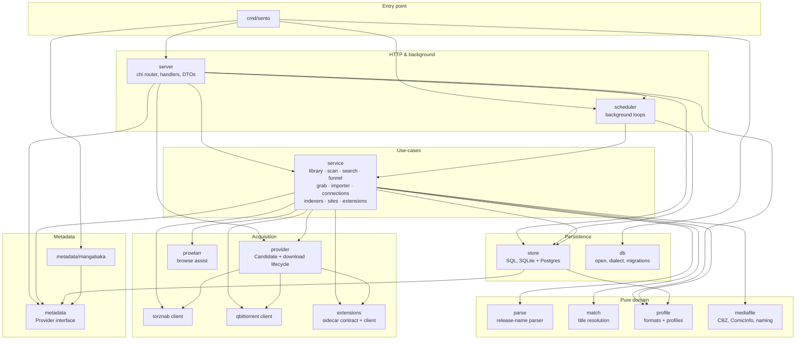
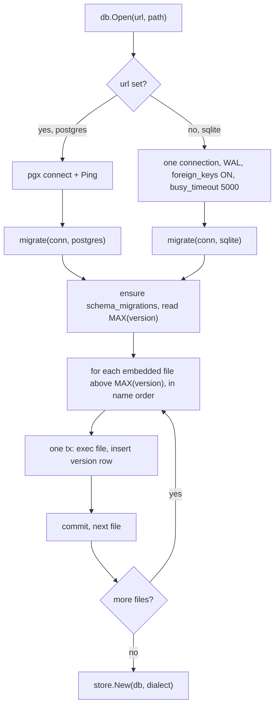
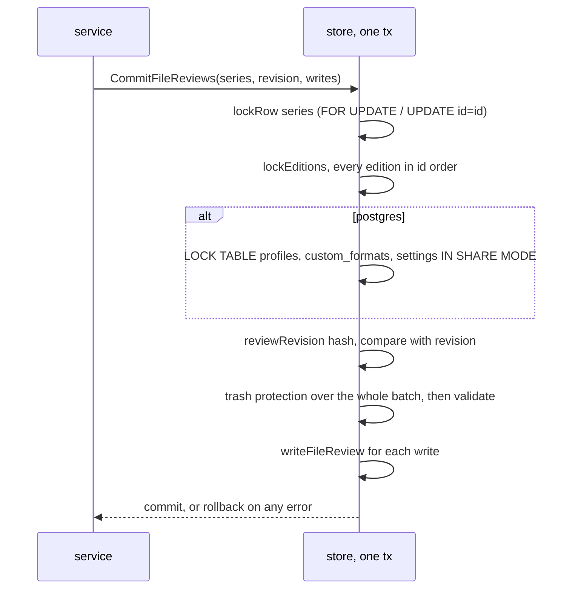

# Backend architecture

The current edition/acquisition model is described in [Editions, units, collected versions, and files](domain/editions.md). Stable work IDs identify memberships, targets express independently collected versions, and verified asset coverage determines ownership. Release evaluations and queue snapshots preserve acquisition decisions.

A map of the Go backend: packages, their dependencies, and the data flows
that run through them. Product behavior is specified in [spec/](spec/)
(`spec.md`, `decision-engine.md`, `parser.md`); this document is about how
the code is organized.

The [domain guides](domain/) describe the implemented data flows.

## Package dependency graph

Edges are real imports, extracted from the module graph. Cross-cutting
leaves (`apperr`, `config`, `version`) are imported broadly and omitted
from the diagram for readability. Regenerate the raw data with:

```sh
mise exec -- go list -f '{{.ImportPath}}: {{join .Imports " "}}' ./cmd/... ./internal/... | grep h-wb/sento
```



The graph is strictly layered (no cycles): entry → HTTP/scheduler →
service → {persistence, acquisition, metadata, domain}.

## Package inventory

| Package | Role |
|---|---|
| `internal/service` | All use-cases. Library side (library, scan, bulkimport), acquisition side (search, funnel, grab, importer), configuration (connections, indexers, sites, extensions, profiles, mediasettings) |
| `internal/server` | HTTP layer: chi router, JSON handlers, DTOs (`types.go` feeds tygo → TS types) |
| `internal/store` | Persistence: hand-written SQL via scany, portable across SQLite and PostgreSQL (`?` rebound per dialect) |
| `internal/parse` | Pure release/file/chapter-name parser (spec/parser.md); no I/O, regression corpus |
| `internal/provider` | Abstraction over release sources + download clients. `TorrentProvider` (torznab + qBittorrent) and `SourceProvider` (extension sources; Sento assembles CBZs itself) |
| `internal/mediafile` | CBZ import (atomic), ComicInfo.xml merge, naming templates and their token list, hardlink-or-copy |
| `internal/extensions` | Protocol-adapter contract for extension sources + HTTP client for the Kotlin sidecar (`extensions/`). Host keys are opaque; Sento owns all state |
| `internal/metadata/mangabaka` | The one `metadata.Provider` implementation |
| `internal/scheduler` | Background loops, crash-isolated; observable via System → Tasks |
| `internal/qbittorrent` | qBittorrent WebUI API client |
| `internal/match` | Parsed-title → library-series resolution: normalization, title index, token-set Jaro-Winkler |
| `internal/profile` | Pure domain: custom formats (Sonarr semantics) + release profiles with funnel knobs |
| `internal/torznab` | Torznab XML API client |
| `internal/db` | Connection opening, dialect detection, migrations (SQLite or PostgreSQL) |
| `internal/config` | YAML + environment configuration; initial connection seeds and enforced extension overrides |
| `internal/prowlarr` | Prowlarr API client for the Add Indexer browse assist |
| `internal/metadata` | `metadata.Provider` interface + types (anti-corruption layer, D13) |
| `cmd/sento` | Wiring: config → db → provider → server → scheduler; graceful shutdown |
| `internal/apperr` | Error classification sentinels (`ErrNotFound`, `ErrConflict`, …) mapped to HTTP statuses |
| `internal/version` | Version string |
| `internal/db/dbtest` | Test helper: per-test database |

## Persistence

`cmd/sento` calls `db.Open(cfg.Database.URL, cfg.Database.Path)` once:
a PostgreSQL URL (`SENTO_DB_URL`) wins, otherwise a SQLite file
(`SENTO_DB_PATH`). The dialect decides only the few things the portable
SQL subset cannot express: placeholder style and constraint-violation
codes. The schema itself, every table, column, key and state value, is
documented in [Data model and persistence](domain/data-model.md).

This diagram shows opening and migrating a database: dialect choice,
then pending migration files applied in one transaction each.



Store conventions (`internal/store/store.go`, `query.go`, `tx.go`):

- Queries are written with `?` placeholders; `q` rebinds them to `$N` on
  PostgreSQL. No query contains a literal `?`.
- Timestamps are TEXT in UTC, `2006-01-02 15:04:05` (`utcNow`), matching
  the column defaults. The two progress columns `progress_at` and
  `observed_at` are the exception: RFC 3339 (`progress.go`).
- Book numbers are integer hundredths (`sequence_num`, `cutoff_num`,
  `book_observations.number`).
- Inserts use `INSERT ... RETURNING id` (`insert`), the portable
  replacement for `LastInsertId`.
- `conflict` maps a unique violation (PostgreSQL `23505`, SQLite
  "UNIQUE constraint") to `apperr.ErrConflict`; `ErrNotFound` maps to 404.
- Rows map to structs with scany (`list`/`get`): columns match snake-cased
  field names or `db` tags. `inTx` runs one transaction; `touch` fails
  with `ErrNotFound` when no row was affected.

Concurrency and locks. All writes that change edition identity or take
reservations lock the affected edition rows in ascending id order:
`SELECT ... FOR UPDATE` on PostgreSQL, `UPDATE id=id` on SQLite (whose
single write transaction already serializes). `CommitFileReviews` locks
the series row first, then its editions, and on PostgreSQL additionally
takes `LOCK TABLE profiles, custom_formats, settings IN SHARE MODE`. It
then re-hashes the review revision and refuses the commit when it
changed. `ReserveQueue` takes `FOR UPDATE` on the active offer row on
PostgreSQL. This sequence shows one review commit taking its locks.



The review revision is a SHA-256 over the JSON-encoded rows of: `series`,
`editions`, `versions`, `books`, `files` (minus volatile columns),
`asset_contents`, `asset_coverage`, `file_trash`, `queue_items` (only
`id`, `books_json`, `snapshot_json`, `release_key`, `external_id`),
`profiles`, `custom_formats`, and `settings` keys `default_profile_id`
and `media`. `refreshed_at` is skipped because a refresh stamps the series
even when nothing changed. Because the hash reads `SELECT *`, it is taken
by column name: never rely on column order.

Writing a migration. Add one file under both
`internal/db/migrations/sqlite/` and `internal/db/migrations/postgres/`,
named `NNNN_description.sql` with the next free number. Never edit a
shipped file. The runner applies each file in one transaction. Keep to
the portable subset:

| SQLite | PostgreSQL |
| --- | --- |
| `INTEGER PRIMARY KEY` (rowid; rebuilt tables use `AUTOINCREMENT`) | `BIGINT GENERATED ALWAYS AS IDENTITY` (`BY DEFAULT` for `versions`, `book_observations`) |
| booleans as `INTEGER` 0/1 | real `BOOLEAN` |
| `REAL` | `DOUBLE PRECISION` |
| `json_*` functions | `jsonb_*` functions; `IS JSON OBJECT` needs PostgreSQL 16 or later (mise pins 17) |
| rebuild a table to change it | drop constraints dynamically with the `DO $$` pattern (see 0014) |

Partial indexes, `ON CONFLICT ... DO UPDATE`, `RETURNING` and
`CREATE TABLE IF NOT EXISTS` work in both dialects.

Current dialect drift (same version numbers, different physical schema):

- PostgreSQL has no 0001–0012; its 0013 baseline is the reference.
- 0014 rebuilds `collections`/`works` in SQLite (column order differs),
  while PostgreSQL drops the UNIQUE constraints dynamically and adds
  columns.
- In SQLite, the pre-0014 tables (`series`, `files`, `queue_items`,
  `decisions`, `blocklist`, `source_bindings`, `indexers`, `profiles`)
  use rowid ids, which can reuse the highest deleted id; PostgreSQL
  identity columns never reuse ids.
- 0030 sorts `aliases_json` in PostgreSQL (`jsonb_agg ORDER BY`); SQLite
  does not.
- 0022/0023 JSON rewrites reformat the text through `jsonb` on PostgreSQL.
- Type differences as in the table above, e.g. `file_trash.file_id` is
  BIGINT vs INTEGER. No index drift.

Two data migrations run in Go at startup, before serving:
`MigrateCopyRules` moves legacy `versions.required_group` /
`allow_unknown` into profiles, and `ReconcileLibraryRoot` records the
library root in `settings` and rewrites stored paths when it changes.

## Architectural invariants

- **Book identity is stable.** Acquisition targets are `(version ID, book ID)`.
  The service computes wanted/fulfilled state from stored book, file, policy
  and queue facts; a displayed volume or chapter number is not an identity.
- **Providers are uniform.** The funnel and importer never know which
  protocol a candidate came from; only the payload shape differs
  (directory of files vs CBZ stream).
- **The decision engine is pure.** `funnel.go` does parse → hard
  rejections → scoring with no I/O, parameterized by profiles and the prepared search state.
- **Connections live in the DB.** Initial qBittorrent and Prowlarr settings
  can be seeded by YAML/environment. Extension URL/repository environment
  overrides remain enforced. `connections.go` rebuilds live clients into a
  shared registry on save; consumers keep the same registry reference.
- **The sidecar is replaceable.** Sento stores the desired extension
  list; `ExtensionService.Reconcile` re-installs whatever a fresh host is
  missing.

## Data flows

- [Editions and files](domain/editions.md): metadata, collected versions, book identity and ownership.
- [Acquisition](domain/acquisition.md): search, release decisions, downloads, import and recovery.
- [Naming](domain/naming.md): where files land, templates, names in readers and organize.
- [Parsing](domain/parsing.md): release names and title matching.
- [Data model and persistence](domain/data-model.md): every table, column, key, relation and state value.

Entry-point wiring is in `cmd/sento`, HTTP handlers in `internal/server`, and
background loops in `internal/scheduler`. Read the service handling a flow
alongside its store methods; the package inventory above maps both.
