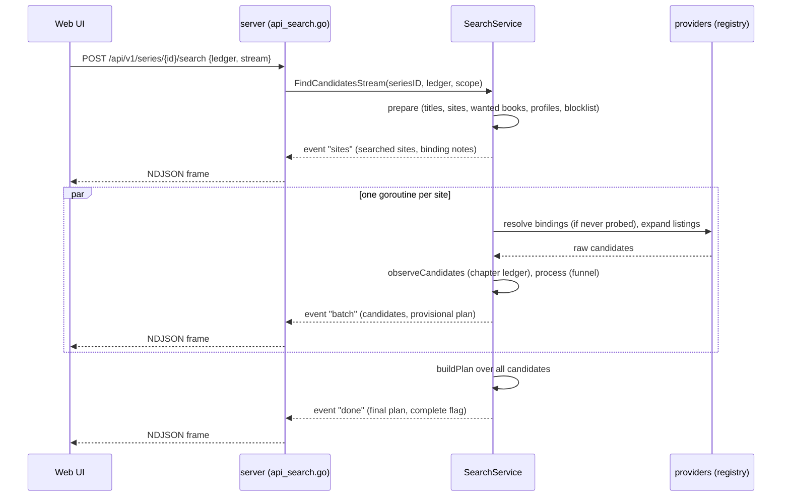
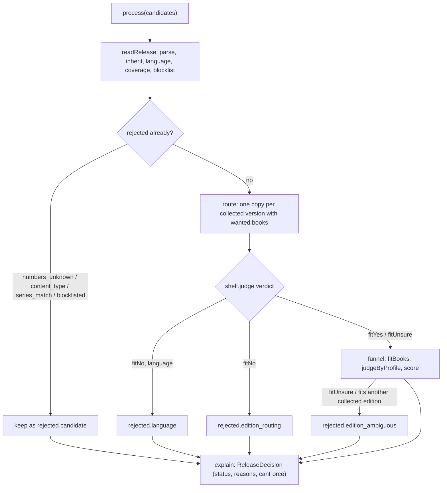
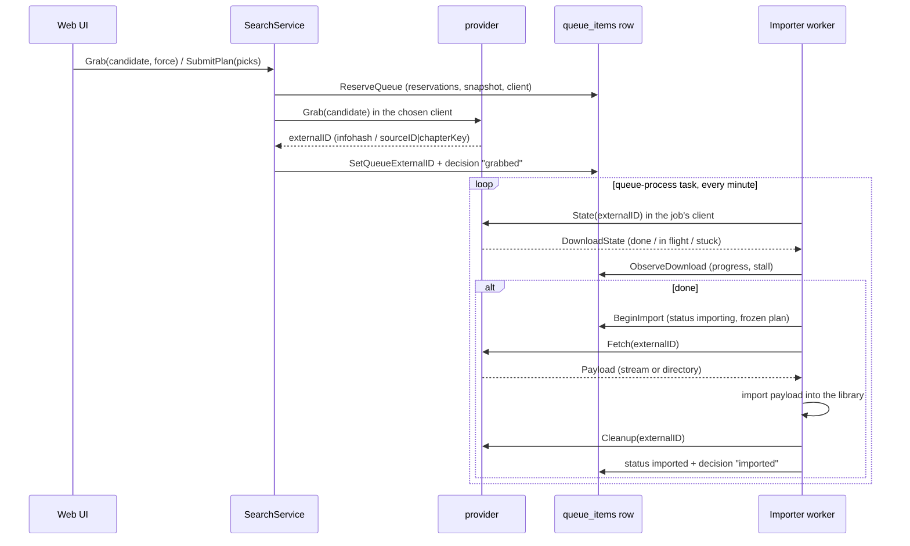
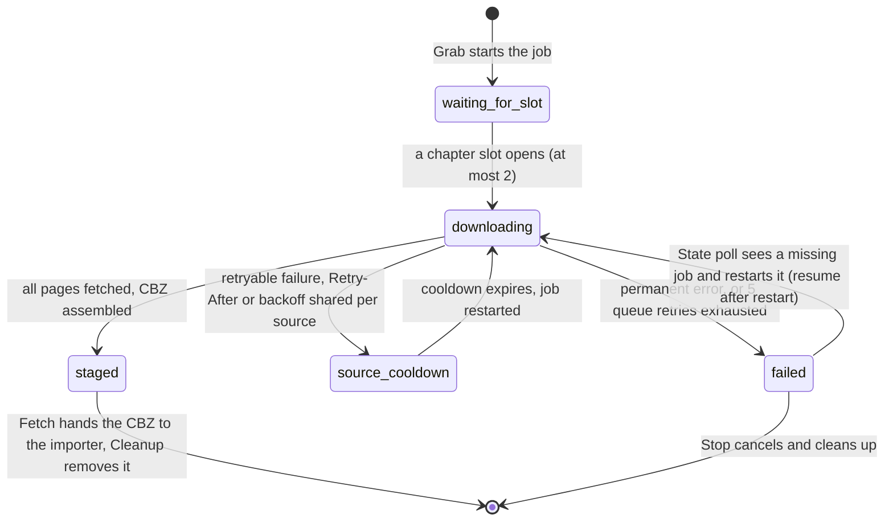
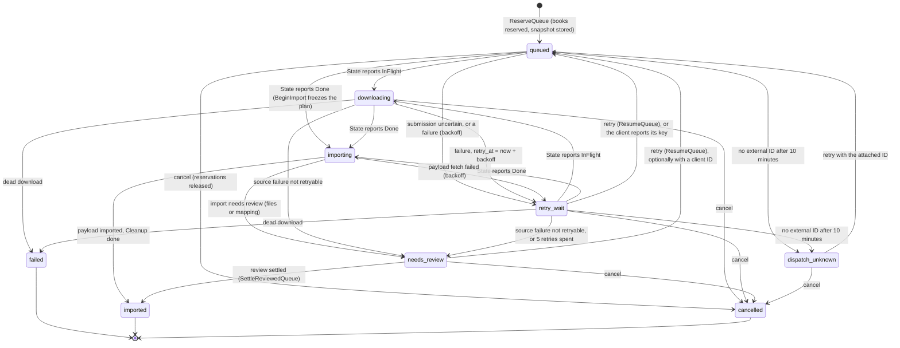
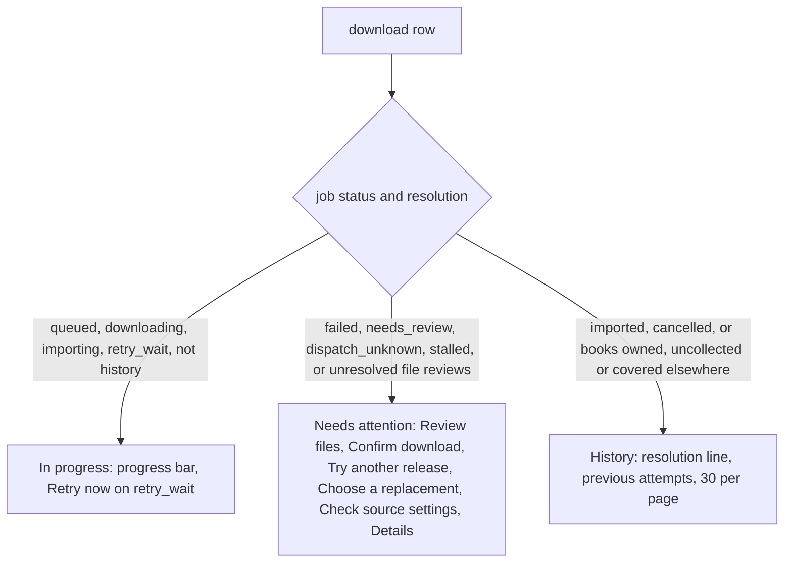

# Acquisition planning

Sento collects and manages files. **Reader integration is explicitly out of
scope**: no embedded reader, reader connection, reader scan, reading progress,
or reader handoff. This is a standing product decision confirmed on 2026-10-07.
It supersedes the reader proposal in the Lire comparison.

Acquisition turns search results into downloads. One pipeline serves both
ledgers (volumes and chapters): providers return raw candidates, the decision
funnel parses, rejects and scores them, and the queue worker downloads and
imports the chosen ones. Plans are derived from a search and the selected
edition/version's books; they are not another collection model.

Book identity remains `(versionID, bookID)`; chapter numbers and volume numbers
are never interchangeable. See [profiles and acquisition
state](profiles-ledger.md) for the book states a search fills from, and [parsing
and title matching](parsing.md) for how a release name becomes facts.

## In the code

| File or package | What it holds |
| --- | --- |
| `internal/service/search.go` | `SearchService`, `FindCandidatesStream`/`FindCandidates`, the `SearchEvent` stream, `discover` |
| `internal/service/search_prepare.go` | `prepare`/`prepareVersions`: titles, usable sites, wanted books, replacement scope |
| `internal/service/search_bindings.go` | `resolveBindings`, `resolveQueries`: source auto-binding |
| `internal/service/listings.go` | `expandListings`, `listingName`, `listingBelongs`: nested listing discovery |
| `internal/service/observations.go` | `observeCandidates`, `placeChapterListings`: chapter observation |
| `internal/service/funnel.go` | `process`, `readRelease`, `route`, `fitBooks`, `judgeByProfile`, `score` |
| `internal/service/release_decision.go` | the `rejectionRules` table, `explain`, `ReleaseDecision` |
| `internal/service/plan.go` | `BuildPlan`, `markAvailability`, `AcquisitionPlan` |
| `internal/service/grab.go` | `Grab`, `SubmitPlan`, `GrabBest`, `grabClaims`, `retire`, `SearchAgain` |
| `internal/service/importer.go` | `Importer.ProcessQueue`/`processItem`/`recordFailure`: the queue worker |
| `internal/service/queue_recovery.go` | blocklisting, the listing circuit breaker, `TryAnother`, `QueueView` |
| `internal/service/activity.go` | `Library.Activity`: downloads, reviews, events, issue codes |
| `internal/provider/provider.go` | the `Provider` interface, optional capabilities, `Registry`, `Candidate` |
| `internal/provider/torrent.go`, `torrent_search.go` | Torznab search and qBittorrent grabs |
| `internal/provider/source.go`, `source_fetch.go`, `source_retry.go` | extension-source jobs: slots, pacing, CBZ staging, retry classification |
| `internal/store/queue.go`, `progress.go`, `blocklist.go`, `history.go` | queue rows and transitions, progress/stall, blocklist aliases, decision log |
| `internal/server/api_search.go`, `api_queue.go`, `api_indexers.go` | the HTTP endpoints below |

## Triggers and endpoints

A search is started by a person in the UI, or by Sento's own loops. The one
interactive endpoint is `POST /api/v1/series/{id}/search` (`api_search.go`); its
body selects what happens after the search:

| Body field | Effect |
| --- | --- |
| `ledger` | `volume` or `chapter` (required) |
| `stream` | answer with an NDJSON `SearchEvent` stream instead of one JSON body; implies `dryRun` |
| `dryRun` | return candidates and the plan, queue nothing |
| `picks` | submit exactly these planned releases (1 to 200), re-evaluated first: `SubmitPlan` |
| `grab` (+ `force`, `grabProvider`, `grabSiteID`, `grabVersionID`) | grab one candidate by GUID: `Grab` |
| none of these | `GrabBest`: plan and queue the default selection |

`GET /api/v1/lookup?q=...` is the metadata title search behind the add-series
dialog. The queue, activity, history and blocklist routes (`api_queue.go`) are
listed in
[api.md](../api.md#queue-history-activity-and-blocklist).

**Test search** on the Indexers page (`POST /api/v1/indexers/{iid}/search-test`, Torznab indexers only, query of 1 to 200 characters) sends one raw query with the Books category. If that returns nothing, it compares an unrestricted query and shows up to 5 sample titles with their categories. It never evaluates, plans or queues releases; it helps distinguish an empty query from a feed whose category settings need attention (`indexer_search.go`).

Acquisition itself is different: it normalizes titles and sends up to 4 alias queries, gates one request at a time per indexer endpoint, and caches results for 2 minutes (see torrent search below).

Background triggers live in `internal/scheduler/scheduler.go`. The
`queue-process` task runs every minute: it calls `ProcessQueue`, then hands
`TakeSearches()` to `SearchAgain`, so a series whose download failed is searched
again within the minute.

`chapter-check` (every 2 hours) and `volume-sweep` (every 12 hours) run searches
with a `Scheduled` context, which only fills missing and unsatisfactory books
and never hunts quality upgrades; `GrabBest` then queues what the plan picks.

## The search run

One search fans out over every usable site of every configured provider. Each
usable indexer entry (or source with resolved bindings) is one "search book"
that runs in its own goroutine, so a slow indexer never holds back its siblings.
This sequence shows an interactive streaming search from the UI to the providers
and back:

The stream emits `sites` first (what will be searched), then one `batch` per
finished search book with the candidates that book produced and a provisional
plan built from everything so far, and finally `done` with the complete plan. A
provider error degrades that batch only: the event carries `error` and the
remaining batches still count.

`complete` on the final plan is true only when at least one site was searched
and no batch errored and the context was not cancelled. A non-streaming call
collects the same events into one `SearchResult`, sorted by score.

`prepare` (`search_prepare.go`) resolves everything the run shares: the series' titles (language-scoped to the scoped version when one is given), the usable sites (enabled, reachable, and enabled for this ledger: `UseVolumes`/`UseChapters`, with per-series overrides applied via `EffectiveIndexer`), each site's priority, the blocklist keys, the effective profiles, the wanted books per version (`prepareVersions`, which also refreshes file presence first), and, for a replacement search (`scope.replaceQueueId`), the old job's books as wanted plus its release as excluded. Query titles come from `store.QueryTitles`: the primary title, the secondary titles in the collected editions' languages, and the romanized title. Anchoring uses `store.SeriesTitles`, which adds every alias in every language, with the scoped version's language first.

### Binding auto-resolution

A source site that has never been probed resolves its series-to-listing bindings
on the first search (`resolveBindings`): up to 3 queries (the primary title, its
normalized form, then Latin-script aliases), each scored against the series
titles with `match.Similarity`; every entry at or above `match.AutoThreshold`
(0.90) is bound, capped at 5 bindings (`maxAutoBindings`), under a 20-second
budget.

All matches bind, because sites like Madokami list the same series several times
and the funnel picks per book with better information. A definitive miss
persists as one `unmatched` sentinel binding so slow sources are not re-probed
on every search; transient errors are not persisted. A rebind from the UI
retries.

### Nested listing discovery

`expandListings` walks the active bindings of a source that supports listings and adds their nested listings as bindings, under a 20-second budget and a cap of 32 listings (`maxListings`). A listing is named by its path: the parent's name plus its own, with the source's sorting mark (`!`) and a repeat of the series title dropped (`listingName`). Whether it belongs to this series is decided by parsing its own name against the series titles (`listingBelongs`): a folder named for another work is switched off (`disabled`), one named by release words alone stays with its parent. Existing listings are renamed and re-judged once when their source starts carrying names. Disabled entries are never traversed. A release found in a listing inherits what the listing name says (color, group, edition) via `parse.Result.Inherit`.

### Chapter observation and discovery

On the chapter ledger, every batch also records what the sources list, before
the funnel runs (`observeCandidates`): a candidate whose anchored parse is manga
and fits a chapter edition yields its single-number ranges as book observations,
at most 100 per batch (the counter is local to `observeCandidates`, which runs
once per search book, so a run over N sites can record up to 100×N).
Observations on bindings marked trusted (or placed
by `placeChapterListings`) are auto-accepted, so new chapters appear as books.

`placeChapterListings` places, without asking, a source's match whose edition is
unset when there is no choice: it is the source's only match, the series
collects exactly one chapter edition, and the match lists chapters, not volumes.

`discover` is the observe-only pass used when a chapter edition has nothing wanted (an empty or fully collected one): it runs the source providers just to record observations, discards the candidates, and re-prepares the run so the search then runs on what was found.

## Reading a release

`readRelease` turns one raw provider candidate into a `ReleaseCandidate` before any edition is asked (`funnel.go`). It parses the title anchored to the series titles, on the torrent channel for torrents and the source channel for source releases. A source release named by its number alone is described by the listing it sits in: its parse inherits the listing's hints (`Result.Inherit`). The language a name does not state is inferred in this order, strongest evidence first:

1. the source's own language (source releases only);
2. the indexer section the torrent is filed under (`CategoryLanguage`: "english" sections give `en`, "raw" gives `ja`, disagreeing sections give none);
3. an English-language publisher's tag in the parsed edition names (Viz, Seven Seas, Yen Press, Dark Horse, J-Novel Club, Vertical, Ize Press, Udon);
4. the indexer's default language.

The inferred language is recorded with its source (`languageSource`) and shown
in the decision as `LanguageSource` ("release name", "source listing", "indexer
category", "publisher", "indexer default").

The release's numbers give its coverage ranges for the searched ledger
(`coverageRanges`): volumes or chapters depending on what the name is, plus, for
a terse source name the parser could not place, the extension's own chapter
recognition as corroboration.

A number-less torrent on the volume ledger is kept only as a potential pack:
either the name says `Complete`, or it is an anchored, leftover-free manga name
with no number anywhere, which is treated as an inferred pack (offered for
review, never grabbed automatically; the import maps what is inside). A release
whose numbers fall outside the ledger is dropped from the results entirely
(`Dropped` counts these).

A release that cannot be read at all comes back with a rejection:
`numbers_unknown` (no confirmed numbers, nothing for the other ledger either),
`content_type` (not manga), or `series_match` (torrent not anchored to the
series). Finally the blocklist is checked under both the download key and the
feed GUID.

## Routing and the funnel

Each surviving candidate is routed to every collected version that has wanted
books (`route`), judged against that edition by `shelf.judge` (see
[editions](editions.md)), and then run through the funnel. This diagram shows
the stages every candidate passes, in running order:

Rejected candidates keep their parse and are shown in the UI with their
reasons. A release no collected version takes is shown once, for the first one, with why
not; a search scoped to one collected version always shows it. When several take
it, each copy gets its own GUID suffix (`@versionID`), including the default
version's; the default copy goes unsuffixed only when it is the only
compatible one.

Inside the funnel for one collected version, three gates run in order and the
first failure stops scoring:

- `fitBooks`: the content-type gate (`content_type`), the series-match gate for torrents (`series_match`), the language gate against the edition (`language`, recorded but kept going so a force-grab still has the book list), then the book mapping: each book of the edition whose number falls in the release's ranges becomes `Contents`, and each wanted one becomes `Coverage`. Two books of the same kind sharing a number make the release `book_ambiguous` (search from the specific book instead). A pack whose wanted share is under half of the books it holds gets `pack_threshold`; a release covering no wanted book gets `no_coverage`.
- `judgeByProfile`: the collected version's profile custom formats are evaluated (`profile_rule` when a required format misses or a refused one matches), the upgrade filter (`no_upgrade` when the release does not beat the owned file by at least the profile's minimum gain), the format-score floor (`format_score`, soft), and for torrents the size-per-book and seeder rules (`size`, `seeders`, soft).
- `score` runs only when nothing rejected the candidate.

### Rejection table

One table in `release_decision.go` (`rejectionRules`) holds every code's
hardness, owner and UI message. "Force" says whether a forced grab overrides it
(`Grab` with `force=true`); hard codes always hold.

| Code | Stage | Owner | Message shown | Force overrides |
| --- | --- | --- | --- | --- |
| `rejected.series_match` | readRelease | book | The release name does not identify this series unambiguously. | no |
| `rejected.content_type` | readRelease / fitBooks | book | Classified as video, software, novel, ... not manga. | no |
| `rejected.numbers_unknown` | readRelease | book | No confirmed volume or chapter numbers were found. | no |
| `rejected.blocklisted` | readRelease | other | This release is on your blocklist. | no |
| `rejected.previous_download` | process | other | This is the download you are looking to replace; excluded from this search only. | no |
| `rejected.language` | route / fitBooks | book | The stated language does not match this edition. | no |
| `rejected.edition_routing` | route | book | The release states a different edition than this one. | no |
| `rejected.book_ambiguous` | fitBooks | book | Several books share this number; search from the specific book. | no |
| `rejected.no_coverage` | fitBooks | other | No books in this release need a download in the current selection. | no |
| `rejected.profile_rule` | judgeByProfile | profile | The release breaks a required or refused format rule. | no |
| `rejected.no_upgrade` | judgeByProfile | profile | This release does not improve the file on disk enough. | no |
| `rejected.format_score` | judgeByProfile | profile | Below the profile's minimum format score. | yes |
| `rejected.size` | judgeByProfile | profile | Estimated size per book is outside the profile's limits. | yes |
| `rejected.seeders` | judgeByProfile | profile | Fewer seeders than the profile requires. | yes |
| `rejected.pack_threshold` | fitBooks | profile | Only n of m represented books are wanted; automatic packs require at least half. | yes |
| `rejected.edition_ambiguous` | route | confirm | The release also fits another edition you collect; confirm it. | yes |
| `rejected.pack_unverified` | funnel | confirm | Nothing in the name says which books this pack holds; the import checks. | yes |

`explain` turns the codes into the `ReleaseDecision` the UI reads: `Status` is `ready` with no rejections, `review` when every rejection is overridable and there is coverage, `blocked` when any rejection is hard. `CanDownload` is no rejections at all; `CanForce` is only-soft rejections plus coverage.

## Scoring

A candidate nothing stands against is scored (`score`). Every term is visible in
the candidate's `ScoreParts`:

| Term | Value | Condition |
| --- | --- | --- |
| Wanted books | +1000 each | per book in `Coverage` |
| Preferred protocol | +200 | protocol equals the profile ledger rule's `PreferredProtocol` |
| Custom formats | summed format score | `FormatScore` from `Judge` (see [profiles](profiles-ledger.md)) |
| Torrent availability | +50 / +25 | seeders > 20 / > 5 |
| Uncertain name | −100 | parse `Confidence` below 0.8 |

The only tie-break is the indexer's priority (lower number wins); it is a
property of the indexer, never part of the score (`betterRelease`). Candidates
are sorted by score, then priority.

## The plan

The plan distinguishes the release's contents from the subset of wanted books
assigned to a job. Overlapping packs can therefore have disjoint reservations.
Import still verifies file contents and preserves the original payload. Existing
profile gates, edition checks, blocklists, and uncertain-dispatch handling
remain authoritative.

`BuildPlan` (`plan.go`) picks the default selection greedily by marginal coverage. In each round it takes the unrejected candidate that adds the most not-yet-taken wanted books, scored as `score − 1000·coverage + 1000·newBooks − 150·additional`, where `additional` is the books it holds beyond the new ones (the −150 per extra book penalizes redundant payload); a candidate whose remaining share is under half of what it holds is skipped (the same pack rule as the funnel, applied to the job's share). Ties break by indexer priority, then by the smaller known size. A final pruning pass drops a chosen release whose coverage is fully covered by the others. The result is deterministic, not a claim of global optimality.

The pack rule applies to a job's share as well as to the release: the default
plan, which automatic acquisition also uses, never picks a pack whose remaining
contribution is under half of the books it holds. Those books stay listed as
available, and a person can still select the pack; the plan then says why it was
not chosen.

Each `PlanPick` carries the candidate key, the books assigned to it, and
`AdditionalBooks` (surplus contents). The plan's `Size` sums the picks' sizes;
releases without an advertised size increment `UnknownSizes`.

Search availability is a timestamped observation, separate from ownership:
`markAvailability` sets each plan book's `Availability` to `available` (an
unrejected candidate covers it), `outside_profile` (only soft-rejected
candidates cover it), `no_seeders` (a torrent whose only rejection is zero
seeders), `not_found`, or `unknown` while the search is incomplete. A proposed
download does not establish ownership.

The common interaction is a coverage summary and editable selection of releases,
with raw release details and rejected candidates available below. A provisional
plan accompanies each batch of results so the view fills in during the search;
it becomes editable when the search ends. Submission searches and evaluates
again and reports each release's outcome; it never silently substitutes a
different release.

## Grabbing

`Grab` routes one candidate to its provider and records the queue item (`grab.go`). Hard rejections always refuse the grab; soft ones refuse it too unless `force` is set, and force survives exactly the six soft codes in the rejection table (`format_score`, `size`, `seeders`, `pack_threshold`, `pack_unverified`, `edition_ambiguous`). Before anything is reserved or sent, a `ClientRouter` provider names the download client for the release, and that client is stored on the job: polling and import then ask that client only. A replacement search's old job is retired only when the new grab claims one of its books (`retire`); the old torrent and its files stay in the client.

`grabClaims` then reserves the books transactionally (`ReserveQueue`, `store/queue.go`): it locks the editions, validates every `(versionID, bookID)` reference, deletes reservations of terminal jobs, and either creates a new `queued` row or attaches the books to the release's existing active job (same series, provider and release key), whose snapshot gains the new evaluation. A book already reserved by another active job conflicts. The chosen candidate, snapshotted in full, is stored on the queue row. Only then is the provider's `Grab` called; if submission fails, the job is deferred (`dispatch_unknown` path) and never submitted twice. A successful grab sets the external ID and records a `grabbed` decision with `By` = "you" or "schedule".

`SubmitPlan` (the `picks` path) re-runs `prepare` and the funnel for each selected pick immediately before reserving, so policy and ownership are current at grab time; each pick ends `queued`, `skipped` (books no longer need it) or `failed`, and partial failure never silently chooses a different release. `GrabBest` builds the plan and submits its picks.

Only a person's explicit choice grants replacement intent in review
(`RequestedReplacements`): owned or policy-driven claims and surplus pack
contents do not.

Reviewing an overlapping pack preserves the existing selected archive unless
replacement was explicitly requested in the acquisition snapshot or chosen in
review; the download plan offers an unchecked replacement choice for each
selected book with an existing copy, and single-book search offers the same.
Generated and scheduled plans leave it unset.

Automated imports continue to
apply the acquisition plan and configured upgrade policy; review separately
confirms archive contents, chooses each collected book's supplying copy, and
retains or trashes unused incoming archives. See [review and file
ownership](editions.md) for preview validation, recoverable trash, and durable
skip behavior.

This sequence shows one grab from dispatch to import, as the queue worker
advances it:

The queue statuses between are detailed below. Loose-image imports must map a
folder confidently to one book, order and validate its pages, build a staged
CBZ, and pass through the normal non-overwriting import path; ambiguous
folders require review.

## Providers

`internal/provider` abstracts release sources and download clients: the funnel and the import pipeline never know which provider a candidate came from. The `Provider` interface (`provider.go`) is:

| Method | Role |
| --- | --- |
| `ID()` / `Protocol()` | stable provider key (`torrent`, or the host's name for sources) and its protocol |
| `Sites(ctx)` | the searchable entries (indexers or extension sources) |
| `Search(ctx, SearchRequest)` | raw `Candidate`s; `Allowed` restricts to specific sites |
| `Grab(ctx, Candidate)` | start the download, return the external ID used by State/Fetch/Cleanup |
| `State(ctx, externalID)` | `DownloadState` (below) |
| `Fetch(ctx, externalID)` | the finished `Payload`: one archive stream, or a directory of files left in place |
| `Cleanup(ctx, externalID)` | release provider-side storage after import (a no-op where data must stay for seeding) |

Optional capabilities are separate interfaces a provider may implement:
`DownloadStopper` (`Stop`), `Recoverer` (`Recover`), `Progresser` (`Progress`, a
side-effect-free live fraction for HTTP handlers, unlike `State`),
`MangaResolver` (`ResolveManga`, used by auto-binding), `MangaListings`
(`Listings`, used by nested listing discovery), `ClientRouter` (`ClientFor`),
`Remover` (`Remove`).

`DownloadState` carries `StallEligible` (actively waiting for data, not
paused/queued/checking), `Transferring`, `Done`, `InFlight`, the
provider-specific `Detail` string, and `Progress` (0 to 1).

Download identity is the external ID: for a torrent the lowercased infohash
(derived from the magnet when the feed publishes none), for a source release
`sourceID|chapterKey`. `Registry` holds the configured providers and is swapped
in place when connection settings change, so every service sees edits
immediately; `InClient` binds a call to the one download client that holds a
job.

Saving a source preference rebuilds its loaded instance before the save
finishes; the source stays discoverable alongside other installed sources,
including when saved preferences are restored after a sidecar restart.

### Torrent search and grab

`TorrentProvider` searches every enabled, allowed Torznab entry in parallel, Books category only (`CategoryBooks`), so a general tracker does not fill its result cap with films. Up to 4 alias queries are sent per entry (`TorrentQueries`: primary title then aliases, normalized and deduplicated), but one request at a time per endpoint (URL + API key) via a gate, so a search cannot multiply an indexer's load by four. Results are cached 2 minutes per query (cache cleared at 128 entries); the whole alias fan-out has a 90-second budget. Repeated offers across aliases are deduplicated by feed GUID. Each indexer's category names are fetched once and cached per endpoint to read `CategoryLanguage` off the release's sections. A failing indexer degrades with an error; the rest still answer.

A grab goes to the client the release's indexer names, or the default (first)
client; with several clients, an unknown indexer or a missing named client is an
error, never a silent fallback (`clientFor`).

The external ID must be the infohash, so it is derived from what is actually
handed to qBittorrent: the magnet is added as-is when present; otherwise the
download URL is fetched by Sento itself (60-second timeout, at most 10 MB, at
most 10 redirects, a redirect to a `magnet:` link reported as such and used
instead), and the bytes are uploaded as a `.torrent` file.

The hash comes from
the feed, the magnet, or the fetched bytes, in that order; only when none exists
does the feed identity stand in.

The same torrent in another client is never
adopted: lookups are bound to the job's client via `InClient`. `State` lists the
client's torrents and reports done/in-flight/progress; the stall-eligible
qBittorrent states are `downloading`, `stalledDL`, `metaDL`, `forcedDL`,
`forcedMetaDL`. `Fetch` returns the torrent's save directory and file list.

`Cleanup` is a no-op (data stays for seeding, imports hardlink); `Remove`
deletes the torrent with its data, searching only Sento's own category.

### Source jobs

`SourceProvider` adapts the extensions sidecar: search lists the chapters of every bound listing in parallel; downloads are done by Sento itself (page fetch, then CBZ assembled in a staging dir). A grab just starts the job and returns `sourceID|chapterKey` as the external ID. All download state is in memory (the queue row is the durable record): jobs are bounded to 2 concurrent chapter downloads (a semaphore), and each download gets a 30-minute timeout that starts when a slot opens, not when the grab was sent. This diagram shows the
states of one source download as `State` reports them:

The reported states are `waiting for download slot`, `downloading`, `waiting
for source cooldown`, `staged` (done), `restarted`, or the error text. A
missing job for an unstaged item is restarted on the next poll, because the
queue is durable but the job table is not.

Each page is fetched with up to 4 attempts (`retryPage`). Retryable failures are
temporary HTTP statuses (408, 425, 429 and 5xx), network errors, deadlines and
truncated bodies; a 404/410, or an archive the source marks unreadable, is dead
(`DownloadError.Dead`).

Every attempt passes through the source's shared page rate limiter (token
bucket, burst 1, default 4 requests/second per source,
`SENTO_DOWNLOADS_PAGE_RATE`; up to 3 pages in flight per chapter,
`SENTO_DOWNLOADS_PAGE_CONCURRENCY`, default 3) and the source-wide cooldown: a
failed attempt sets a cooldown of `Retry-After` (never shortened) or `2^attempt`
seconds plus up to a quarter of that in jitter, whichever is longer, and every
later page request of that source waits it out. Successful pages stay staged
while a sibling retries.

An exhausted chapter attempt cleans up its temporary
files and the queue applies its own backoff (below). `SweepStaging` removes
leftovers of crashed downloads at startup: `.page-*`/`.part-*` files older than
an hour and staged `.cbz` files older than 24 hours.

After five queue retries a job moves to Review with its book reservations
intact. Other permanent source errors go directly to Review. Neither outcome
blocklists the release.

## The queue lifecycle

Every download is a `queue_items` row with one of nine statuses
(`store/queue.go`). The worker (`Importer.ProcessQueue`, run every minute by the
`queue-process` task and on `POST /queue/process`) advances the runnable ones,
oldest first: `queued`, `downloading`, `importing` and `retry_wait` (past its
`retry_at`). Jobs waiting on a person (`needs_review`, `dispatch_unknown`) are
left out of the runnable list. This diagram shows the queue statuses and their
transitions:

The timers, all measured from the job's `created_at` unless said otherwise: a job with no
external ID after 10 minutes becomes `dispatch_unknown` (confirm the download in
the client, then attach its ID or cancel; never resubmitted blindly, the stable
release key is reconciled against `State` first).

A job neither done nor in flight gets a `Recover` kick from a `Recoverer`
provider on every queue pass once it is older than 2 minutes, and is declared
dead (`errDownloadDead`) after 10 minutes. Queue backoff (`DeferQueueUntil`)
waits 30 seconds times
`2^min(retryCount, 6)`, so doubling up to 32 minutes at the cap, longer when the
source's `Retry-After` says so; timestamps are rounded up to the next second so
a retry never fires early. `retry_wait` jobs past their `retry_at` are picked
up by the worker again, straight into `downloading` or `importing`.
Source failures retry up to 5 times (`maxSourceRetries`), then move to
`needs_review` with their reservations intact; a source failure that is not
retryable goes there at once, and a dead source download fails. These source
failures, like a dead torrent, come from any status before import (`queued`,
`downloading` or `retry_wait`); the diagram draws each once. A grab whose
submission result is uncertain waits in `retry_wait` without an external ID
until the client reports a download under its release key (the job goes
back to `queued` with that ID) or the 10 minutes run out.

Blocklisting a job by hand (`BlocklistQueueItem`) marks it `failed` from any
status but `cancelled` and `imported`. Cancel (`CancelQueue`) is refused
while a job is `importing` or `imported`; `UpdateQueueItem` never touches
`cancelled` or `imported` rows.

`PruneFinishedQueue` keeps the newest 200 terminal jobs
(`imported`/`cancelled`/`failed`); the Activity page shows the newest 200
finished ones plus all active ones.

Reservations live in `book_reservations` (`version_id`, `book_id`, `queue_id`):
they are claimed transactionally at grab time and released when a job reaches a
terminal state (`failed`, `imported`, `cancelled`), so a failed job's books
become wanted again at the next reservation.

The six active statuses (`queued`, `downloading`, `importing`, `needs_review`,
`retry_wait`, `dispatch_unknown`) are the partial index `idx_active_offer`;
`PendingBookStates` maps each reserved book to its holding job's phase, with
`needs_review` yielding to an overlapping transfer.

Progress and stall are recorded independently of status (`ObserveDownload`,
`store/progress.go`): each poll stores the progress fraction (clamped to 0..1),
the state detail, and timestamps. A job is `stalled` when it is stall-eligible,
not transferring, and 20 minutes have passed since the last progress change; a
gap of more than 5 minutes in observations (server or client downtime) restarts
that timer instead of implying a stall.

Stall detection reports sustained lack of progress, excluding deliberate pauses
and queued/checking states. In the views, the stall flag is dropped after 5
minutes without a fresh observation, and a downloading item's live progress
comes from the stored observation plus the provider's `Progresser`, if it has
one.

## Failures, the blocklist and recovery

`recordFailure` classifies one failed queue pass (`importer.go`):

| Failure | Queue status | Blocklist | Search again |
| --- | --- | --- | --- |
| Source cannot give the release (404, 410, unreadable archive): `DownloadError.Dead` | `failed` | yes | yes, within the minute |
| Download never completes (`errDownloadDead`, after the 10-minute grace) | `failed` | yes | yes, within the minute |
| Source retryable failure | `retry_wait` (backoff), after 5 retries `needs_review` | no | no |
| Import needs review (`errImportReview`) | `needs_review` | no | no |
| Dispatch uncertain (`errDispatchUnknown`) | `dispatch_unknown` | no | no |
| anything else | `retry_wait` (backoff) | no | no |

A source that cannot give the release is different from one that fails
temporarily: one that no longer has the listing or a page of it (404, 410), or
serves an archive with an explicit ZIP format error, fails the job and
blocklists the release, like a torrent that never completes, and the series is
searched again within the minute for another. The same happens when you ask to
try another release.

The torrent and its files are never removed from the client by this, and no
replacement is made automatically. An IO-wrapped range/header failure, including
"Not a local file header", remains retryable: a transient response can fail that
check even for a valid archive.

Upgrades remove automatic blocks created by the
old classification, preserving manual blocks and evidence that a release is
gone. Historical jobs stay failed; ordinary acquisition decides whether to try
the release again.

The blocklist (`store/blocklist.go`) bans a release under every name it goes by,
saved atomically as one alias group: the download external ID, the listing
release key, and the feed GUID from the candidate snapshot (`blockRelease` →
`AddReleaseBlocklist`). Searches match candidates against the ban set under both
the download key and the GUID.

Blocks retain their title and protocol-scoped aliases independently of queue
history, so housekeeping cannot split a release into separate blocks; upgrades
recover existing aliases from retained queue history, and blocks with no
remaining identity evidence stay separate.

Blocked releases can be reconsidered
from Activity → History → Blocked releases, individually, as a selection, or all
at once; the list groups a release's known listing, download and feed
identifiers into one entry with its title, reason and date. Clearing all blocks
asks for confirmation and includes manual blocks and releases outside the
current page or filter.

Unblocking removes all known blocked identifiers of the
chosen release and leaves previous attempts, files and reservations unchanged;
search results rejected by the blocklist also offer **Unblock**, then search
again to evaluate current policy and ownership.

A source listing that fails three downloads in a row is switched off
(`listingFailed`): the breaker cancels that listing's other
queued/downloading/retrying jobs, stops their downloads via `DownloadStopper`,
and records a `listing_switched_off` decision; the next search uses other
listings, and Sources lists it, switched off, to switch back on.

"Try another release" (`TryAnother`, `POST /queue/another`) blocklists each
chosen job's release, cancels the job (releasing reservations), stops the
download if the provider can, and returns the series ledgers to search again
right away (15-minute budget), with the job's own release excluded and its books
wanted.

Recovery is guided: a replacement search treats the stalled job's books as
wanted and rules out the job's own release, while the job keeps running and
keeps its reservations. Sento stops tracking the old job only when a chosen
replacement claims one of its books; a search that finds nothing changes
nothing.

## Activity

Activity (`Library.Activity`, `activity.go`) is derived from queue, coverage and
review facts, never stored as a feed. It returns one row per queue job
(`ActivityDownload`), the file review items (attached to the download row of the
release they arrived in when they have one), the last 200 decision events, and
the series titles.

The decision log (`decisions` table, `store/history.go`) is capped at 1000 rows
by the daily housekeeping task and records the events `grabbed`, `imported`,
`imported_after_review`, `import_failed`, `download_failed`, `download_retry`,
`download_needs_review`, `blocklisted`, `editions_grouped`,
`listing_switched_off`.

Each download row carries an issue code worked out from the job
(`downloadIssue`):

| Issue | Meaning |
| --- | --- |
| `dispatch` | `dispatch_unknown`: confirm whether the download reached the client |
| `stalled` | no download progress for at least 20 minutes |
| `archive_read` | the source could not read part of the archive (range/header failure) |
| `empty` | the source returned no pages; no file was downloaded |
| `damaged` | the source archive is damaged |
| `gone` | 404/410: the source no longer provides this download or a page of it |
| `access` | 401/403: the source did not allow the download |
| `rate_limit` | 429: the source is limiting requests |
| `connection` | timeout / refused / 503: temporarily unavailable |
| `storage` | permission denied / no such file locally |
| `import` | `needs_review`: the download needs attention before import |
| `download` | any other error: the download could not finish |

A row is History when the job is `imported` or `cancelled`, or when every
requested book is already owned, no longer collected, or covered by a different
live job (`failedResolution`); it needs Attention when `failed`, `needs_review`,
`dispatch_unknown`, or a stalled download, and whenever unresolved file reviews
are attached.

Confirmed source 404/410 failures move to Activity History while their books
remain wanted for replacement searches; they do not remain tasks merely because
no replacement exists. Downloaded files with unresolved review questions still
require attention. Other failures retain the normal coverage-based resolution
rule.

Partial imports show accepted books as owned (`ImportedBooks`) and
identify the requested books that remain unmatched (`UnresolvedBooks`), while
file questions and their reservations remain intact.

**Find releases for
unmatched books** uses the normal guided replacement search: it excludes the
original release, leaves its files and job intact until another release is
selected, and does not reacquire books already accepted from the partial import.
Retry times interpret stored UTC timestamps consistently with the other Activity
dates.

## In the UI

The web app shows all of this in two places: the global Activity page
(`/queue`, `web/src/pages/QueuePage.tsx`) and the Activity tab of a series
page, both rendering `ActivityPanel`. The data is one query,
`['activity', seriesID]`, polled every 10 seconds; the tab lives in
`?activity=progress|attention|history` and defaults to Needs attention when
anything needs it, else In progress (`components/activityModel.ts`).

The three tabs group the same rows differently: In progress holds the downloads
whose job is `queued`, `downloading`, `importing` or `retry_wait` and not
history, grouped by series; Needs attention groups the rest by problem (a
repeated source-listing failure is one group, a pack with several unmatched
files is one group, one file or chapter review is one group), sorted by series
title; History lists completed, cancelled and resolved attempts, newest first,

30 per page. A text filter narrows all three by series and release title.

Each download row (`DownloadActivityRow`) shows the release title, a status
badge (`downloadLabel`), the source, the age, a progress bar while downloading,
and one primary action picked by state, plus a menu:

| Condition | Action |
| --- | --- |
| Files waiting | Review N files (expands the file questions in place) |
| `dispatch_unknown` | Confirm download (attach the client ID) |
| Source `access` failure | Check source settings |
| `failed`, or `gone`/`damaged` | Try another release |
| Stalled and downloading | Choose a replacement (opens the replacement search, the old job keeps running) |
| `retry_wait`, `needs_review` | Retry now |
| Menu, any non-importing job | Try another release, Find releases for unmatched books, Recheck files, Stop tracking download (confirmed; reservations are released, client files stay) |

Raw errors, the source folder and the last update sit under Details. Which tab
a row lands in, and what it offers there:

The shell badge on the Activity nav link is the count of attention groups,
falling back to active downloads. The blocklist is a secondary section of
Needs attention (Blocked releases) with Unblock per release, which invalidates
`['blocklist']` and reruns the search.

The interactive search behind "Search releases" lives in the book dialog
(`BookDialog` in `components/`, search logic in `components/search/`,
`CandidateList` and `AcquisitionPlan` in `components/`): it streams `POST
/series/{id}/search` as NDJSON (`sites`/`batch`/`done`/`error` events, reduced
by `applySearchEvent`), so each provider's results render as they land. Results
split into Matches, Ruled out and All (`CandidateList`): Matches shows
releases ready to grab or to review, sorted by score, number or size, filtered
by text, site and packs/singles, 25 per page; Ruled out groups the rejected
releases by reason and by who decides it (Not this book, Your profile, To
confirm, Other), each row expandable to the full reason, with Unblock on
blocklisted ones. An edition-wide search (more than one book in the plan)
shows the acquisition plan instead (`AcquisitionPlan`): a shelf of the planned
books with per-book states (Will download, Will upgrade, Available not
selected, Found needs review, No seeders, Not found, Not checked), tickable
releases, and Queued/Skipped/Failed outcomes after sending. Grabbing posts
`grab` to the same search endpoint; the library queries (`['series']`,
`['activity']`, `['wanted']`, `['blocklist']`) are invalidated afterwards, so
the new job appears on the next poll.
