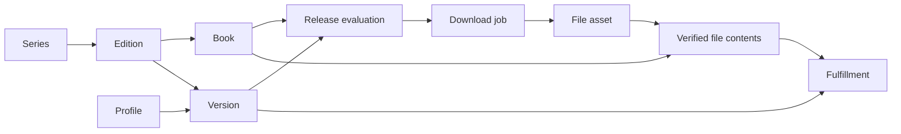

# Editions, books, collected versions, and files

Sento distinguishes what a book **is**, which releases you want to **keep**, and which files you actually **have**. An English omnibus, a French standard volume, and two release groups' copies of an English digital volume are different cases.

| Entity | Meaning | Identity |
| --- | --- | --- |
| Series | The manga represented in your library | Local series ID; MangaBaka reference |
| Collection / edition | A publication run: language, publisher, medium, independent traits, and content variant | Local collection ID |
| Book | A volume, chapter, extra, special, or revision within an edition | Stable local book ID |
| Collected version | An independently collected set of releases of one edition | Version ID |
| Profile | Reusable release eligibility, scoring, and upgrade policy | Profile ID |
| Queue item | A provider download with a frozen coverage plan and decision snapshot | Queue ID; provider and offer key |
| File / asset | One physical archive with observed facts and a content hash | File ID and path; SHA-256 identifies bytes |
| File contents | Confirmed books inside an archive, independent of collection rules | File ID + work ID |
| Fulfillment | Whether a present, verified asset meets a version’s current rules | Derived; explicit selections and pins use file ID + version ID + work ID |

## Catalog identity and local editions

Names, numbers, dates, publishers, and ISBNs are facts, not primary keys. Refresh resolves known MangaBaka references and aliases first. Exact descriptors are fallback evidence only when one already-linked row matches. Ambiguity creates a separate catalog row rather than guessing.

Existing work rows act as **stable collection memberships**. A MangaBaka work can belong to several collections: each membership retains its own local ID, and `external_refs` records the shared upstream work reference. This preserves installed library IDs and allows edition-specific numbering and overrides without conflating ownership. Sento does not automatically treat shared external IDs as equivalent file coverage.

A local edition remains local when similar catalog data appears. **Link to catalog** shows book matches before attaching references. The local edition, IDs, files, versions, and field overrides survive. Unmatched local books remain. The unused catalog row is retained as `superseded`, and verified source mappings move to the linked edition. Linking refuses pending downloads, existing catalog ownership, and additional catalog versions that need separate review.

Metadata edits override only changed fields. Other fields continue receiving catalog updates. **Use catalog values** clears overrides and refreshes metadata. Edition traits (`standard`, `omnibus`, `boxset`, `deluxe`) can combine: a deluxe omnibus and a box of standard books are valid. Standard and omnibus numbering are mutually exclusive. An empty trait list is unspecified. Content variant is `unknown`, `original`, or `colored`. A generic name does not establish standard/original identity. Traits and variant are separate from the editable display name.

A disappeared catalog entry becomes `stale`; its identity and files are retained. A retired linked book is retained so the next refresh cannot silently recreate it. A stale parent edition suspends automatic acquisition even when its books are still linked. Continue locally explicitly detaches the upstream references while preserving books, files, and collection preferences. Stale and retired books are excluded from automatic acquisition.

## Numbers and chapter discovery

Volumes and chapters are collected independently: a release or a file is one kind or the other, never both (`ledgerOf`). Only volume numbers make a volume and only chapter numbers make chapters; with both, a single chapter ("Vol.5 Ch.34") is a chapter that notes its volume, and several chapters ("v01 c001-008") are a volume that lists what is inside it. A volume is never used to fill chapters, or the reverse.

A book has a display label and an optional number. Numbers use integer hundredths: volume 0 is `0`, chapter 12.5 is `1250`. `number_known` distinguishes actual zero from an unnumbered special. Main, extra, and other books can share a number without sharing ownership.

New local chapter editions start with **explicit books**. Numbering modes are:

- `manual`: add individual books or accept source observations.
- `catalog`: use published MangaBaka memberships.
- `series_count`: explicitly infer consecutive chapters from the series chapter count. The default chapter edition uses this mode. Inference is capped at 10,000 books and records `inferred` provenance. Counts are not proof that numbering has no gaps.

Source discovery is opt-in per chapter edition and requires a verified source listing → edition mapping. Individual source observations enter review. Search records at most 100 new observations per source batch; accepting an observation adds one book, never every intervening integer. A verified active binding can be trusted to accept compatible individual chapter observations automatically; changing its edition clears that trust. Source maxima never generate intervening chapters. Accepted chapters become available on the next evaluation.

## Collected versions and profiles

Every edition has one implicit default version. Its selector is hidden until there are additional versions. Only collected versions persist collection intent; collection-level monitoring and cutoff in API responses are projections. Additional versions share its books and carry independent monitoring, per-book intent, required release group, profile assignment, chapter cutoff, and handling of unknown language/dates. Include extras enables bonus/other books; individual overrides can select them separately. “Skip through chapter N” means number > N. Chapter zero remains selectable with an override.

Profile inheritance is **version → edition → series → instance default**. An unset profile follows its parent; selecting a profile creates an explicit assignment. Profile deletion checks version assignments too.

Availability is `released`, `upcoming`, or `unknown`. Missing dates stay unknown. The version decides whether unknown-date books may be searched. Actual volume 0 never means “search the whole edition”; a search names a collected version, plus `bookId` for one book or `all` for the whole version. A book's identity everywhere — wanted, reserved, grabbed, owned — is its id within a collected version, never its displayed number.

Whether a release belongs to an edition is decided by one table of **facets** (`internal/service/edition_fit.go`). A *content* facet changes what is on the pages (omnibus, deluxe, coloured): release and edition must agree, and a mismatch is a hard rejection. A *packaging* facet changes only how the same pages are wrapped or produced (box set, digital rip, print scan): it never excludes a release and only breaks ties between editions of the same language that are both collected. A new trait is a new row of that table, of one kind or the other.

A catalog box set is a single item with one ISBN, while releases are named after the books inside. **This is a box of several volumes** (book menu) adds volumes 1..N carrying the box's ISBN and date and moves the box out of the main run so it is no longer collected. A torrent named for the series with no number at all is treated as an inferred whole-edition pack (`rejected.pack_unverified`, soft): reviewable, never grabbed automatically, and checked against its actual contents at import. Only collected editions compete for a release. A release that still fits several of them is `rejected.edition_ambiguous`: never grabbed automatically, downloadable after review from the edition the user searched. A name that states no language takes it from the indexer section it is filed under ("English-translated", "Raw"), then an English-only publisher's tag, then the indexer's default language setting. Torrent searches are restricted to the Books category and use the normalised title. A verified source listing can establish publication identity, while contradictory explicit language or edition tags still reject the release. Required groups and strict unknown-language policy are hard gates.

Upgrades are off by default. When enabled, Sento evaluates stored file facts against the **current** profile, requires the configured score improvement, and stops at the cutoff score (`0` means no cutoff). Pins prevent automatic upgrades. Historical files without trustworthy facts are not automatically upgraded. Earlier copies are retained; there is no automatic deletion or chapter-to-volume replacement.

The ledger is computed from books, monitoring intent, eligible coverage, file presence, pending jobs, availability, and optional upgrades. The Editions view manages both volumes and chapters, using the same model.

## Downloads and imports

Several torrent download clients can be configured (Connections), the default one first. Each torrent indexer may name the client its releases go to — a private tracker that must download through the VPN client, say; indexers that name none use the default. An indexer whose client no longer exists refuses to grab instead of falling back, and is reported on System → Health. The queue stores only the torrent's hash, so status and import look the download up in every client.

Acquisition reserves version/book pairs transactionally before contacting the provider. A second evaluation of the same active provider offer within a series attaches its coverage to the existing job instead of starting another transfer. Other offers cannot reserve the same pending book. Only terminal failure, completion, or cancellation releases reservations. Nonterminal `needs_review`, `retry_wait`, and `dispatch_unknown` retain them. The importer freezes and rereads the combined plan before importing.

Queue snapshots retain the parsed release, covered memberships, rejection/score details, profile, custom-format definitions, edition, and version settings. They explain the decision without relying on today's settings.

Every import is post-processed into a self-contained book when **Embed metadata** is on (the default): a clean CBZ (zip/cbz and rar/cbr accepted) with pages byte-for-byte as downloaded, a wrapping folder flattened, OS junk dropped, and a full `ComicInfo.xml` — series, number, volume, title, summary, dates, credits, publisher, genres, tags, language, reading direction, age rating, ISBN, release group, and a notes line (`sento:v1 mangabaka:… edition:… work:… release:…`) that re-identifies the file without the database. An existing ComicInfo is merged (Sento wins on fields it knows, unmodelled elements are kept) and preserved once as `ComicInfo.orig.xml`. Torrent payloads are copied, never modified, so they keep seeding; with embedding off they are hardlinked untouched.

A book's identity is its **content fingerprint**: the SHA-256 of the sorted SHA-256s of its page images. Container, names, order and ComicInfo do not enter it, so a payload and its processed copy are the same asset and re-tagging never changes identity. Non-archives fall back to a byte hash.

**Organize files** (series → Files) previews and applies what the current settings would change in existing files: move and rename to the templated path, and rewrite embedded metadata where the merge would change it. Fingerprints, coverage and pins are unaffected; emptied folders are removed; a seeding payload hardlinked to an old library file is never modified.

A series has a folder for its volumes (`series.path`) and, when chapters are kept apart, one for its chapters (`series.chapter_path`). Optional top folders per type (`volumesRoot`, `chaptersRoot`) put the type above the series: `Volumes/<series>/…` and `Chapters/<series>/…`; equal values (both empty by default) keep one folder per series. A series keeps its own folder name when re-rooted, and one adopted from outside the library root is never moved. Scans cover both folders, and storage availability is judged per folder, so an unreachable chapter tree does not block volumes. The `{type}` token puts the split inside the series instead (`<series>/Volumes/…`).

Folder layout inside a series folder is a template (`bookFolder`): by edition (`Standard Edition [en]`, the default, with `(version)` for additional copies), flat, by internal id (`collections/42/versions/81`), or custom. The fingerprint enters a file name only when configured or when a different book already holds the path.

Installation does not overwrite an occupied path with different bytes. Existing library paths are preserved. A pack stays **one archive** with several coverage links. Identical bytes from one job may satisfy several confirmed versions through the same asset. Different releases remain separate assets.

Scans consider paused editions too, check parsed language and edition evidence, and leave ambiguous archives for review. Unmatched downloaded archives are retained in the review area. Partial imports record verified files and hold the job in `needs_review` until unresolved coverage is reviewed. Retrying a fully reviewed payload completes from its recorded files without fetching it again. Partial retries preserve already confirmed bytes and mappings.

File review can map an archive to several books and versions. Editing one version's mappings preserves the others. Clearing coverage keeps the file without claiming ownership. Coverage pins survive edits to retained mappings. Removing a version preserves intrinsic content knowledge and files; deleting a pinned file requires unpinning first. Duplicate-edition merges require unique book matches and preserve version policies, pins, coverage, and paths. Pending downloads block destructive identity changes.

## Presence, file facts, and recovery

Scans and acquisition checks record `present`, `missing`, `unavailable`, or `unknown` presence. An unreadable/missing series root blocks automatic acquisition for the series; a missing archive under a healthy root remains wanted. Page reads do not probe the filesystem or initialize models. Review provides an explicit recheck action.

Offer claims and per-file observed facts are stored separately. Filename observations take precedence over advertised language/group/quality; stream imports retain offer evidence. The file editor supports manual language/group corrections with provenance. Retrying or scanning identical bytes preserves manual corrections and content confirmation. Group contradictions remain visible for review.

Transient client errors back off from 30 seconds up to 32 minutes. If dispatch succeeded but saving its handle was interrupted, reconciliation checks the stable provider key without submitting again. Unresolved dispatch after ten minutes enters review, where a user can attach the client ID or cancel the reservation. Cancelling leaves remote downloads and files intact; an active import must finish before cancellation. Pending plans and edition identity edits use a common transactional parent lock.

## Screens and evaluation

Your editions contains selected editions, local publications, and editions with files. Other editions is a collapsed catalog chooser. Additional copies and metadata operations live in the edition action menu. The profile summary explains inheritance. Book lists load every book of a version at once: state counts double as filters, long editions open as a colour-coded grid (a dense list is the alternative view), and monitoring actions apply to a filter, a number range, or a selection. The series page has one tab row: Editions, Files, Review, Indexers, History. Review combines files, jobs, and chapter observations and shows a count when something is waiting; file mappings are edited from Files; source edition mappings sit under Indexers.

The shared ledger batches works, overrides, facts, coverage, profiles, and pending work per series. It computes a complete consistent series view per request; the book list is returned whole and filtered in the browser. A book on disk can be unsatisfactory for a particular copy without disappearing from the library. New versions reuse qualifying verified files. Series totals count unique books on disk and wanted copies separately.

## Migration and compatibility

Migration 14 intentionally resets the old library and its downloads, file mappings, bindings, and decision history. Connections, profiles, custom formats, application settings, and physical files remain. Add series again after upgrading and review existing files before counting them as owned.

Migration 15 preserves the current library. It backfills intrinsic asset contents from confirmed coverage, moves collection intent entirely to versions, and adds cached presence, review/retry states, and independent edition traits. Existing file presence starts unknown and is checked during scan, search, or explicit review recheck.

Canonical ownership uses version and work IDs. The old number-based ownership tables and queued-plan adapters are removed. Migrations remain transactional on SQLite and PostgreSQL.

Deliberate limits: upgrades retain earlier copies; completed downloads are not automatically reused across unrelated editions or series. Explicit file mapping can share confirmed assets. A comprehensive story/chapter ontology and destructive retention rules remain separate future features.

Calendar entries use the same version/book ownership as the ledger, including per-version monitoring and actual file presence. Language, medium, trait, or content corrections invalidate affected coverage for review. Manual file mapping records explicit confirmation of edition coverage; release-group requirements still apply. A generic catalog rename preserves known traits instead of assuming standard volumes.
