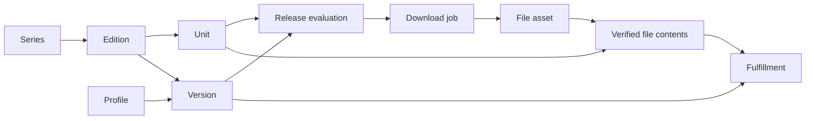

# Editions, units, collected versions, and files

Sento distinguishes what a book **is**, which releases you want to **keep**, and which files you actually **have**. An English omnibus, a French standard volume, and two release groups' copies of an English digital volume are different cases.

| Entity | Meaning | Identity |
| --- | --- | --- |
| Series | The manga represented in your library | Local series ID; MangaBaka reference |
| Collection / edition | A publication run: language, publisher, medium, independent traits, and content variant | Local collection ID |
| Work / unit | A volume, chapter, extra, special, or revision within an edition | Stable local work ID |
| Download target / collected version | An independently collected set of releases of one edition | Target ID |
| Profile | Reusable release eligibility, scoring, and upgrade policy | Profile ID |
| Queue item | A provider download with a frozen coverage plan and decision snapshot | Queue ID; provider and offer key |
| File / asset | One physical archive with observed facts and a content hash | File ID and path; SHA-256 identifies bytes |
| File contents | Confirmed books inside an archive, independent of collection rules | File ID + work ID |
| Fulfillment | Whether a present, verified asset meets a version’s current rules | Derived; explicit selections and pins use file ID + target ID + work ID |

## Catalog identity and local editions

Names, numbers, dates, publishers, and ISBNs are facts, not primary keys. Refresh resolves known MangaBaka references and aliases first. Exact descriptors are fallback evidence only when one already-linked row matches. Ambiguity creates a separate catalog row rather than guessing.

Existing work rows act as **stable collection memberships**. A MangaBaka work can belong to several collections: each membership retains its own local ID, and `external_refs` records the shared upstream work reference. This preserves installed library IDs and allows edition-specific numbering and overrides without conflating ownership. Sento does not automatically treat shared external IDs as equivalent file coverage.

A local edition remains local when similar catalog data appears. **Link to catalog** shows unit matches before attaching references. The local edition, IDs, files, versions, and field overrides survive. Unmatched local units remain. The unused catalog row is retained as `superseded`, and verified source mappings move to the linked edition. Linking refuses pending downloads, existing catalog ownership, and additional catalog versions that need separate review.

Metadata edits override only changed fields. Other fields continue receiving catalog updates. **Use catalog values** clears overrides and refreshes metadata. Edition traits (`standard`, `omnibus`, `boxset`, `deluxe`) can combine: a deluxe omnibus and a box of standard books are valid. Standard and omnibus numbering are mutually exclusive. An empty trait list is unspecified. Content variant is `unknown`, `original`, or `colored`. A generic name does not establish standard/original identity. Traits and variant are separate from the editable display name.

A disappeared catalog entry becomes `stale`; its identity and files are retained. A retired linked unit is retained so the next refresh cannot silently recreate it. A stale parent edition suspends automatic acquisition even when its books are still linked. Continue locally explicitly detaches the upstream references while preserving books, files, and collection preferences. Stale and retired books are excluded from automatic acquisition.

## Numbers and chapter discovery

A unit has a display label and an optional number. Numbers use integer hundredths: volume 0 is `0`, chapter 12.5 is `1250`. `number_known` distinguishes actual zero from an unnumbered special. Main, extra, and other units can share a number without sharing ownership.

New local chapter editions start with **explicit units**. Numbering modes are:

- `manual`: add individual units or accept source observations.
- `catalog`: use published MangaBaka memberships.
- `series_count`: explicitly infer consecutive chapters from the series chapter count. The default chapter edition uses this mode. Inference is capped at 10,000 units and records `inferred` provenance. Counts are not proof that numbering has no gaps.

Source discovery is opt-in per chapter edition and requires a verified source listing → edition mapping. Individual source observations enter review. Search records at most 100 new observations per source batch; accepting an observation adds one unit, never every intervening integer. A verified active binding can be trusted to accept compatible individual chapter observations automatically; changing its edition clears that trust. Source maxima never generate intervening chapters. Accepted chapters become available on the next evaluation.

Content relationships record `contains`, `equivalent`, and `revision`, for example omnibus 1 containing standard volumes 1–3. Relationships document known content; they never imply ownership of another edition or language. Containment and revision cycles are refused.

## Collected versions and profiles

Every edition has one implicit default version. Its selector is hidden until there are additional copies. Only download targets persist collection intent; collection-level monitoring and cutoff in API responses are projections. Additional versions share its units and carry independent monitoring, per-unit intent, required release group, profile assignment, chapter cutoff, and handling of unknown language/dates. Include extras enables bonus/other books; individual overrides can select them separately. “Skip through chapter N” means number > N. Chapter zero remains selectable with an override.

Profile inheritance is **version → edition → series → instance default**. An unset profile follows its parent; selecting a profile creates an explicit assignment. Profile deletion checks version assignments too.

Availability is `released`, `upcoming`, or `unknown`. Missing dates stay unknown. The version decides whether unknown-date units may be searched. Actual volume 0 never means “search the whole edition”; new requests use `workId` for a unit and `all` for an edition-wide search. Older number-only requests remain supported when unambiguous.

Releases must match the edition's language, known traits, and content variant. Explicit digital/scan evidence helps distinguish publication media. Ambiguous matches require review. Selecting a target is not edition evidence. A verified source listing can establish publication identity, while contradictory explicit language or edition tags still reject the release. Required groups and strict unknown-language policy are hard gates.

Upgrades are off by default. When enabled, Sento evaluates stored file facts against the **current** profile, requires the configured score improvement, and stops at the cutoff score (`0` means no cutoff). Pins prevent automatic upgrades. Historical files without trustworthy facts are not automatically upgraded. Earlier copies are retained; there is no automatic deletion or chapter-to-volume replacement.

The ledger is computed from units, monitoring intent, eligible coverage, file presence, pending jobs, availability, and optional upgrades. The Editions view manages both volumes and chapters, using the same model.

## Downloads and imports

Acquisition reserves target/work pairs transactionally before contacting the provider. A second evaluation of the same active provider offer within a series attaches its coverage to the existing job instead of starting another transfer. Other offers cannot reserve the same pending unit. Only terminal failure, completion, or cancellation releases reservations. Nonterminal `needs_review`, `retry_wait`, and `dispatch_unknown` retain them. The importer freezes and rereads the combined plan before importing.

Queue snapshots retain the parsed release, covered memberships, rejection/score details, profile, custom-format definitions, edition, and version settings. They explain the decision without relying on today's settings.

New paths contain stable collection/target IDs and the full content hash:

`Series/collections/42/versions/81/book [sha256].cbz`

Installation does not overwrite an occupied path with different bytes. Existing library paths are preserved. A pack stays **one archive** with several coverage links. Identical bytes from one job may satisfy several confirmed versions through the same asset. Different releases remain separate assets.

Scans consider paused editions too, check parsed language and edition evidence, and leave ambiguous archives for review. Unmatched downloaded archives are retained in the review area. Partial imports record verified files and hold the job in `needs_review` until unresolved coverage is reviewed. Retrying a fully reviewed payload completes from its recorded files without fetching it again. Partial retries preserve already confirmed bytes and mappings.

File review can map an archive to several units and versions. Editing one version's mappings preserves the others. Clearing coverage keeps the file without claiming ownership. Coverage pins survive edits to retained mappings. Removing a version preserves intrinsic content knowledge and files; deleting a pinned file requires unpinning first. Duplicate-edition merges require unique unit matches and preserve version policies, pins, coverage, and paths. Pending downloads block destructive identity changes.

## Presence, file facts, and recovery

Scans and acquisition checks record `present`, `missing`, `unavailable`, or `unknown` presence. An unreadable/missing series root blocks automatic acquisition for the series; a missing archive under a healthy root remains wanted. Page reads do not probe the filesystem or initialize models. Review provides an explicit recheck action.

Offer claims and per-file observed facts are stored separately. Filename observations take precedence over advertised language/group/quality; stream imports retain offer evidence. The file editor supports manual language/group corrections with provenance. Retrying or scanning identical bytes preserves manual corrections and content confirmation. Group contradictions remain visible for review.

Transient client errors back off from 30 seconds up to 32 minutes. If dispatch succeeded but saving its handle was interrupted, reconciliation checks the stable provider key without submitting again. Unresolved dispatch after ten minutes enters review, where a user can attach the client ID or cancel the reservation. Cancelling leaves remote downloads and files intact; an active import must finish before cancellation. Pending plans and edition identity edits use a common transactional parent lock.

## Screens and evaluation

Your editions contains selected editions, local publications, and editions with files. Other editions is a collapsed catalog chooser. Additional copies and metadata operations live in the edition action menu. The profile summary explains inheritance. Book lists have 25-item server pages, state filters, and per-page monitoring actions. The review inbox combines files, jobs, and chapter observations; source mappings and content relationships are advanced tools.

The shared ledger batches works, overrides, facts, coverage, profiles, and pending work per series. It computes a complete consistent series view before filtering/paging the response; pagination does not yet limit the SQL work set. A book on disk can be unsatisfactory for a particular copy without disappearing from the library. New versions reuse qualifying verified files. Series totals count unique books on disk and wanted copies separately.

## Migration and compatibility

Migration 14 intentionally resets the old library and its downloads, file mappings, bindings, and decision history. Connections, profiles, custom formats, application settings, and physical files remain. Add series again after upgrading and review existing files before counting them as owned.

Migration 15 preserves the current library. It backfills intrinsic asset contents from confirmed coverage, moves collection intent entirely to targets, and adds cached presence, review/retry states, and independent edition traits. Existing file presence starts unknown and is checked during scan, search, or explicit review recheck.

Canonical ownership uses target and work IDs. The old number-based ownership tables and queued-plan adapters are removed. Migrations remain transactional on SQLite and PostgreSQL.

Deliberate limits: relationships do not synthesize ownership; upgrades retain earlier copies; completed downloads are not automatically reused across unrelated editions or series. Explicit file mapping can share confirmed assets. A comprehensive story/chapter ontology and destructive retention rules remain separate future features.

Calendar entries use the same target/work ownership as the ledger, including per-version monitoring and actual file presence. Language, medium, trait, or content corrections invalidate affected coverage for review. Manual file mapping records explicit confirmation of edition coverage; release-group requirements still apply. A generic catalog rename preserves known traits instead of assuming standard volumes.
