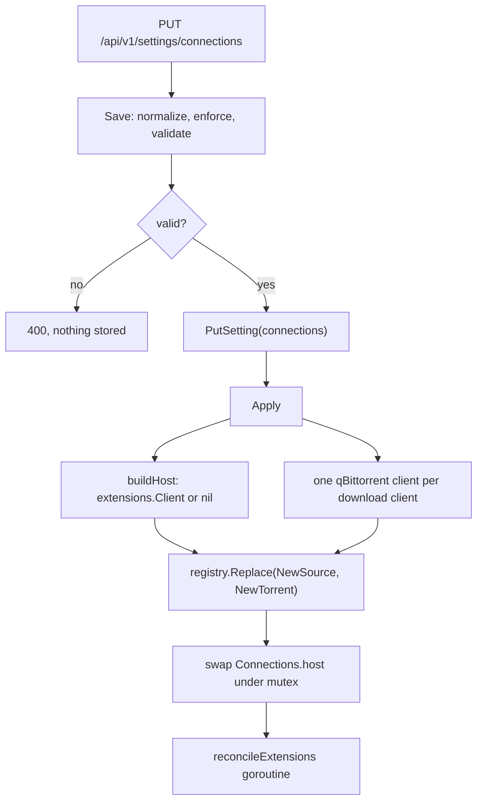
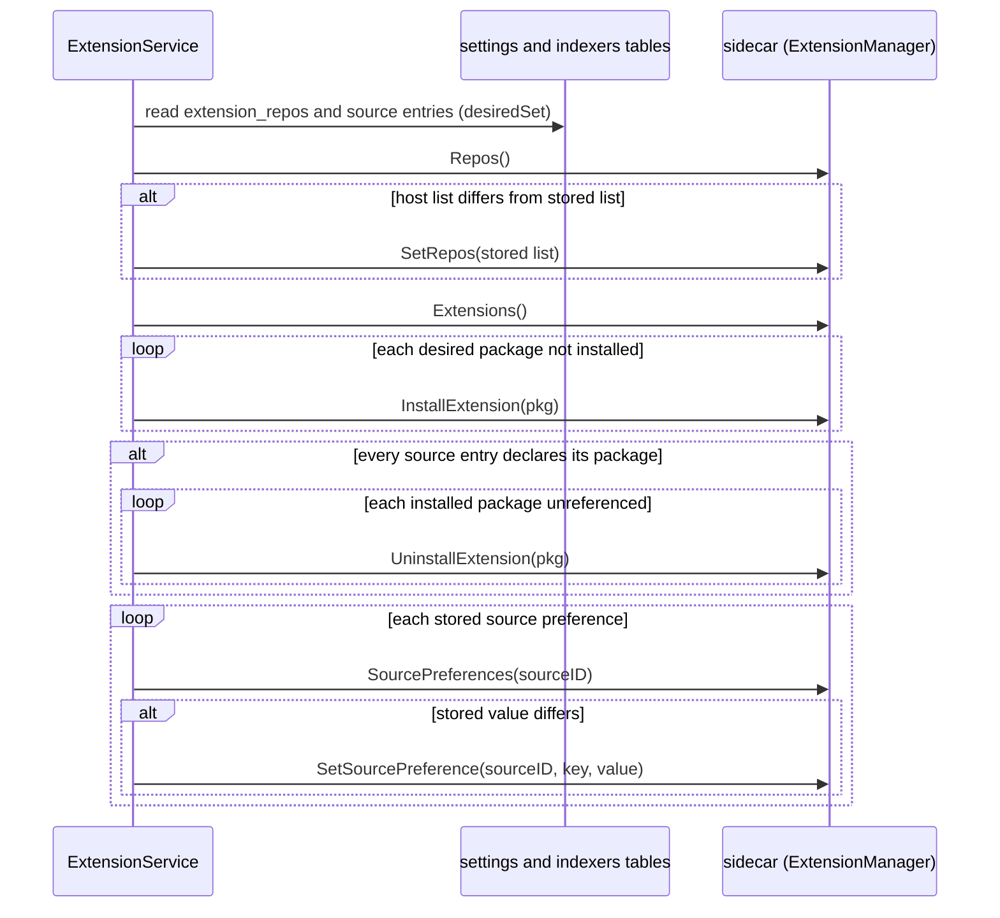

# Connections, indexers, extensions and health

Sento talks to its peripherals over plain HTTP: qBittorrent download clients,
an extensions sidecar that runs Tachiyomi/Mihon sources, an optional Prowlarr
for the add-indexer assist, and one Torznab endpoint per torrent indexer.
Connection settings live in the database and apply without a restart; a
health service probes everything configured and reports what is broken.

## In the code

| File or package | What it holds |
| --- | --- |
| `internal/service/connections.go` | `Connections`: settings load/save, `Apply`, `TestConnections`, legacy key migration |
| `internal/service/indexers.go` | entry settings (`TorznabSettings`, `SourceSettings`), `ValidateIndexer`, the Prowlarr browse assist |
| `internal/service/sites.go` | `SiteService`: Indexers views, live reachability, per-series overrides |
| `internal/service/extensions.go` | `ExtensionService`: the desired set, `Reconcile`, repos, source preferences |
| `internal/service/health.go` | `HealthService`: the checks, probe timeout, report caching and invalidation |
| `internal/store/indexers.go` | the `indexers` table accessors |
| `internal/extensions/` | the `Host` contract and the Go `Client` for the sidecar; the wire format is in [the sidecar contract](../extensions.md) |
| `internal/metadata/mangabaka/client.go` | the MangaBaka client: rate limits, retries, paging |
| `internal/server/api_settings.go`, `api_indexers.go` | the HTTP routes; the tables are in [api.md](../api.md) |

## Connection settings

Connection settings are the service endpoints Sento talks to. They live in
the `settings` table under the `connections` key, editable in the UI and
applied without restart. YAML/env values seed the first run only; once saved,
the stored values win. The full key/env list and the precedence diagram are
in [installation.md](../installation.md#configuration).

| Field | JSON key | Meaning |
| --- | --- | --- |
| `Prowlarr` | `prowlarr` | `{url, apiKey}`, remembered for the Add Indexer browse assist; not a search connection |
| `DownloadClients` | `downloadClients` | list of `{id, name, url, username, password, category}`; the first entry is the default; passwords are stored in the database |
| `Extensions` | `extensions` | `{url}` of the extensions sidecar; empty means no extension sources |
| `Managed` | `managed` | response-only flags for settings fixed by file/env; never stored |

Legacy migration on load: a sidecar URL saved before the rename under
`sourceHost` moves to `extensions.url`, and a single `qbittorrent` client
moves into `downloadClients` with id `default`.

`normalizeClients` prepares the download client list:

| Condition | Result |
| --- | --- |
| URL empty after trimming | the client is dropped |
| id empty or already used | `default`, then `client-2`, `client-3`, ... |
| name empty | `qBittorrent` |
| category empty | `sento` |

`ValidateConnections` requires every URL (Prowlarr, sidecar, each download
client) to start with `http://` or `https://`. `enforce` applies what the
deployment's configuration fixes: a sidecar URL from `SENTO_EXTENSIONS_URL`
always wins over the stored one, is reported as `managed.extensionsUrl`, and
is read-only in the UI.

Testing before saving: `POST /api/v1/settings/connections/test` runs
`TestConnections` against the posted, not yet saved, settings. One overall
15-second timeout, all probes in parallel, one
`ConnectionTest {service, ok, error, detail}` each. Download clients are
probed with a qBittorrent version call as `downloadClient:<id>`; the sidecar
with a sources call, the detail reporting the source count (`3 sources`,
`1 source`).

## Saving a connection: `Save` to the registry swap

Saving runs in this order:

1. `Save` normalizes the client list, applies enforcement, validates, then
   writes the settings document (`managed` stripped) to the `connections`
   key.
2. `Apply` builds the new live objects: `buildHost` returns an
   `extensions.Client` for the sidecar URL (nil when empty), and one
   qBittorrent client per download client.
3. `Apply` calls `registry.Replace(provider.NewSource(...), provider.NewTorrent(...))`.
   The source provider gets the host, the downloads staging dir, the page
   fetch tuning and a live accessor for `source` entries; the torrent
   provider gets the Torznab entries and the client list. Nil providers are
   skipped.
4. The registry pointer never changes, so the search, import and sites
   services follow the swap transparently; `Connections.host` is swapped
   under the mutex.
5. In-flight source downloads lose their job entries on a swap; the queue
   importer's `State` poll restarts them against the new backend.

This diagram shows the path from the save request to the swapped registry:

Any non-GET write under `/api/v1/indexers`, `/api/v1/settings/connections` or
`/api/v1/extensions` also invalidates the cached health report, so the next
health read re-runs the checks. Saving connections kicks the extension
reconcile (below) directly.

## Indexer entries

Each indexer entry is one explicitly configured searchable endpoint: a
Torznab URL or an extension source on the sidecar. The row holds:

| Column | Meaning |
| --- | --- |
| `id` | numeric id; source entries are referenced by its string form |
| `name` | the display name everywhere (candidates, history, queue) |
| `protocol` | `torznab` or `source`; immutable on update |
| `enabled`, `use_volumes`, `use_chapters`, `priority` | search behavior switches |
| `settings_json` | the protocol-specific document below |

The two settings documents:

| Document | Field | Meaning |
| --- | --- | --- |
| `TorznabSettings` | `url`, `apiKey` | the indexer's Torznab endpoint and key |
| `TorznabSettings` | `language` | lowercased; releases without a stated language take it (`fr` for a French tracker); empty = mixed |
| `TorznabSettings` | `downloadClient` | id of the download client its releases go to; empty = the default client |
| `SourceSettings` | `sourceId` | the host-minted source id; required |
| `SourceSettings` | `pkgName` | the owning extension; the entry is what makes the extension wanted |

Validation rules (`ValidateIndexer`): a name is required; a Torznab URL must
start with `http://`/`https://`; `language` must match
`^[A-Za-z]{2,3}(-[A-Za-z]{2,4})?$` (examples: `en`, `fr`, `pt-BR`); a source
entry must select a source; the protocol must be `torznab` or `source`.
`Update` keeps the existing protocol; `Patch` only flips
enabled/useVolumes/useChapters/priority and does not re-validate.

The Prowlarr browse assist (`BrowseProwlarr`) lists a Prowlarr's enabled
indexers as ready-to-add Torznab URLs `{base}/{id}/api` and remembers the
entered URL and key in the connection settings for next time. Prowlarr is not
a search connection: torrent search queries each indexer's own Torznab
endpoint (see [acquisition](acquisition.md)).

Reachability is live: the providers answer `Sites`, and a source entry
reports disabled when its extension is not installed on the host. Entries
are read live at search time, so edits apply without rewiring. Per-series
overrides are merged on top by `store.EffectiveIndexer`; the routes are in
[api.md](../api.md#indexers-and-extension-sources). Deleting a source entry
garbage-collects its extension when no other entry references the package
(`DeleteIndexerEntry` → `CleanupExtension`).

### Empty indexer searches

A successful connection test checks that the indexer answers, not that its
feed contains manga. On **Indexers**, use **Test search** with a title you
know the tracker has. Sento shows the Books result count, sample titles and
their categories. An empty Books query also runs an unrestricted comparison.

If the unrestricted samples are films or anime, check the tracker's own
category setting in Prowlarr or Jackett. Some definitions fetch a fixed
category and apply the requested Books filter only after the site's result
limit. For Prowlarr's Nyaa definition, create a separate instance with
**Category → Literature - English-translated** and use that instance's
Torznab URL in Sento. Give it a separate tag if the existing instance also
serves Sonarr or Radarr; each application's tags determine which indexers
Prowlarr syncs to it. See [Prowlarr's settings guide](https://wiki.servarr.com/prowlarr/settings).

## Extension lifecycle

Sento owns the desired extension list; the sidecar is stateless. The desired
set is the `pkgName` of every `source` indexer entry. Installing through the
UI records nothing extra: the entry is what makes the extension wanted, and
deleting the last referencing entry uninstalls it.

`Reconcile` converges the host onto the entries:

1. `reconcileRepos` pushes the stored repo list when the host's list differs;
   with a managed list, the managed list is the whole list, so host extras
   go too.
2. `desiredSet` collects the entry-referenced packages, plus whether every
   source entry declares its package (garbage-collection safety).
3. After listing the host's extensions, every desired package that is not
   installed is installed.
4. Installed but unreferenced packages are uninstalled only when every
   source entry declares its package; otherwise an unbackfilled entry's
   extension would be torn down.
5. `reconcilePrefs` replays stored source preferences whose values differ
   from the host's current ones (compared structurally with `jsonEqual`).

This sequence shows one `Reconcile` run against the sidecar:

Reconcile runs at server startup, after every connection save, and from the
`extension-sync` task every 30 minutes. At startup it runs in a goroutine
with retries: first wait 5 seconds, doubling to at most 1 minute, inside a
10-minute budget, because the sidecar starts beside Sento and is often not
up yet. The current loops are listed in
[architecture.md](../architecture.md#background-tasks).

Repos are stored under the `extension_repos` key as `{"urls": [...]}`. When
`SENTO_EXTENSIONS_REPOS` is set in the deployment configuration the list is
managed: `SetRepos` refuses and the config list wins. Otherwise `SetRepos`
trims, drops empties, requires an `http(s)://` prefix, dedupes, pushes to
the host first, and only then stores. `RepoStatus` pairs every stored URL
with what the host currently gets from it: the repo's own name and usable
extension count, or the error (including "not loaded on the host yet" and
host-unreachable reasons).

Source preferences are stored under `source_prefs` as
`{sourceID: {key: JSON value}}`. `SetPreference` pushes the value to the
host first and records it only on success, so reconciliation replays values
onto fresh hosts.

## Health checks

The routes are in [api.md](../api.md#health-checks). `HealthService` keeps
the last report; reads serve it until it is invalidated or re-run. All
remote probes run in parallel, each bounded by a 10-second timeout
(`probeTimeout`), and the issues are sorted errors first. Failures of
background tasks are merged into the report live, not cached.

| Source | Level | Raised when |
| --- | --- | --- |
| `library` | error | the library path is unreadable, not a folder, or rejects a temp file (a missing folder is fine: it is created on the first import) |
| `indexer` | warning | no indexers are enabled at all |
| `download-client` | warning | torrent indexers exist but no download client is configured |
| `download-client` | error | a download client fails its ping |
| `indexer` | error | a torrent indexer names a download client that no longer exists |
| `extensions` | warning | source indexers exist but no sidecar is configured |
| `extensions` | error | the sidecar does not answer a sources call |
| `indexer` | error | an enabled source entry's source is missing on the host, or an enabled Torznab entry fails its ping |

Remote-probe issues carry the UI route where they are fixed (`/connections`,
`/indexers`); the `library` issues are raised with no `Link` at all. The
`health-check` task runs `Check` every 15 minutes.

## The MangaBaka client: retries and paging

Sento's metadata provider, contained in `internal/metadata/mangabaka`. The
base URL is `https://api.mangabaka.org/v1` unless `SENTO_MANGABAKA_BASE_URL`
says otherwise (see [installation.md](../installation.md#configuration)).
One shared HTTP client with a 30-second timeout sends
`User-Agent: sento (github.com/h-wb/sento)`; response bodies are capped at
32 MiB.

Client-side rate limiters keep Sento under the documented API budgets
(search 30/min, lookup 120/min):

| Limiter | Rate | Burst | Covers |
| --- | --- | --- | --- |
| `searchLimit` | 1 request per 2 s | 5 | `GET /series/search` |
| `lookupLimit` | 1 request per 500 ms | 10 | series, collections, works, editions |

One request is tried at most 4 times (`maxAttempts`), and only on 429, 502,
503 or 504. The wait honors the response's `Retry-After` header when present,
otherwise doubles from 1 s (1 s, 2 s, 4 s); each single wait is capped at 30
seconds (`maxRetryWait`).

| Endpoint | Used for |
| --- | --- |
| `GET /series/search?q=` | the add-series flow |
| `GET /series/{id}` | refresh; follows `merged_with` up to 5 hops (`maxMergeHops`) |
| `GET /series/{id}/collections` | editions (paginated) |
| `GET /series/{id}/works` | volume slots (paginated) |
| `GET /editions/all?limit=50` | the edition list (paginated) |

Paging: `eachPage` follows `pagination.next` until it is absent; a repeated
page URL is an error ("catalog pagination repeats a page"). Every response's
raw JSON is cached per record with schema version 1 (`SchemaVersion`), so a
future adapter version can re-derive columns from the cache.

## Settings keys stored in the database

The full table of settings keys is in
[installation.md](../installation.md#settings-stored-in-the-database). The
keys this page owns:

| Key | Shape | Written by |
| --- | --- | --- |
| `connections` | `ConnectionSettings` JSON; legacy `sourceHost`/`qbittorrent` keys migrated on load | `Connections.Save` |
| `extension_repos` | `{"urls": [...]}` | `ExtensionService.SetRepos` |
| `source_prefs` | `{sourceID: {key: JSON value}}` | `ExtensionService.SetPreference` |

