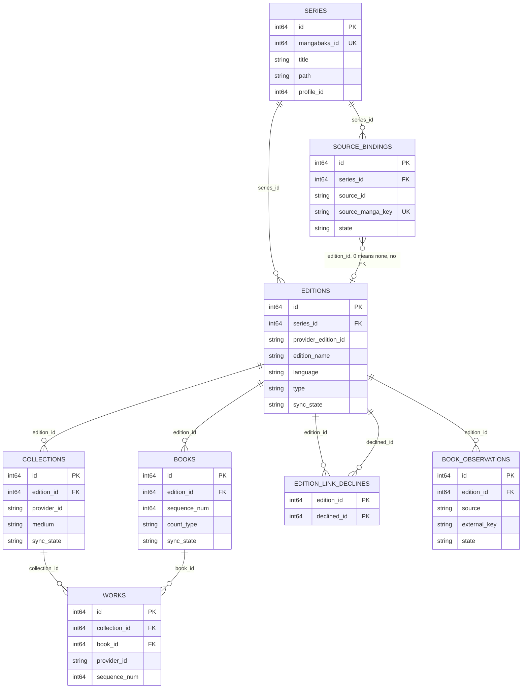
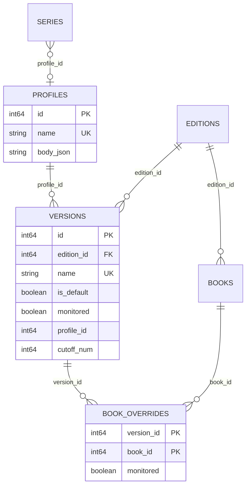
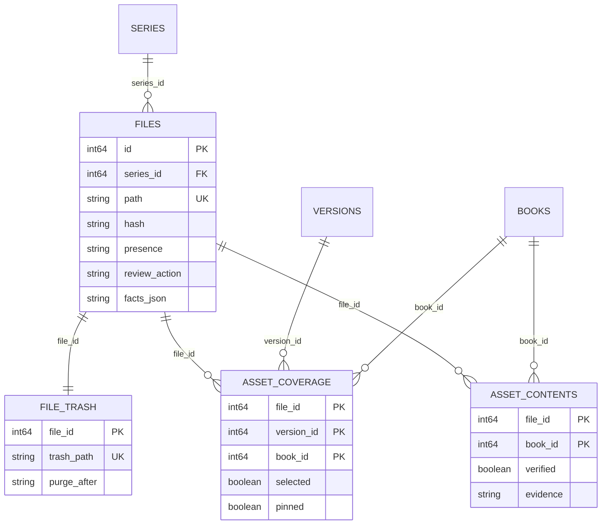
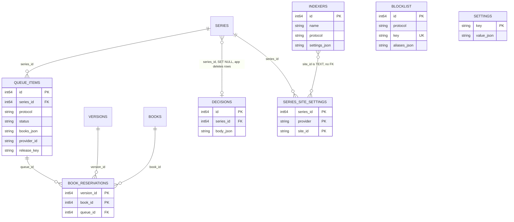
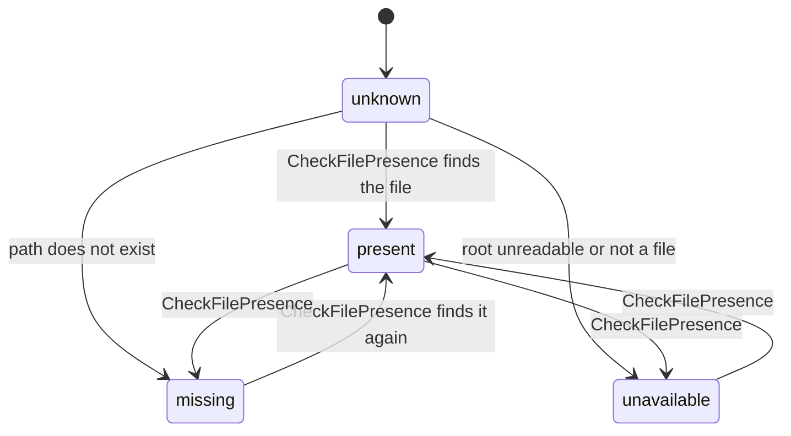
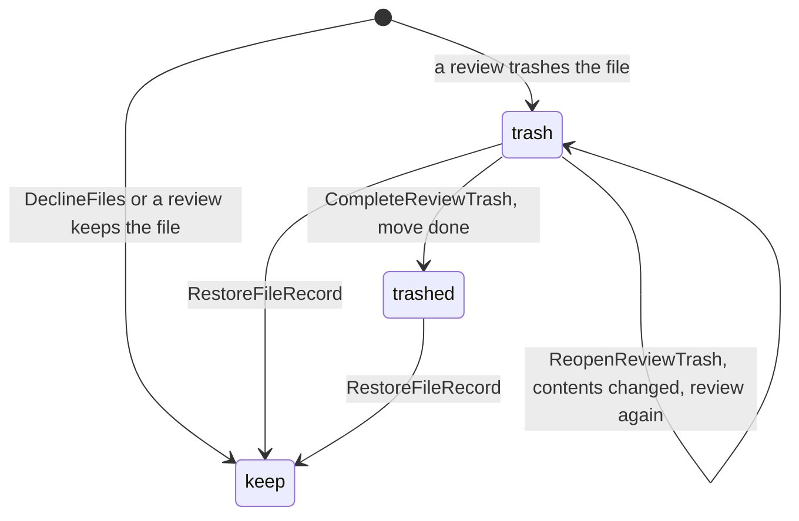
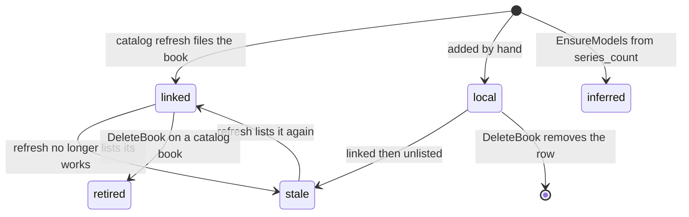

# Data model and persistence

Everything Sento remembers lives in one relational database, SQLite by
default or PostgreSQL when `SENTO_DB_URL` is set. The schema is derived
from the embedded migrations in `internal/db/migrations/` and mirrored in
the structs of `internal/store`; this page is the reference for both. The
operational side (opening, migrating, locking, writing new migrations) is
in [Architecture: Persistence](../architecture.md#persistence).

## In the code

| File or package | What it holds |
| --- | --- |
| `internal/db/db.go` | `Open` picks the dialect, runs the migration loop, records `schema_migrations` |
| `internal/db/migrations/sqlite/` | migrations 0001–0035, SQLite dialect |
| `internal/db/migrations/postgres/` | migration 0013 (baseline) and 0014–0035, PostgreSQL dialect |
| `internal/db/dbtest/` | per-test databases; isolated PostgreSQL schema per test when `SENTO_TEST_DB_URL` is set |
| `internal/store/store.go` | `Store`, dialect flag, `q` placeholder rebinding, `utcNow`, `insert` (RETURNING), `conflict` |
| `internal/store/query.go`, `tx.go` | scany row mapping (`list`/`get`/`listQ`/`getQ`), `touch`, `inTx` |
| `internal/store/series.go`, `editions.go`, `catalog_sync.go`, `books.go` | library and catalog tables |
| `internal/store/versions.go`, `book_overrides.go`, `profiles.go` | collecting tables |
| `internal/store/files.go`, `coverage.go`, `facts.go`, `presence.go`, `file_trash.go`, `file_review.go`, `review.go` | file tables, review commits |
| `internal/store/queue.go`, `progress.go`, `blocklist.go`, `history.go`, `bindings.go` | acquisition tables |
| `internal/store/settings.go`, `library_root.go`, `sites.go`, `indexers.go`, `profile_migration.go` | settings, indexers, startup data migrations |

## How the schema is defined

The final schema is the sum of the migration files, applied in filename
order. Each file runs in one transaction and is recorded in
`schema_migrations(version, applied_at)`; only files with a version above
`MAX(version)` are applied, so a shipped file is never re-run and never
edited. PostgreSQL starts at a consolidated baseline, `postgres/0013_init.sql`,
which carries the schema as of SQLite 0013; from 0014 on, every migration
exists in both dialect directories under the same number. Version numbers
mean the same schema state in both dialects. The header comment of
`sqlite/0001_init.sql` cites `specs/data-api.md`, which does not exist; the
file has shipped, so it is left as is and the schema reference is this
page.

## Entity relationships

The model splits into four areas. Each diagram below shows one area; the
tables with every column follow.

This diagram shows the library and its mirror of the MangaBaka catalog:
a series holds editions, an edition groups catalog collections, a
collection holds works, and a book gathers the works that share a number.

This diagram shows what is collected: each edition has collected versions
(copies), each version can override a book's monitoring, and profiles are
chosen on a series or a version.

This diagram shows the files: a file holds verified contents (books) and,
per collected version, a selection with optional pins; trash journals a
move before it touches disk.

This diagram shows acquisition and configuration: queue items with their
reservations, the blocklist, history, and the settings, indexers and
per-series indexer overrides.

## Tables

Column types are the SQLite ones; [the dialect differences](../architecture.md#persistence)
list where PostgreSQL differs. "Hundredths" means integer hundredths of a
book number: volume 0 is `0`, chapter 12.5 is `1250`. Timestamps are TEXT
in UTC, `YYYY-MM-DD HH:MM:SS`, written by the app.

### Library and catalog

| Table | Purpose | Columns that matter | Keys and relations |
| --- | --- | --- | --- |
| `series` | one library entry with its MangaBaka metadata | `mangabaka_id` UNIQUE; `title`, `sort_title`, `type`, `status`, `year`, `total_chapters`, `final_volume`; `monitored`; `path`, `chapter_path`; `profile_id` (NULL = instance default); `raw_json`; `added_at`, `refreshed_at` | PK `id`; `profile_id` → `profiles` |
| `editions` | what is collected: one catalog edition of a series (language, type) or a local one | `provider_edition_id`, `provider_edition_name`, `edition_name`, `language`, `publisher`, `medium`; `type` volume or chapter; `custom`; `split`; `sync_state` local, linked or stale; `numbering_source` manual, catalog or series_count; `count_main/extra/other`, `start_date`, `end_date`; `generated_bound`; `overrides_json`; `reader_fields_json` | PK `id`; `series_id` → `series` ON DELETE CASCADE; `profile_id` → `profiles` (legacy); index (`series_id`, `provider_edition_id`); no UNIQUE on identity since 0014 |
| `collections` | the catalog mirror: one product line of an edition | `provider_id` (MangaBaka collection id), `publisher`, `medium`, `format`, `status`, `related_collection_id`, counts, dates, `raw_json`; `sync_state` linked or stale | PK `id`; `edition_id` → `editions` ON DELETE CASCADE; indexes (`edition_id`), (`provider_id`) |
| `works` | the catalog mirror: one copy of a book in one collection | `provider_id` (MangaBaka work id), `sequence_num`, `sequence_string`, `number_known`, `count_type`, `release_date`, `isbn`, `pages`, `sub_title`, `revision`, `raw_json`; `sync_state` | PK `id`; `collection_id` → `collections`, `book_id` → `books`, both CASCADE; indexes (`collection_id`, `provider_id`), (`book_id`) |
| `books` | one volume, chapter, extra or revision of an edition | `provider_id` (NULL when local), `sequence_num` (hundredths), `sequence_string` (label), `count_type` main, extra or other; `number_known`; `revision`; `release_date`, `isbn`, `pages`; `sync_state` local, linked, stale, retired or inferred; `overrides_json`; `raw_json` | PK `id`; `edition_id` → `editions` CASCADE; indexes (`edition_id`, `provider_id`), (`edition_id`, `sequence_num`) |
| `edition_link_declines` | a person's "not the same edition" answer, so the link offer is not repeated | (`edition_id`, `declined_id`) | PK (`edition_id`, `declined_id`); both → `editions` CASCADE |
| `book_observations` | a chapter a source listing reported, awaiting review | `source`, `external_key`, `label`, `number` (hundredths), `state` pending, accepted or rejected | PK `id`; UNIQUE (`edition_id`, `source`, `external_key`); `edition_id` → `editions` CASCADE |
| `source_bindings` | a series' match on an extension source | `source_id` (indexer id as TEXT), `source_manga_key` (opaque, minted by the source), `source_name`, `manga_title`; `state` active, disabled or unmatched; `priority`; `edition_id`; `trust_chapters`; `dead_streak` | PK `id`; UNIQUE (`series_id`, `source_id`, `source_manga_key`); `series_id` → `series` CASCADE; `edition_id` has no FK, 0 means none |

### Collecting

| Table | Purpose | Columns that matter | Keys and relations |
| --- | --- | --- | --- |
| `versions` | one way of collecting an edition (a collected version) | `name`, `is_default`, `monitored`; `profile_id` (NULL = inherit from series); `cutoff_num` (hundredths, exclusive chapter cutoff); `acquire_unknown`; `include_extras`; `required_group`, `allow_unknown` (legacy, see below) | PK `id`; UNIQUE (`edition_id`, `name`); partial UNIQUE `idx_default_version` on (`edition_id`) WHERE `is_default`; `edition_id` → `editions`, `profile_id` → `profiles` |
| `book_overrides` | one book's monitored flag in one collected version | `monitored` | PK (`version_id`, `book_id`); both CASCADE |
| `profiles` | a reusable release profile | `name`, `body_json` (see [JSON columns](#json-columns)) | PK `id`; UNIQUE `name` |
| `custom_formats` | a named condition list profiles match against | `name`, `conditions_json` | PK `id`; UNIQUE `name` |

### Files

| Table | Purpose | Columns that matter | Keys and relations |
| --- | --- | --- | --- |
| `files` | one recorded library archive | `path`, `size`, `provenance`, `unrequested`; `hash`, `hash_stat` (stat signature of the hashed archive), `parser_version`; `facts_json`, `claims_json`, `parse_json`; `presence` present, missing, unavailable or unknown, `presence_error`, `checked_at`; `needs_review`; `review_action` empty, keep, trash or trashed; `added_at`, `modified_at` | PK `id`; UNIQUE `path`; `series_id` → `series` CASCADE |
| `asset_contents` | the books a file verifiably holds, independent of versions | `verified`, `evidence`: the file's provenance (`torrent`, `source`, `library-import`) falling back to `observed`, or `manual` when person-confirmed | PK (`file_id`, `book_id`); both CASCADE; index (`book_id`) |
| `asset_coverage` | a file's selection of a book inside one collected version | `selected`, `pinned`, `verified`, `evidence` | PK (`file_id`, `version_id`, `book_id`); all three CASCADE |
| `file_trash` | the journal of a reversible move to trash | `trash_path`, `digest`, `trashed_at`, `purge_after` | PK `file_id` → `files` CASCADE; UNIQUE `trash_path`; index (`purge_after`) |

### Acquisition and configuration

| Table | Purpose | Columns that matter | Keys and relations |
| --- | --- | --- | --- |
| `queue_items` | one download job with its frozen plan | `protocol` torrent or source; `external_id`, `title`; `status` (see [Queue status](#queue-status)); `books_json` (the planned `BookRef` list); `error`; `provider_id`, `release_key`; `snapshot_json`; `retry_count`, `retry_at`; `download_client`; `download_progress` (0–1), `progress_at`, `observed_at`, `download_state`, `stalled`; `created_at`, `updated_at` | PK `id`; `series_id` → `series` CASCADE; partial UNIQUE `idx_active_offer` on (`provider_id`, `release_key`) WHERE `release_key<>''` AND status is active |
| `book_reservations` | the books a queue item has claimed | (`version_id`, `book_id`, `queue_id`) | PK (`version_id`, `book_id`); all three CASCADE |
| `blocklist` | releases banned from ever being grabbed again | `protocol`, `key`, `reason`, `title`, `aliases_json` (all known keys of the release); `expires_at` (legacy, unused) | PK `id`; UNIQUE (`protocol`, `key`) |
| `decisions` | history: one row per grab, import, failure or catalog event | `body_json` (a `DecisionBody`) | PK `id`; `series_id` → `series` ON DELETE SET NULL, but `DeleteSeries` removes the rows itself |
| `indexers` | one searchable entry: a Torznab endpoint or an extension source | `name`, `protocol` torznab or source; `enabled`, `use_volumes`, `use_chapters`, `priority`; `settings_json`; `created_at` | PK `id` |
| `series_site_settings` | per-series override of one indexer entry | `provider` (`indexer`), `site_id` (the indexer id as TEXT); `enabled`, `use_volumes`, `use_chapters`, NULL means inherit | PK (`series_id`, `provider`, `site_id`); `series_id` → `series` CASCADE |
| `settings` | app settings documents, one JSON value per key | `value_json`, `updated_at` | PK `key` |
| `root_folders` | legacy library roots | `path` | PK `id`; UNIQUE `path`; only read by `ReconcileLibraryRoot` |
| `schema_migrations` | the runner's bookkeeping | `version`, `applied_at` | PK `version`; created by `db.Open`, not by a migration file |

## JSON columns

JSON is stored as TEXT in both dialects (PostgreSQL re-parses some of it
through `jsonb` during migrations 0022, 0023 and 0030). The Go shapes:

| Column | Go shape | Defined in |
| --- | --- | --- |
| `queue_items.books_json` | `[]BookRef` (`versionId`, `bookId`, `ledger`, `editionId`, `number` in hundredths) | `queue.go` |
| `queue_items.snapshot_json` | raw JSON (`JSONText`), the decision snapshot; `extraEvaluations` accumulates | `queue.go` |
| `decisions.body_json` | `DecisionBody` (`event`, `ledger`, `title`, `provider`, `key`, `slots`, `error`, `note`, `force`, `by`) | `history.go` |
| `editions.overrides_json`, `books.overrides_json` | `FieldList`: the keys of a JSON object of hand-edited fields; a refresh never overwrites a listed field | `catalog_sync.go` |
| `editions.reader_fields_json` | `ReaderFields`: map of ComicInfo field to template, e.g. `{"series":"{Series Title} {edition}"}` | `editions.go` |
| `files.facts_json`, `files.claims_json` | `AssetFacts`: parsed release facts, with a `sources` map marking each fact's origin (`manual` for a person's correction) | `facts.go` |
| `profiles.body_json` | `profileBody`: scores, required/refused format ids, volume and chapter rules | `profiles.go` |
| `custom_formats.conditions_json` | `[]profile.Condition` | `profiles.go` |
| `blocklist.aliases_json` | `[]string`, every known key of the blocked release | `blocklist.go` |
| `indexers.settings_json` | protocol-specific document (`JSONText`) | `indexers.go` |
| `settings.value_json` | one JSON document per key; current keys: `media`, `default_profile_id`, `library_root` | `settings.go`, `library_root.go` |
| `series.raw_json`, `collections.raw_json`, `works.raw_json`, `books.raw_json` | the raw MangaBaka payload | `series.go`, `bookmeta.go` |

## State columns

### Queue status

The constants live in `queue.go`. Active statuses (those in
`idx_active_offer`) are `queued`, `downloading`, `importing`,
`needs_review`, `retry_wait` and `dispatch_unknown`; `imported`,
`failed` and `cancelled` are terminal. The state diagram with every
transition and its trigger is in
[the queue lifecycle](acquisition.md#the-queue-lifecycle). This table gives
the stored value of each status and the store method that writes it.

| Stored value | Kind | Written by |
| --- | --- | --- |
| `queued` | active | `ReserveQueue` inserts the row; `ResumeQueue` (from `needs_review`, `retry_wait` or `dispatch_unknown`) and `SetQueueExternalID` (an attached or found client ID) put it back, both resetting `retry_count` to 0 |
| `downloading` | active | `UpdateQueueItem`, when the client reports the download in flight |
| `importing` | active | `BeginImport`, from `queued`, `downloading`, `importing` or `retry_wait`; it freezes the plan |
| `retry_wait` | active | `DeferQueue`, which also increments `retry_count` and sets `retry_at` |
| `needs_review` | active | `UpdateQueueItem`: files await a person, or a source failure is not retryable or out of retries |
| `dispatch_unknown` | active | `UpdateQueueItem`: no external ID after 10 minutes |
| `imported` | terminal | `UpdateQueueItem` after an import; `SettleReviewedQueue` from `needs_review` once all files are reviewed |
| `failed` | terminal | `UpdateQueueItem`: a dead download, or a release blocklisted by hand |
| `cancelled` | terminal | `CancelQueue`, from any status but `importing` and `imported` |

`UpdateQueueItem` never changes a `cancelled` or `imported` row.
`PruneFinishedQueue` deletes terminal rows beyond the newest 200.

The service computes the retry time: `queueRetryAt`
(`internal/service/importer.go`) waits 30 s × 2^`retry_count`, capped at
2^6 (about 32 minutes), and longer when the source sent a Retry-After
deadline. `DeferQueue` stores it rounded up to whole seconds, the stored
precision, so a retry never fires early.

Reservations in `book_reservations` are released when a job reaches
`failed`, `imported` or `cancelled`, and when a new `ReserveQueue` runs. A
job of another series holding the same download (`DownloadShared`) is
checked before dispatch.

The service also decides the stall: `observeDownload`
(`internal/service/progress.go`) marks a job `stalled` when it is
eligible, not transferring, and unobserved for 20 minutes, with gaps over
5 minutes restarting the timer. `RecordDownloadObservation` stores
`download_progress`, `progress_at` (RFC 3339), `observed_at` and `stalled`
independently of status.

### File presence and review action

The service reads the disk and the store records the result.
`CheckFilePresence` (`internal/service/presence.go`) runs during scans and
before acquisition, and writes each file's state with `SetFilePresence`:
`present`, `missing` (path does not exist), `unavailable` (storage error,
or a directory where an archive was expected) or `unknown` (not checked
yet).

`AddFile` stores the presence its caller passes. `FilePresence`
(`internal/service/filestat.go`) gives `present` when the path is a file,
and `unknown` when it cannot be stat'ed or is a directory. This diagram
shows the presence states.

`files.review_action` remembers an explicit review choice even when the
archive supplies no book: empty, `keep` (declined), `trash` (move pending)
and `trashed` (move done). This diagram shows its transitions.

### Catalog sync state

`editions.sync_state` is `local` (custom, not backed by the catalog),
`linked` or `stale` (every collection disappeared from the catalog).
`collections` and `works` are `linked` or `stale`. `books.sync_state` adds
`retired` (a linked book the person deleted; kept so a refresh cannot
recreate it) and `inferred` (a chapter inferred from the series chapter
count). This diagram shows a book's states and who sets them.

### Source binding and observation states

`source_bindings.state` is `active`, `disabled` (a person turned the
listing off, or `dead_streak` reached 3 after three releases in a row
could not be given; an imported release resets the streak) or `unmatched`
(a discovered listing with no series match yet; an active binding deletes
the unmatched sentinel of the same source).

`book_observations.state` is `pending`, then `accepted` (the book was
added) or `rejected`, set once by `ResolveObservation`.

## Legacy and unused columns

These ship in the schema but no code path reads or writes them:

- `series.root_folder_id`, `series.overrides_json`.
- `editions.discover_chapters`.
- `blocklist.expires_at`.
- `source_bindings.bound_at`, `source_bindings.last_checked_at`.
- `series.raw_schema_version` is always written as 1 and never read.

Near-legacy:

- `root_folders` is only read (path rewrite) by `ReconcileLibraryRoot`.
- `editions.profile_id` was cleared by migration 0024; it is still
  counted by `CountProfileUses` and copied by `detach`, never set.
- `versions.required_group` and `versions.allow_unknown` are read and
  cleared only by `MigrateCopyRules` at startup; saving never writes them.

Relations without foreign keys:

- `source_bindings.edition_id` uses 0 for "none" (`DeleteCustomEdition`
  clears it before deleting the edition).
- `source_bindings.source_id` and `series_site_settings.site_id` store
  the indexer id as TEXT. `DeleteIndexer` removes the per-series overrides
  but not the bindings.
