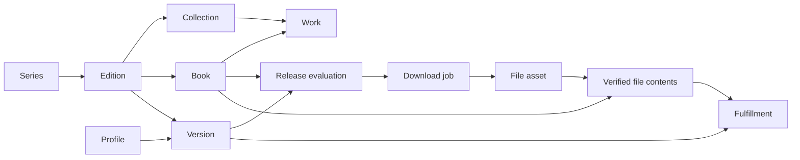

# Editions, books, collected versions, and files

Sento distinguishes what a book **is**, which releases you want to **keep**, and which files you actually **have**. An English omnibus, a French standard volume, and two release groups' copies of an English digital volume are different cases.

| Entity | Meaning | Identity |
| --- | --- | --- |
| Series | The manga represented in your library | Local series ID; MangaBaka reference |
| Edition | What is collected: MangaBaka's edition for one series, language and type, or a local one | Local edition ID; MangaBaka edition ID |
| Collection | A MangaBaka collection: one product line of an edition (publisher, medium, format) | MangaBaka collection ID |
| Book | A volume, chapter, extra, special, or revision within an edition | Stable local book ID |
| Work | A MangaBaka work: one copy of a book in one collection, with its own ISBN and date | MangaBaka work ID |
| Collected version | An independently collected set of releases of one edition | Version ID |
| Profile | Reusable release eligibility, scoring, and upgrade policy | Profile ID |
| Queue item | A provider download with a frozen coverage plan and decision snapshot | Queue ID; provider and offer key |
| File / asset | One physical archive with observed facts and a content hash | File ID and path; SHA-256 identifies bytes |
| File contents | Confirmed books inside an archive, independent of edition rules | File ID + book ID |
| Fulfillment | Whether a present, verified asset meets a version’s current rules | Derived; explicit selections and pins use file ID + version ID + book ID |

## Catalog identity and local editions

The catalog is mirrored under MangaBaka's own names and fields (`collections`, `works`, and its edition ID and name on `editions`), so a change on their side lands in one place. MangaBaka files a series' books as **collections** — a language, a publisher, an edition, a type, a format and a medium — each holding **works**. The digital and the paperback run of a series are two collections with separate works, ISBNs and dates, and the same edition.

An **edition** here is that MangaBaka edition for one series, language and type. It groups the collections that differ only in medium or publisher, and a **book** is the works of those collections that carry the same number, kind and revision: the digital and the paperback volume 3 are two works and one book, wanted once. A volume that exists in only one medium is a book all the same. The preferred copy (digital, then paperback, then hardcover) supplies a book's ISBN and page count and the edition's publisher and medium; a book's date is the earliest any copy came out. Which kind of release is downloaded is the profile's business, not this order's.

Refresh matches collections and works by their MangaBaka IDs. A new collection joins the series' edition of the same language, type and MangaBaka edition, or starts one. Editions that predate grouping are folded together by a refresh when only one of them holds files, pending downloads or additional versions; when both do, **Merge into** does it by hand. Grouping also merges two publishers' "Standard Edition" that are different translations: **Separate into its own edition** takes a collection out, and a separated edition is never grouped again. When MangaBaka files a collection under another edition, the edition here follows.

Names, numbers, dates, publishers, and ISBNs are facts, not primary keys. A book keeps its local ID whatever happens to the works behind it. Sento does not treat books of different editions as equivalent file coverage.

A local edition stands in for a publication the catalog does not list yet. It is never adopted silently: when a refresh brings a catalog edition of the same type and language (and the same MangaBaka edition, when the local one was named from the catalog's list) with at least half of the local books matching, **Review** offers to link the two (best candidate only). "Not the same edition" records the answer so the offer is not repeated; the manual **Link to catalog** stays available.

Linking turns the local edition into that catalog edition. Its ID, files, collected versions and hand-edited fields survive; it takes the catalog edition's collections and works, its name, publisher and medium, without sending files back to review. Books are matched by number (by label when unnumbered), kind, revision and ISBN; catalog books it lacked are added at once and unmatched local books remain. Verified source mappings move over and the separate catalog row is deleted, so the edition exists once. Linking refuses pending downloads, a catalog edition that already owns files, and one with additional collected versions.

An edition is either local (`custom`, `sync_state = local`) or catalog-backed (`linked`, or `stale` when its entry disappears); a linked edition is a catalog edition whoever created it.

Metadata edits override only changed fields. Other fields continue receiving catalog updates. **Use catalog values** clears overrides and refreshes metadata. There is no list of traits. What an edition is, is what its names say — MangaBaka's name for it and the one it is shown under — read with the vocabulary release names are read with (omnibus and N-in-1, deluxe, coloured, box set). Renaming an edition cannot take away what the catalog says it is, and can add what the catalog leaves out: a "Box Set Edition" whose books are the deluxe ones is renamed "Deluxe Box Set Edition". Add edition offers MangaBaka's edition names, so a local edition can carry the name the catalog will use.

A collection or work the catalog no longer lists becomes `stale`; an edition is stale when all its collections are, a book when all its works are. Identity and files are retained. A retired linked book is retained so the next refresh cannot silently recreate it. A stale parent edition suspends automatic acquisition even when its books are still linked. Continue locally explicitly detaches the upstream references while preserving books, files, and edition preferences. Stale and retired books are excluded from automatic acquisition.

## Numbers and chapter discovery

Volumes and chapters are collected independently: a release or a file is one kind or the other, never both (`ledgerOf`). Only volume numbers make a volume and only chapter numbers make chapters; with both, a single chapter ("Vol.5 Ch.34") is a chapter that notes its volume, and several chapters ("v01 c001-008") are a volume that lists what is inside it. A volume is never used to fill chapters, or the reverse.

A book has a display label and an optional number. Numbers use integer hundredths: volume 0 is `0`, chapter 12.5 is `1250`. `number_known` distinguishes actual zero from an unnumbered special. Main, extra, and other books can share a number without sharing ownership.

New local chapter editions start with **explicit books**. Numbering modes are:

- `manual`: add individual books or accept source observations.
- `catalog`: use published MangaBaka memberships.
- `series_count`: explicitly infer consecutive chapters from the series chapter count. The default chapter edition uses this mode. It skips through the chapter count at add when a volume edition is collected (those chapters are in the volumes) and wants every chapter otherwise (a one-shot, a chapter-only series). Inference is capped at 10,000 books and records `inferred` provenance. Counts are not proof that numbering has no gaps.

Directory sources can expose nested listings. Searches discover these as separate source matches, including beneath existing root matches, and evaluate all active matches through the same release profile. Disabling a match excludes that listing; discovery does not restore it or copy a parent's edition mapping or chapter trust. Discovery is bounded to 32 listings per source and 20 seconds; failures retain the matches already available and are reported in search notes.

A source match placed on a chapter edition reports its new chapters. A match is placed by a person in Sources, or without asking when there is no choice to make: it is its source's only match for the series, the series collects exactly one chapter edition, and the match lists chapters (never volumes). Placing verifies a match, so it is trusted: the chapters it lists are added as they appear, and become wanted past the cutoff, like a new episode in Sonarr. Untrusted, individual source observations enter review. A series collecting a chapter edition checks its sources even when nothing is wanted yet. Search records at most 100 new observations per source batch; accepting an observation adds one book, never every intervening integer. Placing a match on another edition trusts it anew; clearing its edition clears the trust. Re-matching a source keeps both. Source maxima never generate intervening chapters. Accepted chapters become available on the next evaluation.

## Collected versions and profiles

A **collected version** is one way of collecting an edition: the edition with a release profile, and which of its books are wanted. The series page shows one card per collected version. An edition starts with one (its default); **Collect again with another profile** adds another — the same books wanted as the releases that profile accepts (a colored copy beside a black-and-white one). An edition is collected once per profile, and a file counts for every card whose profile accepts it, so two cards keep their files apart only when one profile refuses a format the other requires (profile.Apart decides it; the dialog says so when they do not). A card is titled by its edition, plus its own profile when the edition has several (`cardTitle`; `cardLabel` adds the language where the card is named away from the list, as in a search); a card beside the first is named after its profile, and that name is its folder. Release restrictions live only in profiles: the old per-copy required group and strict language are read once by `MigrateCopyRules` and never written again. Any card can be removed while the edition keeps another (removing the default makes the oldest other one the default); the last one is switched off instead. Only collected versions persist edition intent; edition-level monitoring and cutoff in API responses are projections. Each carries its own monitoring, per-book intent, profile, chapter cutoff, and handling of unknown publication dates. Include extras enables bonus/other books; individual overrides can select them separately. “Skip through chapter N” means number > N. Chapter zero remains selectable with an override.

Profile inheritance is **copy (collected version) → series → instance default**: a profile is chosen where downloads are configured, on the series or in a copy's Download settings, not on the edition itself (migration 24 moved edition-level profiles onto the copies that inherited them). An unset profile follows its parent; selecting a profile creates an explicit assignment. Profile deletion checks version assignments too.

Availability is `released`, `upcoming`, or `unknown`. Missing dates stay unknown. The version decides whether unknown-date books may be searched. Actual volume 0 never means “search the whole edition”; a search names a collected version, plus `bookId` for one book or `all` for the whole version. Widened to all books (`allBooks`), a search lists every release for every book but its plan proposes only the books the version wants; Select range picks releases inside a number range. A book's identity everywhere — wanted, reserved, grabbed, owned — is its id within a collected version, never its displayed number.

Whether a release belongs to an edition is decided in one place (`parse.ReadEdition` reads names, `shelf.judge` in `internal/service/edition_fit.go` decides). **An edition is a numbering**: the original run, or a regrouping into fewer, bigger books — Deluxe, Omnibus, 3-in-1, VIZBIG, Perfect/Kanzenban, Colossal, Collector's, Eternal and the like are names for that one thing. Medium, a box, a scan or a digital rip, colorization of the same volumes and the group are variants within an edition, ranked by the profile's custom formats. A release and an edition are read into the same claim (the regroupings they name, a name of their own such as "Fullmetal Edition", a color claim) and judged **fits**, **unsure** or **no**. No: a language mismatch; volume numbers past the edition's last book that another edition of the series reaches (a catalog listing fewer books than exist proves nothing); an edition that claims color against an uncolored release; a release naming another edition of the series; a regrouping offered to a box set. Unsure (`rejected.edition_ambiguous`, soft: never grabbed automatically, downloadable after review, the reason in its text): words alone disagree — a regrouping word against the original numbering, a plain release against a regrouped edition, a colored release where the series has a color edition. A verified source listing turns unsure into fits but not no. Among editions that fit, packaging, color and medium pick the better home; a release that still fits several collected editions is the same question. A release that names a numbering no edition of the series surely takes is offered in the search: "Add <name>", in the release's own words, with the volume count the releases name.

A catalog box set is a single item with one ISBN, while releases are named after the books inside. **This is a box of several volumes** (book menu) adds volumes 1..N carrying the box's ISBN and date and moves the box out of the main run so it is no longer collected. A torrent named for the series with no unit numbers is a proposed whole-edition pack (`rejected.pack_unverified`, soft): reviewable, never grabbed automatically, and checked against its actual contents at import. An explicit "Complete" tag still needs this confirmation: it establishes neither volume units nor the selected edition's numbering. A release ruled out as another edition names that edition (`otherEdition`); when the series has none like it, the search offers to add it, starting Add edition from its name and language and reopening the search on it. An edition's numbering shows in its shape as well as its name: in a completed series, a volume edition holding the story in at most two thirds of the original's volumes regroups it, whatever the catalog calls it (VIZ's English Goodnight Punpun, 7 books for 13, is listed as "Standard Edition"; its files say "Omnibus Edition"). A release naming a regrouping fits such an edition when no sibling edition names a numbering of its own; with named siblings (a 3-in-1, a VIZBIG) a bare "Omnibus" stays a question, and an ongoing series' shorter edition is only behind. Only collected editions compete for a release. A release that still fits several of them is `rejected.edition_ambiguous`: never grabbed automatically, downloadable after review from the edition the user searched. A name that states no language takes it from the indexer section it is filed under ("English-translated", "Raw"), then an English-only publisher's tag, then the indexer's default language setting. Torrent searches are restricted to the Books category and use the normalised title. A verified source listing can establish publication identity, while contradictory explicit language or edition tags still reject the release. Required and refused custom formats in the release profile are hard gates, including group and stated-language rules. Manually confirming a file as an explicit Full Color edition also confirms its color for that card, even when a bare volume filename supplies no color tag.

A catalog edition has a closed numbering when every linked collection
explicitly says it is completed and its book count agrees with the known
final number. A release extending beyond that boundary needs confirmation
of its numbering, even when its edition words match or a source is bound to
the edition. A release that explicitly calls itself complete at an earlier
number also needs confirmation; an ordinary partial pack remains eligible.
It is never automatically clipped to the edition's books.
Unknown, ongoing or conflicting catalog lines retain the normal allowance
for metadata lag. Different numberings belong to different editions.

The shipped Standard profile prefers digital, official and premium releases and a few groups established for English digital rips (Known digital groups, editable), and scores a colorized release well below any black-and-white one (on a color edition every release is colored, so the penalty cancels out); a profile that must never take a colored release refuses Colored instead. Release profiles assign independent scores to shared custom formats: the same group can score highly in one profile and poorly in another. A profile may also require every selected format or refuse any selected match. These hard rules apply to search, observed files at import, and existing files when calculating fulfillment; force-download cannot bypass them. Conditions within a format can express alternatives, required conditions, and negation. A language condition of `*` matches any stated language. Download settings keeps book intent and the profile selector; keeping another copy means collecting the edition using another profile. At startup, legacy copy group and unknown-language restrictions become equivalent profiles in one transaction, reusing identical policies and clearing the legacy restrictions.

Upgrades are off by default. When enabled, Sento evaluates stored file facts against the **current** profile, requires the configured score improvement, and stops at the cutoff score (`0` means no cutoff). Pins prevent automatic upgrades. Historical files without trustworthy facts are not automatically upgraded. Earlier copies are retained; there is no automatic deletion or chapter-to-volume replacement. Eligibility is visible but never acted on unattended: scheduled searches fill missing and unsatisfactory books only, and an upgrade-eligible copy is replaced when a person searches the book (per-book searches state the choice, so the improvement minimum steps aside) or the edition (the minimum still applies).

The ledger is computed from books, monitoring intent, eligible coverage, file presence, pending jobs, availability, and optional upgrades. The Editions view manages both volumes and chapters, using the same model.

## Downloads and imports

Global Activity and a series' Activity are two scopes of the same interface: **In progress**, **Needs attention**, and **History**. Series pages have Editions, Files, and Activity; older Review and History links open the corresponding Activity filter. The shell badge counts grouped unresolved issues, falling back to active downloads when nothing needs attention.

In progress groups current downloads by series, with compact expandable rows and progress. Automatic retries stay here, with the retry time and a **Retry now** action. Needs attention groups repeated source failures by listing and cause; a download with several files waiting for confirmation is one import question, expandable into its file questions. File matching, catalog linking and source decisions work in place in either scope. Raw errors are available under Details. History contains completed and cancelled downloads and previous failed attempts whose books are now owned, no longer collected or covered by another live download. Partly uncovered packs remain attention items. Confirmed source 404/410 attempts without file questions belong to History even while their books remain wanted. These views are derived without changing queue records, reservations or file presence on a page read. History is paginated; decision history and blocked releases are secondary sections.

Every download uses the same recovery actions in both scopes. **Try another release** is offered for unresolved failed downloads and dead download reviews that have delivered no files. It blocklists and retires the selected releases, frees their books and immediately searches the series again. Temporary failures offer Retry now, and jobs already importing or holding files for review keep their reservations. A stalled download offers **Choose a replacement**, keeping the original running until a replacement is selected. An uncertain submission offers **Confirm download**, attaching the existing client ID without submitting twice.

Three consecutive dead downloads (gone or unreadable) from one source listing switch that listing off and retire its remaining queued downloads. A successful import resets the failure count; manually enabling the listing gives it a fresh attempt. Temporary network errors and rate limits do not count. The series history records when a listing is switched off.

Several torrent download clients can be configured (Connections), the default one first. Each torrent indexer may name the client its releases go to — a private tracker that must download through the VPN client, say; indexers that name none use the default. An indexer whose client no longer exists refuses to grab instead of falling back, and is reported on System → Health. The queue stores only the torrent's hash, so status and import look the download up in every client.

Acquisition reserves version/book pairs transactionally before contacting the provider. A second evaluation of the same active provider offer within a series attaches its coverage to the existing job instead of starting another transfer. Other offers cannot reserve the same pending book. Only terminal failure, completion, or cancellation releases reservations. Nonterminal `needs_review`, `retry_wait`, and `dispatch_unknown` retain them. The importer freezes and rereads the combined plan before importing.

Queue snapshots retain the parsed release, covered memberships, rejection/score details, profile, custom-format definitions, edition, and version settings. They explain the decision without relying on today's settings.

The files inside a download are placed by their numbers: the edition was decided when the release was grabbed. A file named by numbers alone ("Volume 1.cbz") is the series' when its release names the series (a source download always does); an edition word in a file name ("Omnibus Edition", where that is just the English edition's name) only sends it to review when another edition of the series answers to it, and a contradiction (another language, numbers the edition cannot hold) still does.

Every import is post-processed into a self-contained book when **Embed metadata** is on (the default): a clean CBZ (zip/cbz and rar/cbr accepted) with pages byte-for-byte as downloaded, a wrapping folder flattened, OS junk dropped, and a full `ComicInfo.xml` — series, number, volume, title, summary, dates, credits, publisher, genres, tags, language, reading direction, age rating, ISBN, release group, and a notes line (`sento:v1 mangabaka:… edition:… work:… release:…`) that re-identifies the file without the database. An existing ComicInfo is merged (Sento wins on fields it knows, unmodelled elements are kept) and preserved once as `ComicInfo.orig.xml`. Torrent payloads are copied, never modified, so they keep seeding; with embedding off they are hardlinked untouched.

A book's identity is its **content fingerprint**: the SHA-256 of the sorted SHA-256s of its page images. Container, names, order and ComicInfo do not enter it, so a payload and its processed copy are the same asset and re-tagging never changes identity. Non-archives fall back to a byte hash.

Upgrade ownership and placement are per collected version's book. A colored
copy cannot block or displace a black-and-white copy of the same book; each
uses its own profile and pins. Compatible versions can still share one file.
Replacing a selected file changes that version's selection, preserving the
old asset's verified contents and selections in other versions. A file moves
to `review/` only when no version selects it for placement. Organization uses
the same profile-aware selection as upgrades, including hard refusals.

**Organize files** (series → Files) previews and applies what the current settings would change in existing files: move and rename to the templated path, and rewrite embedded metadata where the merge would change it. Fingerprints, coverage and pins are unaffected; emptied folders are removed; a seeding payload hardlinked to an old library file is never modified. The same action runs across several series (Library table → select → Organize files) or the whole library (Media → Organize existing files): the preview lists each series it would change, and the run continues in the background, one series at a time, reporting progress and per-series failures (`GET /library/organize/status`, and System → Tasks as *Organize Library Files*; running that task directly organizes every series). A run cut short is resumed by starting it again — files already in place drop out of the plan. Moving and re-tagging reuse a file's stored fingerprint and only hash its pages when none is recorded.

A series has a folder for its volumes (`series.path`) and, when chapters are kept apart, one for its chapters (`series.chapter_path`). Optional top folders per type (`volumesRoot`, `chaptersRoot`) put the type above the series: `Volumes/<series>/…` and `Chapters/<series>/…`; equal values (both empty by default) keep one folder per series. A series keeps its own folder name when re-rooted, and one adopted from outside the library root is never moved. Scans cover both folders, and storage availability is judged per folder, so an unreachable chapter tree does not block volumes. The `{type}` token puts the split inside the series instead (`<series>/Volumes/…`).

Changing the library root itself is a separate startup operation: after the
operator moves the tree, Sento validates destination archives and rewrites all
library path references and its recorded root in one database transaction.
Paths outside the old root stay unchanged. See [moving the library](../installation.md#moving-the-library).

Folder layout inside a series folder is a template (`bookFolder`): by edition (`Standard Edition [en]`, the default, with `(version)` for additional copies), flat, by internal id (`editions/42/versions/81`), or custom. The fingerprint enters a file name only when configured or when a different book already holds the path.

Installation does not overwrite an occupied path with different bytes. Existing library paths are preserved. A pack stays **one archive** with several coverage links. Identical bytes from one job may satisfy several confirmed versions through the same asset. Different releases remain separate assets.

Scans consider paused editions too, check parsed language and edition evidence, and leave ambiguous archives for review. Unmatched downloaded archives are retained in the review area. Partial imports record verified files and hold the job in `needs_review` until unresolved coverage is reviewed. Books already verified and accepted remain owned while the rest of the batch waits for review; an active transfer still shows pending. Activity reports the imported count and unmatched books separately, and its replacement search selects unmatched books without downloading verified ones again; saving the mapping of its last waiting file imports the job, releases its reservations (planned books no accepted file held are wanted again and searched for within the next queue pass) and records "imported after review" in History.

Review proposes what a waiting file holds when its own name resolves it, read against every edition of the series, collected or not (D16). A number with no volume or chapter marker ("Kagurabachi 067") takes its kind from the download it came in — the volumes or chapters the release names, or the kind of books it was grabbed for — and stays unread outside a download. An unnumbered pack vouches for the planned kind only while every number its files carry is a book of it: a pack numbered past the planned edition (200 chapter files against 15 volumes) is another numbering, and none of its files is proposed onto it; a number zero-padded to three or more digits ("001") is written the chapter way and never read as a volume. A name not all of whose numbers resolve to books of the edition proposes nothing, rather than a subset of them. A name without the series title ("Volume_01.cbz") is only proposed inside a download of the series. Among editions holding the books, the collected one wins; still several, or a number shared by two books, and nothing is proposed. Within that edition, a proposal selects a collected version only when exactly one profile accepts the file, and names that profile when several versions exist. Refused files and overlapping profiles require an explicit choice instead of silently using the default version. Proposals are computed when review is read and recorded only on Accept (one, or all at once); Review file opens the confirmed/proposed contents pre-filled. Confirming those contents and selecting the archive that supplies a collected book are separate choices. File questions group by the release they arrived in, and a group carries the pack-level answers: **Decline all** marks every file of the pack reviewed and unmapped in one transaction (a confirmation lists what will be marked; files that no longer wait are skipped, never overwritten), and **Match whole release** previews one chosen card (or the proposed editions) across the pack, resolving each file by its own numbers and offering the same explicit per-book copy choices as single-file review. Files whose numbers do not resolve — an unreadable name, the other ledger, numbers the edition does not hold, a number two books share — are left for individual review rather than guessed. Retrying a fully reviewed payload completes from its recorded files without fetching it again. Partial retries preserve already confirmed bytes and mappings. Confirming or editing a file mapping also organizes that file using the current import naming and metadata settings, moving it out of the review folder. Other series files are left alone. A failed move preserves the mapping and reports that organization still needs to finish.

Bulk-match preview and submission use the same service resolver, including book
kind and duplicate-number checks. Pack choices are applied in batches of at most
500 files, with 25 archives shown per page; any remaining batch stays in Review. Both endpoints of each named range must be
books of the edition; a range extending past it stays for review instead of
being clipped. Submission rechecks current review state and serializes file
mutations with import, cleanup and organization. Large packs use bounded batches;
each decline batch is transactional.

Partial-import counts identify files from that download. An existing copy from
another release does not count as imported by the unfinished job.

**Review copy choices** default to importing confidently identified, allowed missing books and keeping existing selected copies for overlaps, even when the incoming archive scores higher. A recorded replacement explicitly requested when grabbing a release remains preselected and is labeled in review; ordinary pack contents never imply that intent. Each book shows incoming and existing source/group evidence, current-profile scores and their format breakdowns. Unknown facts require an explicit choice, policy refusals block selection, and pins must be removed before replacing a protected copy. **Use incoming instead** selects a replacement for that book/version; it is independent of confirming the archive's contents. Existing copies used by another book/version remain selected and in place.

When several incoming archives contain the same book/version, the first eligible
copy in the preview is selected by default. Other incoming copies stay unused.
Selecting one switches that book away from any other incoming copy without
changing other books in a shared archive. **Import missing; keep existing** uses
the same one-copy rule, so duplicate files cannot block unrelated imports.
The summary counts each distinct book/version once, including an existing copy
kept across several rejected duplicates and books still missing because no copy
is selected. Files left for later are counted separately. Replacement labels
identify which incoming archive will supply the book.

Editing a file that already supplies a book shows **Keep this copy**. Retaining
that selection counts as keeping an existing copy; clearing its last selection
without choosing another copy counts the book as missing. The import-missing
preset preserves current selections, including those of files in the batch.
Opening confirmed contents in the editor does not select unused copies. This
also applies to files reviewed before explicit keep/trash decisions existed;
saving a fact correction preserves their selected and deselected mappings.
Corrected facts that fail the current profile do not remove an existing
selection. Keeping that mapping leaves other owners and pins intact; the refusal
still blocks adopting unused contents or replacing a different copy.

A live archive whose fingerprint differs from its recorded evidence must be
rescanned before review. A fresh preview cannot confirm old contents or facts
against different bytes; rescan discards the old evidence and matches it anew.
Fingerprinting an archive decompresses every page, so Sento records the
archive's **stat signature** (device, inode, size, modification time and inode
change time) with the fingerprint it read under it, and reads the archive again
only when the live signature differs. Userspace cannot set the change time, so
a rewrite that restores the modification time still changes the signature. As
with git's index, a signature is trusted only once the archive's timestamps are
two seconds older than the stat, so a later write cannot share a coarse
filesystem timestamp. The signature is read through an open file, which makes
NFS revalidate cached attributes. Platforms without inode metadata always
fingerprint.

A preview fingerprints an archive unless its recorded signature still matches.
Its token covers each signature and the preview's time, so apply reuses the
preview's fingerprint while the archive keeps that signature; a change in
between rejects the token. Apply judges each signature against the preview's
time, not its own, so an unchanged archive that settles in between keeps its
token.
After acquiring the decision locks and before writing any choices, apply
compares the live signatures again (or fingerprints an archive whose signature
was not trusted), so an archive changed or replaced during a lock wait rejects
the entire batch. The commit records the signature with the confirmed
fingerprint. Library scans use the same rule; a file without a signature falls
back to its size and modification time.
The transaction locks the series before its editions, keeping inherited series
policy stable through commit as well as version, profile and global settings.

An archive currently selected by any book or version is protected from review
trash, including when that mapping appears in the same request. Clearing or
replacing its selection in the batch does not bypass this protection. Review
trash is for unused archives; previously selected copies can be kept and then
reassessed for cleanup after their selection changes are saved.

For an unused incoming archive, **Keep unused file** confirms/resolves the review while retaining its bytes and content knowledge; **Move incoming file to trash** records rejection and requests recoverable cleanup directly, without first accepting ownership. **Leave for later** leaves the review unresolved. **Apply choices** summarizes imports, existing copies kept, explicit replacements, and trash moves. A multi-book archive stays intact when it supplies any selected book; skipping one book never removes pages, and an archive selected elsewhere or pinned cannot be trashed. Restoring a skipped duplicate preserves its confirmed contents and does not adopt it as the selected copy.

Review previews bind the file fingerprints, facts, current selections/pins, edition/book identities and profile settings. Apply rereads the evidence and checks the revision under the edition mutation locks (and configuration locks on PostgreSQL); a changed decision context requires a fresh preview before any mapping changes. Facts, verified contents and explicit selections commit together across the chosen batch. Filesystem work follows that commit and reports per-file results. A durable `files.review_action` records keep/trash decisions for the file's fingerprint, including an unused or trashed archive. The trash journal makes moves recoverable; failed pending moves remain visible and retry on queue passes. The download-client payload is untouched. Identical retry payloads and rescans preserve reviewed selections and skips instead of reopening or automatically accepting the duplicate. Changed bytes require review again. Download settlement counts files from the release separately from books already held by other releases, reports **Kept existing** for those books, and releases reservations when every actual question is answered.

File review can map an archive to several books and versions. Editing one version's mappings preserves the others. Clearing coverage keeps the file without claiming ownership. Coverage pins survive edits to retained mappings. Removing a version preserves intrinsic content knowledge and files; deleting a pinned file requires unpinning first. Duplicate-edition merges require unique book matches and preserve version policies, pins, coverage, and paths. Pending downloads block destructive identity changes.

## Presence, file facts, and recovery

Scans and acquisition checks record `present`, `missing`, `unavailable`, or `unknown` presence. An unreadable/missing series root blocks automatic acquisition for the series; a missing archive under a healthy root remains wanted. Page reads do not probe the filesystem or initialize models. Review provides an explicit recheck action.

Offer claims and per-file observed facts are stored separately. Filename observations take precedence over advertised language/group/quality; stream imports retain offer evidence. Judging a file falls back to its release's claims for the fields its own facts do not carry, so a copy organized to a bare name ("Volume 1.cbz") keeps the digital/group/resolution score its release earned; a field the facts do carry wins, and a file without claims still scores from its filename alone. The file editor supports manual language/group corrections with provenance. Retrying or scanning identical bytes preserves manual corrections and content confirmation. Group contradictions remain visible for review.

Manual corrections take precedence even when a language or group is explicitly
cleared. Review proposals judge the same combined file and release evidence as
ownership and upgrade scoring.

Transient client errors back off from 30 seconds up to 32 minutes. If dispatch succeeded but saving its handle was interrupted, reconciliation checks the stable provider key without submitting again. Unresolved dispatch after ten minutes enters review, where a user can attach the client ID or cancel the reservation. Cancelling leaves remote downloads and files intact; an active import must finish before cancellation. Pending plans and edition identity edits use a common transactional parent lock.

## File cleanup and trash

**Clean up files**, available from Files and each edition menu, previews file
sizes and explains whether each file is protected or eligible. The user must
select files explicitly. Turning Collect off or pausing a series does not
move files. Candidates include reviewed unmapped files, files used only by
uncollected editions, and copies no collected version selects. A file still
selected by any collected version, a pinned asset (including a deselected
pin), unfinished file review, or an asset from an active download is protected.
Shared assets are judged as a whole, across their edition and version mappings.
The server checks current selections and pins again when applying a preview.

Cleanup moves each selected archive into a hidden `.sento-trash` folder on
the same filesystem. It retains file identity, observed facts, intrinsic
contents and version selections, but excludes the file from ownership,
review, scans and organization while it is in trash. Download-client payloads
and other hardlinks remain intact; selected archive sizes do not promise
immediate disk-space savings. Only regular files are moved, without overwriting
another path or rewriting archive bytes. A journal retains interrupted moves
for recovery.

Review trash retries validate the saved archive fingerprint and resume moves
interrupted before journaling, between linking and unlinking, or before recording
completion. A changed original returns to review without moving its new bytes;
completed moves leave the retry batch. Pending moves remain restorable and their
deletion is paused. Retained archives whose fingerprint changes are protected
from both manual and expired-trash deletion until the discrepancy is resolved.
Recovery pages through pending intents by file ID, advancing past failed moves
so a blocked batch cannot prevent later archives from being recovered. Each new
queue pass retries earlier failures.
Failures to load a pending page are logged with the cursor and database error
and leave the intents available for the next pass.

A missing trash entry is purged from the database only while its storage folder
is accessible. Unavailable storage retains the journal and mappings for recovery.

The confirmation chooses 7, 30 or 90 days of retention (30 by default).
Trash can be inspected and restored from Files even after all active files
are gone. Restore verifies retained bytes and refuses an occupied original
path. It restores mappings and leaves collection preferences unchanged.
Permanent deletion requires confirmation, or happens after expiry during the
daily housekeeping task. Files whose interrupted move still leaves an original
are retained for explicit restore. A series with recoverable trash must have
its trash restored or emptied before series removal, so removing the series
cannot orphan recovery records.

## Screens and evaluation

Your editions contains selected editions, local publications, and editions with files. Other editions is a collapsed catalog chooser. The edition action menu holds Search releases, Edit edition (what the edition is: name, language, publisher, numbering) and Download settings (how a card collects: profile, chapter cutoff, extras, undated books); Collect again with another profile and catalog maintenance are under More. The profile summary explains inheritance. Book lists load every book of a version at once, newest first (one toggle turns the order, remembered for volumes and chapters apart): state counts double as filters, long editions open as a colour-coded grid (a dense list is the alternative view), and monitoring actions apply to a filter, a number range, or a selection. The series page has one tab row: Editions, Files, Activity. Activity shares the global progress, attention and history views, scoped to this series, with a badge for unresolved issues. File mappings can be edited from Files or reviewed directly inside Activity. The header carries Search & download and Monitor series; Refresh, the release profile (shown in the header only when the series chose one) and Sources — the per-series source settings, where each source match carries its edition mapping — are in its menu.

Where information comes from is marked the same way everywhere (`web/src/components/Origin.tsx`): **MangaBaka**, shown as a small “MB” mark that opens the series’ MangaBaka page (listed in the catalog, updated by a refresh; the mark alone labels values pre-filled from MangaBaka), **Local edition** / **Added by you** (never touched by a refresh), **Edited** (a catalog value changed by hand, which a refresh keeps), and **No longer in MangaBaka**. An edition carries one marker (a local edition numbered from MangaBaka's count says so in its tooltip); a book carries one only where it differs from its edition. Edit book lists the copies MangaBaka has behind the book, one per medium, and says which supplies the ISBN and that the date is the earliest. When a refresh groups editions on its own, History records it.

MangaBaka knows some series without listing their volumes (it covers a handful of publishers). The Editions tab then says so and gives the volume count from the series record. **Add edition** is the one place an edition is added: first the editions MangaBaka lists that are not collected yet, then the form for one it does not list, with the publisher (for the chosen language) and the volume count pre-filled from the series record and labelled as coming from MangaBaka. Publisher and medium sit behind a toggle in Add edition and Edit edition, since they rarely need a hand. Nothing is created without the form being submitted.

The shared ledger batches books, overrides, facts, coverage, profiles, and pending work per series. It computes a complete consistent series view per request; the book list is returned whole and filtered in the browser. A book on disk can be unsatisfactory for a particular copy without disappearing from the library. New versions reuse qualifying verified files. Series totals count unique books on disk and wanted copies separately.

## Migration and compatibility

Migration 14 intentionally resets the old library and its downloads, file mappings, bindings, and decision history. Connections, profiles, custom formats, application settings, and physical files remain. Add series again after upgrading and review existing files before counting them as owned.

Migration 15 preserves the current library. It backfills intrinsic asset contents from confirmed coverage, moves edition intent entirely to versions, and adds cached presence, review/retry states, and independent edition traits. Existing file presence starts unknown and is checked during scan, search, or explicit review recheck.

Canonical ownership uses version and book IDs. The old number-based ownership tables and queued-plan adapters are removed. Migrations remain transactional on SQLite and PostgreSQL.

Migrations 22 and 23 add the `collections` and `works` tables, turn each catalog edition into an edition with one collection, and replace `external_refs`, the trait list and the content variant. A trait set by hand that the name did not carry moves into the name. Editions are grouped by the next refresh, not by the migration.

Migration 20 makes a linked edition a catalog edition and removes the leftover duplicate rows earlier links kept. Migration 21 renames the schema to the vocabulary used everywhere else: tables `editions`, `books`, `versions`, `book_reservations`, `book_overrides` and `book_observations`, with `edition_id`, `book_id` and `version_id` columns. "Collection" and "work" name MangaBaka's own records, in `internal/metadata` and in the tables that mirror them.

Deliberate limits: upgrades retain earlier copies; completed downloads are not automatically reused across unrelated editions or series. Explicit file mapping can share confirmed assets. A comprehensive story/chapter ontology and destructive retention rules remain separate future features.

Calendar entries use the same version/book ownership as the ledger, including per-version monitoring and actual file presence. A language correction invalidates affected coverage for review. Manual file mapping records explicit confirmation of edition coverage; release-group requirements still apply. A catalog rename is followed: the edition is what MangaBaka says it is.
