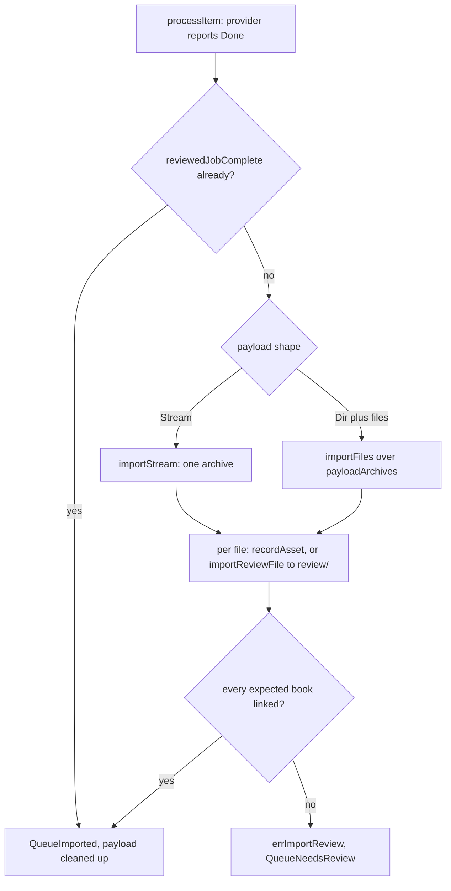
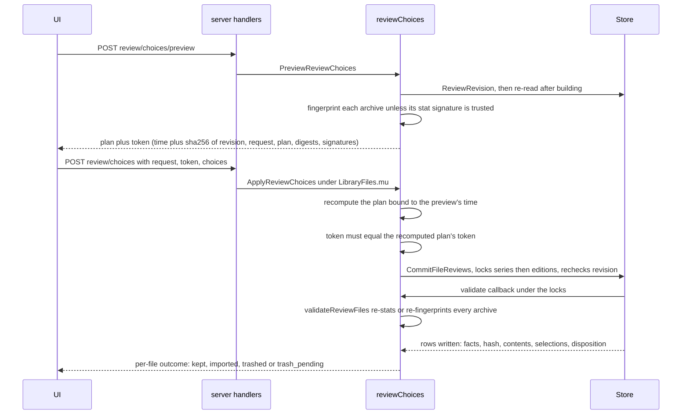
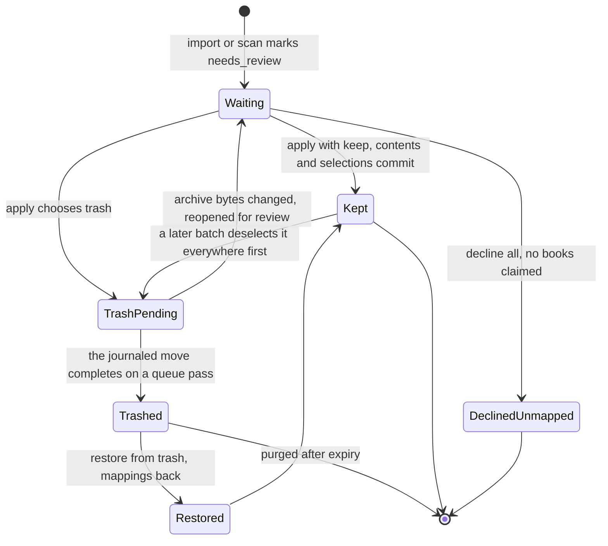

# Import, review and settlement

A finished download is only a folder of bytes until Sento reads each file's
name, decides which books it holds and places it. Import does that reading:
every archive of a payload is installed into the library and linked to its
books, or exiled to `review/` when its name resolves nothing or its facts
break the profile. A person confirms the waiting files in review, then the
queue job settles. No existing path is ever overwritten, and no file is
claimed as collected without evidence.

## In the code

| File or package | What it holds |
| --- | --- |
| `internal/service/importer.go` | `Importer`, `ProcessQueue`/`processItem` under `LibraryFiles.mu`, `recordFailure` |
| `internal/service/import_payload.go` | `importStream`, `importFiles`, `importArchive`, `alreadyImported` |
| `internal/service/asset_import.go` | `assetPath`, `verifyDestination`, `placeAsset`, `installAsset`, `installProcessed`, `recordAsset`, `importReviewFile`, `offerFacts` |
| `internal/service/image_import.go` | `payloadArchives`: image-only folders packed into CBZ |
| `internal/service/import_contents.go` | `fileBooks`: intrinsic contents versus covered books |
| `internal/service/book_resolve.go` | `resolveBooks`, `numberHolds`, `everyNumberHeld`: the one name-to-books rule, shared with scan |
| `internal/service/upgrade.go` | `DisplaceOwners`, `exileToReview`, `autoUpgrade` |
| `internal/service/review_proposals.go` | the review inbox, `proposer`, proposals and hints |
| `internal/service/review_choices.go` | `PreviewReviewChoices`, `ApplyReviewChoices`, the token, `validateReviewFiles` |
| `internal/service/review_bulk.go` | `ResolveFileReviews`, `MatchReleaseFiles`, `matchSlots` |
| `internal/service/review_settle.go` | `reviewedJobComplete`, `SettleReviewedJobs` |
| `internal/service/review_trash.go` | pending review-trash recovery on queue passes |
| `internal/store/file_review.go`, `review.go` | the review revision, `CommitFileReviews`, `DeclineFiles`, the inbox rows |
| `internal/server/server.go`, `api_review.go` | the review endpoints |

The queue worker that fetches the payload is documented in
[acquisition](acquisition.md). Where a placed file lands and what its name
becomes is [naming](naming.md); the `ComicInfo.xml` rewrite inside a processed
copy is [metadata](metadata.md). Scanning, presence and trash are
[library files](library-files.md).

## From a finished download to the library or to review

This diagram shows one done download on its way through import: the payload
is fetched, each archive is either recorded as a library file or exiled to
review, and the job ends imported or held for review. The sections below fill
in each step.

`processItem` first reconciles a job whose remote handle was never saved:
it asks the provider by the stable release key and adopts the handle if the
download is done or in flight, never submitting twice. A job with no handle
at all for more than 10 minutes becomes `dispatch_unknown` and enters review,
where a person attaches the client ID or cancels. A download that is neither
done nor in flight gets a `Recover` kick on every queue pass once it is older
than 2 minutes and fails as dead after 10 minutes.

## Payload import: stream or directory

A provider's `Fetch` returns either a single archive as a stream (source
downloads) or a directory plus a file list (torrents). Both paths end in the
same per-file steps; only the payload shape differs.

`importStream` stages the stream as a `.sento-stage-*.cbz` in the series
folder (not next to its destination, which `place.dir` puts in the edition's
folder and the configured book-folder layout below it), rewrites it through
`mediafile.ImportCBZ` when metadata
embedding is on, fingerprints it, picks the final path with `placeAsset`,
installs it with `installAsset`, and records it with `recordAsset`. The file
name is the sanitized release title plus `.cbz`, or the placement template's
name when `renameImports` is on.

`importFiles` first turns the payload into archives with `payloadArchives`
(image folders included, see below), then imports each one with
`importArchive`. Before touching anything it asks `alreadyImported` what an
earlier attempt at the same release brought in: books already linked by this
release key are skipped, and so are the hashes of files that are reviewed or
still waiting in review, so a retry neither redoes work nor duplicates a file
that sits in `review/`. Payload paths are checked for escapes: each entry
must be local, resolve under the download folder after symlink evaluation,
and no duplicate relative path is processed twice.

One archive waiting on a person does not abort the pack: a file whose
observed facts break the release profile is recorded, counted, and the job is
held for review at the end (`errAssetNeedsReview`). If the expected books are
not all covered, the import reports a partial import, whatever is waiting;
`errAssetNeedsReview` is returned only when all expected books are linked but
files still wait. Both errors land the job in `needs_review`. The queue worker
wraps any import error
in `errImportReview`, so the job is held, not failed; the download-client
payload is cleaned up only after a successful import.

## Image folders in a payload

A torrent folder of loose images becomes an archive too. In
`payloadArchives`, every folder that holds page images but no book file
(any archive, or a `.pdf`/`.epub`: `mediafile.IsBook`) is
packed into a CBZ (`mediafile.WriteImageArchive`) in a temporary staging
directory that is removed when the import ends. A folder whose name is only
a volume or chapter marker (`v01`, `tome 2`, `ch. 3`, `c001` style) gets the
series title prepended before parsing, so `Volume 1` inside a download of
the series reads as that series' volume 1. Any other folder name is packed
as it is. A packed folder is marked for review when its name does not parse
to exactly one single number, and the normal per-archive checks still decide
whether it is linked at all.

## Mapping a file name to books

`fileBooks` separates two things: the books a file intrinsically holds
(`contents`, used for metadata and naming), and the subset of the job's
expected books it covers (`covered`, which claims the job's plan). A file is
only matched against editions the release fits (`shelf.inside`), and retired
or stale books are skipped.

The resolution rules in `book_resolve.go` are the same ones a scan uses:

| Rule | When it applies | What it produces |
| --- | --- | --- |
| `bookKindFits` | every candidate book | a plain number matches `main` books only; a name marked `extra` matches extra/other books only |
| `inRanges` | a book with a known number | the book matches when its number falls inside one parsed range, e.g. `v01-03` matches volumes 1, 2, 3 |
| `sharesNumber` | any matched book | if another book of the same kind shares its number (two revisions of volume 1), the result is `ambiguous` and nothing is linked |
| `everyNumberHeld` | the whole name | every number the name states must identify at least one book of the edition; `187 - Side Story 08` is not volume 8 alone |

An ambiguous result sends the file to review instead of guessing between the
two books.

## Placement and install

Paths and bytes are placed conservatively; the rules are:

| Rule | Where | Behavior |
| --- | --- | --- |
| Name taming | `assetPath` | the base name is sanitized, cut to 120 bytes, falls back to `book` when empty, and gets ` [hash]` before the extension when a hash is given |
| Never overwrite | `verifyDestination` | an existing destination is accepted only when its fingerprint equals the incoming hash; different bytes are a collision error |
| Path choice | `placeAsset` | the plain path when it is free, otherwise the hash-suffixed path; `hashInName` always suffixes |
| Install | `installAsset` | hardlink first; on filesystems without hardlinks, a temp copy plus an exclusive `O_EXCL` create, mode 0644; an occupied path is verified, never replaced |
| Processed copy | `installProcessed` | `mediafile.Process` into a `.sento-stage-` file next to the destination, then `installAsset`; the destination is replaced atomically |
| Series folders | `seriesDir` | the series' volume folder (and separate chapter folder when chapters are kept apart) is computed from the naming settings and recorded on the series row |

With `writeComicInfo` on (the default) the library gets its own tagged CBZ
and the torrent payload stays untouched so it keeps seeding. With it off, the
payload is hardlinked as it is (`alwaysCopy` forces a copy instead). A pack
stays one archive with several coverage links; identical bytes from one job
can satisfy several collected versions through the same asset, and a different
release gets a different hash, so it can never take the same path.

## Recording facts and claims

Every recorded file carries two fact sets. The claims (`offerFacts`) come from
the queue row's frozen snapshot: title, site, protocol, the release's
language, group, flags, resolution, revision, digital mark, format score,
profile and release key, marked with `offer` sources. The facts come from the
file's own parsed name where one was read: flags, language, group, resolution,
revision and digital mark, marked with `filename` sources. Judging a file
falls back to its claims for fields its own facts do not carry, so a copy
organized to a bare name still scores as its release did.

`recordAsset` stats the file before fingerprinting it, so a write during or
after the hash changes the recorded stat signature, records both with the
fingerprint and the current parser version, and links the expected books. It
then judges the file against each slot's current profile: if any slot's
profile is broken by the observed facts, the file is marked `needs_review`
and reported as `errAssetNeedsReview`. After recording, `DisplaceOwners` runs
the upgrade path (below). A file that names no download and matches nothing is
recorded by `importReviewFile` in the series' `review/` folder with
`needs_review` and `unrequested` set, keeping its offer claims beside its
filename facts.

## Upgrades and displacement

One collected version's book has one selected file. `DisplaceOwners` enforces
that after a new file is mapped: for each claimed book/version it judges every
owner against the version's current profile, and the incoming file may only
take the hold when it is itself eligible (a profile refusal cannot displace
an accepted file). Against each other eligible owner:

| Rule | Effect |
| --- | --- |
| `force` (an explicit choice in review) | the incoming file displaces the owner |
| `autoUpgrade` | displaces only when the profile has upgrades on, the owner is not pinned, the owner's facts are known, the owner's score is below the `until` ceiling (`0` means no ceiling), and the gain is at least `minUpgradeScore` (minimum 1) |
| otherwise | the owner stays, the incoming file's selection for that book is dropped, and the outcome is reported as a kept claim |

Displaced files are not deleted: `exileToReview` moves them into the series'
`review/` folder (never onto a path the database already records, rolling back
if the move's record write fails). Files still preferred by any version, and
files already in review or outside the series tree, are left where they are.

## The review inbox and proposals

The inbox (`ReviewItems`) lists one question per waiting file, plus downloads
needing attention, new chapters, catalog-link suggestions and empty sources.
A file appears when it waits for review (`needs_review`), carries unverified
contents, has presence `unavailable` or `unknown`, or has a pending trash
move. Each file question is grouped by the release it arrived in
(`releaseKey`, shown with the download's title).

A proposal is computed when the inbox is read and recorded only on accept.
`propose` works only from the file's own name, and only when that name says
something about this series:

| Step | Rule |
| --- | --- |
| `readsName` | the file waits for review (or is unclaimed for a bulk re-map), is not `unavailable` (a `missing` or `unknown` file still gets its name read), parses as manga with no title leftover, and either anchors on the series title or came from a download of this series; a bare `Volume_01.cbz` is only read inside such a download |
| ledger | a marked number gives the ledger; a bare number (`067`) takes the kind the download's own name gives it, or the planned kind when every number the pack's files carry is a book of that kind (`packReadsAs`), so a pack numbered past the planned edition (200 chapter files against 15 volumes) is another numbering and none of its files is proposed onto it; a 3-plus-digit padded number (`001`) is never read as a volume inside a volume plan |
| editions | the editions of that ledger the name fits (`shelf.fits`), narrowed by `shelf.prefer`; among editions holding the books, a collected one wins; still several, or a number two books share, and no proposal is made |
| version | a collected version is proposed only when exactly one eligible version's profile accepts the file (and clears its minimum format score); overlapping profiles are a choice for the person, never a silent default. The proposal names the edition, plus the profile when the edition has several collected versions |
| books | `resolveBooks` plus `everyNumberHeld`: all numbers of the name must resolve to books of the edition |

When no edition claims the file, a hint (`FileHint`) still offers what the
name says: the ledger and the numbers, so review can prefill them.

## Review choices: preview, token, apply

Confirming files in review is a two-step protocol with a token, so a preview
cannot be applied after anything it depended on changed. Limits: 1 to 500
files per plan, at most 2000 books in one archive.

This sequence shows the protocol from preview to committed choices; the text
below gives the validation each step performs.

A preview fingerprints an archive unless its recorded stat signature still
matches the recorded hash (`reviewFingerprint`), with the preview's time as
"now" in the trust rule of
[files and fingerprints](library-files.md#files-and-fingerprints). When a
preview has to read the pages, it records
the signature it read under, so the next preview trusts it. A known
fingerprint that disagrees with freshly read bytes is a conflict: rescan
first, never renew.

The token is the preview's time in nanoseconds plus the SHA-256 of the review
revision, the request, the built plan, the digests, the signatures and the
time. Apply recomputes the whole plan with `since` pinned to the preview's
time, so an unchanged archive that settles in between keeps its token, and
rejects the request when the recomputed token differs, which happens when the
revision changed or any archive changed.

Inside the commit transaction the store locks the series row, then the
editions (and on PostgreSQL the profiles, custom formats and settings in
share mode), re-reads the revision and rejects when it moved. The validation
callback then re-checks each archive under those locks: by stat signature
when one was trusted, otherwise by a fresh fingerprint, rejecting the whole
batch when bytes changed during the lock wait. A `later` choice never
reaches the commit: it is recorded as a `later` outcome and skipped before
any store write. The write itself records
corrected facts, the hash and signature, verified contents and selections,
the replacement of former owners, and the disposition (`keep` or `trash`
only), plus a durable `review_action` on the file row.

After the commit, the filesystem work runs: a `trash` disposition journals
and performs the recoverable move (see [library files](library-files.md)), an
imported file is moved into place by the organizer, displaced owners are
exiled to review, and `SettleReviewedJobs` closes whatever jobs no longer wait
on a file. The four `POST /series/{id}/review/*` routes sit outside the global
120 second request cap, because a first preview of a large pack fingerprints
every archive by design and each signature read along the way is kept, so a
retry after a disconnect makes progress instead of starting over.

Per book, the preview shows the incoming file's score and reason, the current
owners with their scores, pins and presence, and whether the incoming copy is
preselected: yes when no present owner exists, the file is already selected,
or a replacement was explicitly requested at grab time; unknown facts and
policy refusals force an explicit choice, and a pinned owner must be unpinned
first. When several incoming archives hold the same book, the first eligible
one is preselected and each book is counted once. Apply enforces one incoming
archive per book and edition, and refuses to trash a file that is still
selected anywhere or pinned. The store checks this against the selections as
they stood before the batch, so clearing or replacing an archive's selection
in the same request does not make its trash move safe. The plan's
`trashWhenUnused` is set when an edition's use is the only thing keeping a
file out of trash; the one-file editor then saves the file as unused,
previews again, and only then asks for the trash move.

## Bulk match and decline

Two pack-level actions sit beside the per-file choices; both are explicit,
and neither accepts a proposal on its own.

| Action | Endpoint | Behavior |
| --- | --- | --- |
| Match whole release | `POST /series/{id}/review/match` (`?preview=1` previews) | maps every selected file of the pack onto one chosen collected version by its own parsed numbers, via `matchSlots`; files whose name does not resolve (unreadable, wrong ledger, numbers the edition does not hold, a number two books share) are left for individual review with the reason in words. Preview and submit use the same resolver; submit applies each match with the keep-existing defaults of `ApplySafeFileMapping` |
| Decline all | `POST /series/{id}/review/resolve` | marks every selected file reviewed and unmapped in one transaction (`DeclineFiles`): `review_action='keep'`, `unrequested`, contents and coverage cleared. Files that no longer wait, belong to another series, hold confirmed contents or pins, or are already trashed are skipped with their reason, never overwritten. Limits: 1 to 500 files |

A bulk match re-reads names of files that carry unconfirmed claims from their
own import (`allowClaimed`), but a file with confirmed contents, a pin or a
recorded review decision still requires individual review.

## A file's review lifecycle

This state diagram shows the states a file waiting for review moves through;
the durable markers are `needs_review` and `review_action` on the file row.

## Review trash recovery

A committed trash choice can be interrupted before journaling, linking,
unlinking or recording completion. Every stage keeps the reviewed fingerprint,
so the next queue pass (`finishReviewTrash`, run at the top of `ProcessQueue`)
pages through pending files by file ID (batches of 500) and resumes each move:

| Situation found | Resume behavior |
| --- | --- |
| no trash journal row, hash known | perform the trash move now with the recorded digest |
| no journal row, no hash | reopen the file for review, contents changed |
| journal row, digest mismatch | conflict: the retained evidence changed, restore first |
| trash path missing | verify the original (regular file, digest match), then link-and-unlink it into trash; changed bytes reopen the review instead |
| both paths exist | they must be the same file (hardlink); verify retained bytes, then remove the original name |

Every resume path that completes the move ends by recording completion
(`review_action='trashed'`). A failure is logged and retried on the next pass; a page that fails to load
keeps its cursor and leaves the intents for later. A changed original returns
to review without moving its new bytes.

## Settling jobs

A job held in `needs_review` completes without redownloading once no file it
delivered still waits. `reviewedJobComplete` (checked before fetching the
payload again) answers yes when every planned book is linked by a file of this
release, or when at least one file of the release has an explicit review
action and none waits. `SettleReviewedJobs` runs only after review actions
(`ApplyReviewChoices`, `ResolveFileReviews`), never on queue passes: the worker
(`ProcessQueue`) calls only `finishReviewTrash`, and `ListRunnableQueue`
excludes `needs_review` jobs, so a queue pass cannot even see them. For each
`needs_review` job with delivered files, it settles the
queue row, resets the listing failure count, and records an
`imported_after_review` decision naming how many files were confirmed, which
planned books were kept from existing copies, and which were not in the
download and become wanted again (triggering an immediate search for them).

A job that delivered no files at all still needs a person and stays.

## Review endpoints

| Route | What it does |
| --- | --- |
| `GET /api/v1/review?seriesId=` | the inbox: file, download, chapter, edition and source questions |
| `POST /api/v1/series/{id}/review/match` | match a whole pack to one collected version; `?preview=1` only previews |
| `POST /api/v1/series/{id}/review/resolve` | decline file reviews in bulk |
| `POST /api/v1/series/{id}/review/choices/preview` | build the plan and token |
| `POST /api/v1/series/{id}/review/choices` | apply choices under the token |
| `PATCH /api/v1/series/{id}/files/{fid}/facts` | correct one file's language, group or flags |
| `PATCH /api/v1/series/{id}/files/facts` | correct several files' facts at once |

The four `review/*` POST routes sit outside the global 120 second cap; all
other routes are inside it.

