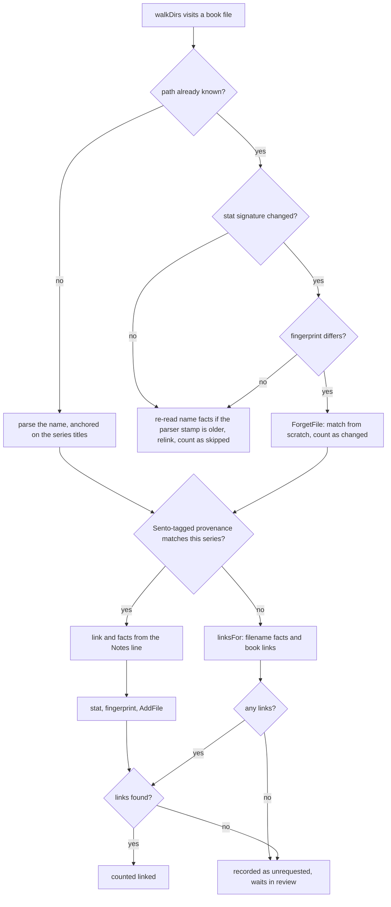
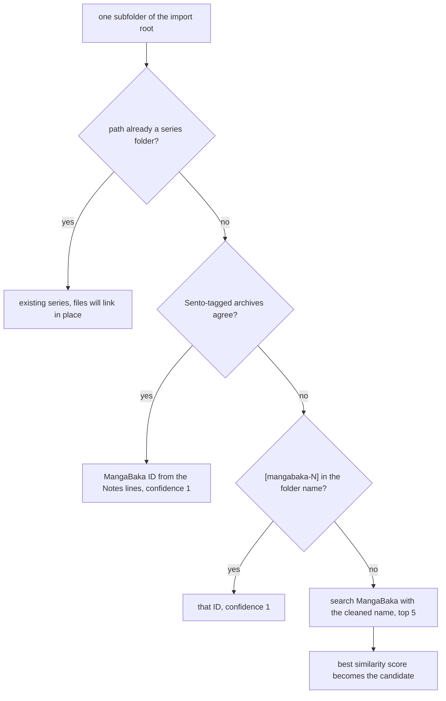
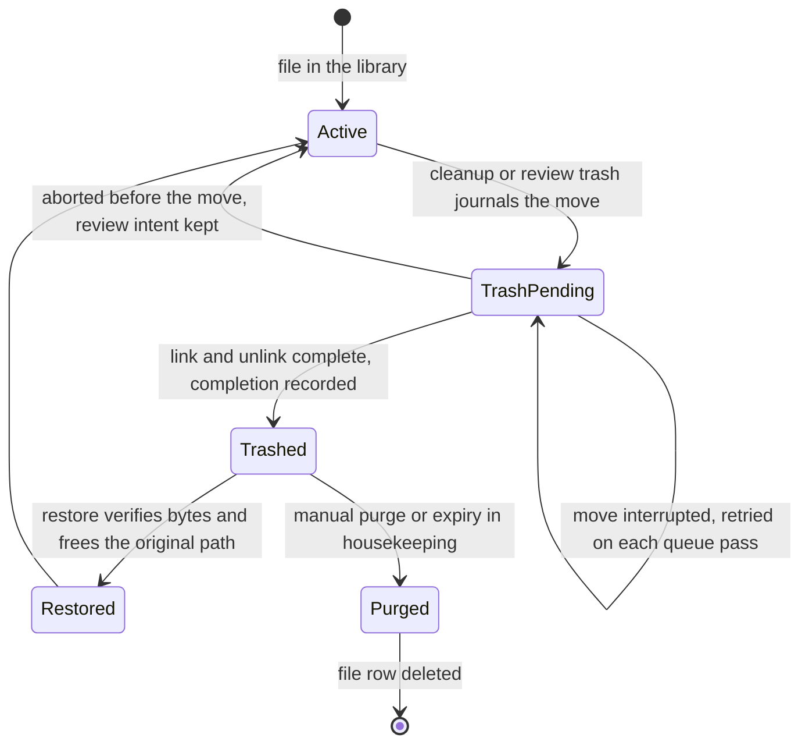

# Library files: fingerprints, scanning, presence and trash

Sento's library is a folder tree plus a database of file rows. A file row
records where an archive lives, what its name and embedded metadata say, a
content fingerprint, and which books it is linked to. This page covers how
files get identified, how scans read the disk, how presence is checked, how
an existing library is imported in place, and how files are removed, trashed,
restored and purged. Downloads landing in the library are
[import and review](import-review.md); folder and name templates are
[naming](naming.md).

## In the code

| File or package | What it holds |
| --- | --- |
| `internal/mediafile/archive.go` | `Fingerprint`, `IsArchive`/`IsBook`, `walk`, junk and image lists, `Process` |
| `internal/mediafile/import.go` | `ImportCBZ`, image extensions, stale temp sweep |
| `internal/mediafile/images.go` | `IsPageImage`, `WriteImageArchive` |
| `internal/service/filestat.go` | `statArchive`, `statSignature`, `trustedSignature`, the 2 second `racyStat` |
| `internal/service/filestat_linux.go` and siblings | `inodeStat` per platform |
| `internal/service/scan.go` | `Scanner`, `scan`, `replaced`, `rederiveFacts`, `relink`, `linksFor`, `linksFromProvenance`, `ScanAndAdoptCutoff` |
| `internal/service/bulkimport.go` | `ProposeImports`, `taggedSeries`, `ImportFolder` |
| `internal/store/presence.go` | `CheckFilePresence`, folder attribution |
| `internal/service/file_cleanup.go` | `CleanupPreview`, `CleanupFiles`, `trashFile`, `RestoreTrashedFile`, `PurgeTrashedFile`, `PurgeExpiredTrash` |
| `internal/store/file_trash.go` | the trash journal: `BeginFileTrash`, `RestoreFileRecord`, `AbortFileTrash` |
| `internal/service/review_trash.go` | resuming interrupted review-trash moves |
| `internal/service/remove.go` | `RemoveSeries`, `DeleteFile`, `pruneEmptyDirs` |
| `internal/service/library_root.go`, `internal/store/library_root.go` | `PrepareLibraryRoot`, `ReconcileLibraryRoot` |
| `internal/scheduler/scheduler.go` | the `library-scan` and `housekeeping` tasks |
| `internal/server/api_files.go`, `api_editions.go`, `api_books.go`, `api_series.go` | the HTTP endpoints below |

## Files and fingerprints

A book's identity is its content fingerprint: the SHA-256 of the sorted
SHA-256s of its page images (`mediafile.Fingerprint`). Container format,
member names, member order and `ComicInfo.xml` do not enter it, so a download
and its processed, tagged library copy are the same asset, and re-tagging
never changes identity. A file that is not a readable archive, or holds no
images, falls back to the SHA-256 of its bytes.

Page images are the extensions `.jpg` `.jpeg` `.png` `.webp` `.gif` `.avif`
`.jxl` `.bmp`. Junk entries never count as pages and are dropped when a copy
is rewritten: `Thumbs.db`, `.DS_Store`, `desktop.ini`, `._*` resource forks
and `__MACOSX/` members. Sento keeps any book file whose extension is an
archive (`.cbz` `.zip` `.cbr` `.rar`) or a document (`.pdf` `.epub`);
only archives can be rewritten into a tagged CBZ (`.7z`/`.cb7` are read as
books but never rewritten).

Fingerprinting decompresses every page, which is slow, so Sento records a
stat signature beside each fingerprint: device, inode, size, modification
time and inode change time, read through an open file descriptor so NFS
revalidates cached attributes. A signature is trusted only once the archive's
timestamps are at least 2 seconds old (`racyStat`), the same rule as git's
index, so a later write cannot share a coarse filesystem timestamp. Userspace
cannot set the change time, so restoring the modification time after a rewrite
still changes the signature. Platforms without inode metadata return an empty
signature and always fingerprint.

Leftover `.sento-import-*` temp files from interrupted imports are swept
when the folder is next written (`cleanStaleTemps`); anything older than one
hour is removed. `.sento-stage-*` leftovers are not swept: they are only
created and defer-removed by the import and organize paths.

## Scanning

A scan links archives where they are: nothing is moved, renamed or rewritten.

`ScanSeriesFolder` walks the given folder (or, by default, everywhere the
series lives: its own folder, the separate chapter folder when chapters are
kept apart, and its edition/version sibling folders), and `LinkFolder` links
a folder outside the series' own while the series keeps its folder. A series
without a folder adopts the one scanned. Scanning a folder inside
`.sento-trash` is refused until the files are restored, and the trash folder
itself is skipped while walking.

This diagram shows what one scanned file goes through; the rules below give
the details.

Known paths are only re-fingerprinted when the file looks touched
(`replaced`): the live stat signature differs from the one recorded with the
fingerprint, or, for rows without one, the size differs or the file was
modified after it was last checked. Sento's own retagging trips this too and
is told apart by the fingerprint, which ignores metadata; the row then gets
its size and signature refreshed. Different pages at a known path forget the
old row entirely, manual confirmations included, and the file is matched
anew.

`rederiveFacts` re-reads a file's name with the current parser when its
parser stamp is older than `parse.Version`; see
[re-reading names after a parser change](#re-reading-names-after-a-parser-change).

`relink` gives a downloaded file that names no download back its release link
from the series' download of the same release name, when exactly one release
goes by that name.

`linksFor` maps a parsed file onto book links: not manga, not anchored on the
series, or a title leftover means no links. Volume files go to the volume
editions, chapter files to the chapter editions, monitored ones first. The
editions the name fits are narrowed by `shelf.prefer`; exactly one fitting
edition takes the file, and the books come from `resolveBooks`, with an
ambiguous shared number leaving the file for review. The link uses the
edition's default version. A file Sento tagged itself is linked by its
embedded Notes line first (`linksFromProvenance`): the edition by MangaBaka's
edition ID or the local edition's name in the file's language, the books by
number, works telling apart two that share one; any ambiguity falls back to
the filename. Edition evidence decides contents even for paused editions, and
files that resolve to nothing are recorded as unrequested and wait in review.

The result counts scanned, linked, unrequested, changed and skipped (already
known) paths. `ScanAndAdoptCutoff` additionally lowers each chapter edition's
cutoff to 100 below its lowest owned chapter when chapter files were linked,
so owned chapters land in-ledger and the frontier continues from them.

The `library-scan` scheduled task (every 12 hours) runs `ScanSeriesFolder`
for every series with a folder: it re-checks presence (below), imports files
that appeared on disk in place, and reports linked and changed counts. A
failed series scan is logged and skipped, never aborting the pass.

## Importing an existing library

Adding a library that already exists on disk is propose-then-confirm:
`POST /library/import/scan` (`ProposeImports`) reads a root folder's
subfolders and matches each against MangaBaka without changing anything;
`POST /library/import` (`ImportFolder`) confirms one folder for one series.

This diagram shows the evidence order `ProposeImports` uses for each
subfolder, first match wins:

A folder whose path is already a series' path is proposed as that series.

Otherwise `taggedSeries` walks the folder reading at most 20 `.cbz` files and
stops after 3 that agree: archives Sento tagged name their series exactly in
the `Notes` line, which makes re-adoption after a reinstall exact. Failing
that, a `[mangabaka-N]` bracket in the folder name is definitive. Otherwise
the folder name is cleaned (brackets stripped, `_` and `.` become spaces) and
searched; the top 5 candidates are returned with the best `match.Similarity`

score as the proposal's confidence. Unreadable roots and trash folders are
refused.

Confirming with `ImportFolder` links the folder's files in place. When the
MangaBaka series is already in the library, the folder is linked to it and
the series keeps its own folder and settings; otherwise the series is added
(monitoring all volume editions) and the folder becomes its path, then
scanned.

## Presence and file facts

`CheckFilePresence` records `present`, `missing`, `unavailable`, or `unknown`
presence. It runs during scans and before acquisition checks, never on
ordinary page reads, and `POST /series/{id}/check-files` runs it on demand.

A file answers to the top folder it lives under: the series' own folder, its
chapter folder, or the edition or version folder beside them, whatever book
folders nest inside. An unreadable or missing root makes every file under it
`unavailable` with the error, which blocks automatic acquisition for those
files; a missing archive under a healthy root is `missing` and stays wanted.

A path that is a directory where an archive was expected is `unavailable`.

Offer claims and per-file observed facts are stored separately. Filename
observations take precedence over advertised language, group and quality;
stream imports retain offer evidence.

Judging a file falls back to its release's claims for the fields its own
facts do not carry (`backedFacts`), so a copy organized to a bare name
("Volume 1.cbz") keeps the digital, group and resolution score its release
earned. A field the facts do carry wins, and a file without claims still
scores from its filename alone.

### Re-reading names after a parser change

Facts read from a file's own name are stamped with the parser revision
(`parse.Version`, see [parsing](parsing.md#parser-version-and-stale-facts)).
A scan re-reads the name those facts came from with the current parser when
the stored stamp is older (`rederiveFacts`).

- **Replaced:** only what a name says: flags, resolution, revision, digital
  mark, and a name-read language or group.
- **Kept:** the download the file came in, its site, profile, score and
  claims, and its bytes, fingerprint, links, presence, review state and
  manual corrections.
- **Left alone:** facts that were not read from a name (an offer's, an
  embedded `Notes` line's).
- **Renamed downloads:** a download renamed at import counts its recorded
  name only while that name still carries the group and digital mark the
  facts hold; otherwise its facts are left alone. Its re-read never adds a
  group or language, because a template's own brackets would read as one.

A downloaded file that names no download at all (the 0.7.0 re-read rebuilt
such files' facts and emptied their claims) gets its release key and claims
back on a scan (`relink`) from the series' download of the same release
name, when one release goes by that name.

### Manual corrections

A person can correct what a file is: its language, its group and each of its
flags (colored, digital, scan and the rest of `store.FactFlags`), in the file
dialog, or for several files at once from the Files table or from an edition.
Each correction is marked as theirs in the facts' `sources`:

| Correction | Marked in `sources` | What it beats | On a re-read or rescan |
| --- | --- | --- | --- |
| Language | `language` = `manual` | the name read and the release's claimed language, even when the person cleared it | kept (`KeepingManual`) |
| Group | `group` = `manual` | the name read and the release's claimed group, even when the person cleared it | kept (`KeepingManual`) |
| One flag | `flag:<name>` = `manual` | the name read and the release's claim, either way: a flag turned off stays off | kept (`KeepingManual`) |

A corrected flag is judged at once. Retrying or scanning identical bytes
preserves manual corrections and content confirmation. Group contradictions
remain visible for review. Review proposals judge the same combined file and
release evidence as ownership and upgrade scoring.

## Cleanup, trash, restore and purge

**Clean up files**, available from Files and each edition menu, previews file
sizes and explains whether each file is protected or eligible. The user must
select files explicitly (1 to 500 per run). Turning Collect off or pausing a
series does not move files. Candidates include reviewed unmapped files,
files used only by uncollected editions, and copies no collected version
selects. A file still selected by any collected version, a pinned asset
(including a deselected pin), an unfinished file review, an asset from an
active download, or a file whose presence is not `present` is protected, each
with its reason. Shared assets are judged as a whole, across their edition
and version mappings. The server checks current selections and pins again
when applying a preview (`BeginFileTrash` revalidates under the edition
locks).

Cleanup moves each selected archive into a hidden `.sento-trash` folder on
the same filesystem: `.sento-trash/<fileID>/<name>` beside the original. It
retains file identity, observed facts, intrinsic contents and version
selections, but excludes the file from ownership, review, scans and
organization while it is in trash. Download-client payloads and other
hardlinks remain intact; selected archive sizes do not promise immediate
disk-space savings. Only regular files are moved, without overwriting
another path or rewriting archive bytes: the move is link-then-unlink, and the
trash folder must be a regular directory, not a symlink. A journal row
(`file_trash`: trash path, digest, trashed-at, purge-after) is written before
any byte moves, so an interrupted move is recoverable.

This state diagram shows a trash entry's lifecycle, including the
interrupted-move branches the recovery pass resolves:

Review trash retries validate the saved archive fingerprint and resume moves
interrupted before journaling, between linking and unlinking, or before
recording completion. A changed original returns to review without moving
its new bytes; completed moves leave the retry batch. Pending moves remain
restorable and their deletion is paused. Retained archives whose fingerprint
changes are protected from both manual and expired-trash deletion until the
discrepancy is resolved. Recovery pages through pending intents by file ID,
advancing past failed moves so a blocked batch cannot prevent later archives
from being recovered. Each new queue pass retries earlier failures. Failures
to load a pending page are logged with the cursor and database error and
leave the intents available for the next pass.

A missing trash entry is purged from the database only while its storage
folder is accessible. Unavailable storage retains the journal and mappings
for recovery.

The confirmation chooses 7, 30 or 90 days of retention (30 by default; the API
accepts 1 to 365). Trash can be inspected and restored from Files even after
all active files are gone. Restore verifies retained bytes and refuses an
occupied original path (or one recorded by another file row). It restores
mappings and leaves collection preferences unchanged, and clears a trash
review action back to keep. Permanent deletion requires confirmation, or
happens after expiry during the daily `housekeeping` task
(`PurgeExpiredTrash`), which never falls back to deleting the original
library path. Files whose interrupted move still leaves an original are
retained for explicit restore. A series with recoverable trash must have its
trash restored or emptied before series removal, so removing the series
cannot orphan recovery records.

## Removal

Removing a series commits its records first and then cleans up disk and the
download client best effort, reporting what it could not do instead of
failing a removal that already happened. A series with trash entries refuses
removal until the trash is restored or emptied. With `deleteFiles`, every
recorded file is deleted from disk and the folders that leaves empty are
pruned, inside the library only, never the library root itself. With
`removeDownloads`, each torrent the series added is removed from its client
with its data, unless another series shares the download or the client is
not configured; those are listed as kept. Imports are hardlinks, so deleting
library files frees no space while the torrent keeps its copy.

`DeleteFile` forgets one file and deletes it from disk; a pinned file is
refused, and a trashed file is purged instead. When the record goes but the
disk refuses, the error says so, and a rescan adopts the file again. The freed
books become wanted again and may re-download.

## Moving the library root

Changing the library root is a startup operation (`PrepareLibraryRoot`, before
the server or scheduler starts): the operator moves the tree while Sento is
stopped. `ReconcileLibraryRoot` records the first root, or rewrites every
stored path when it changes, in one transaction: `series.path`,
`series.chapter_path`, `root_folders.path`, `files.path` and
`file_trash.trash_path`. Only paths inside the old root are rewritten, matched
by path components, so `/books-old` is not inside `/books`. Before any
reference changes, every physical destination (files and trash entries) is
validated: the archive must exist and be a regular file. Paths outside the
old root stay unchanged, and already-missing files keep their missing state.

See [moving the library](../installation.md#moving-the-library).

## Concurrency: what `Importer.mu` serializes

One mutex on the `Importer` serializes queue passes and every file mutation:
review apply and bulk actions, organize, cleanup and trash, removal, and
upgrades. Decisions and disk operations cannot interleave, so a cleanup
preview cannot race a review commit, and two passes cannot move the same
archive. All of these also take the database's edition locks inside their
transactions, which is what makes a stale preview safe to reject: the
review revision, the cleanup eligibility check and the trash journal are all
rechecked under those locks before writing. `ProcessQueue` holds `mu` for the
whole pass; `ApplyReviewChoices`, `ApplyUpgrades`, `CleanupFiles`,
`RestoreTrashedFile`, `PurgeTrashedFile`, `RemoveSeries` and `DeleteFile`
each take it for one operation.

## File and library endpoints

| Route | What it does |
| --- | --- |
| `GET /api/v1/series/{id}/files` | list a series' file rows |
| `DELETE /api/v1/files/{fid}` | forget a file and delete it from disk |
| `PUT /api/v1/series/{id}/files/{fid}/mapping` | remap a file to books, applying the upgrade path |
| `GET /api/v1/series/{id}/versions/{vid}/files/{fid}/score` | one file's score under a collected version's profile |
| `POST /api/v1/series/{id}/check-files` | re-run the presence check for the series |
| `GET /api/v1/series/{id}/files/cleanup` | preview cleanup candidates with reasons |
| `POST /api/v1/series/{id}/files/cleanup` | move the selected files to trash for N days |
| `GET /api/v1/series/{id}/files/trash` | list trashed files |
| `POST /api/v1/series/{id}/files/trash/{fid}/restore` | restore a trashed file to its original path |
| `DELETE /api/v1/series/{id}/files/trash/{fid}` | purge a trashed file permanently |
| `POST /api/v1/series/{id}/import` | scan the series' folder, linking new files |
| `POST /api/v1/library/import/scan` | propose MangaBaka matches for a root folder |
| `POST /api/v1/library/import` | import one confirmed folder in place |

Organize preview routes (`GET /series/{id}/files/organize`,
`/library/organize*`) are in [naming](naming.md). The review routes are in
[import and review](import-review.md).

