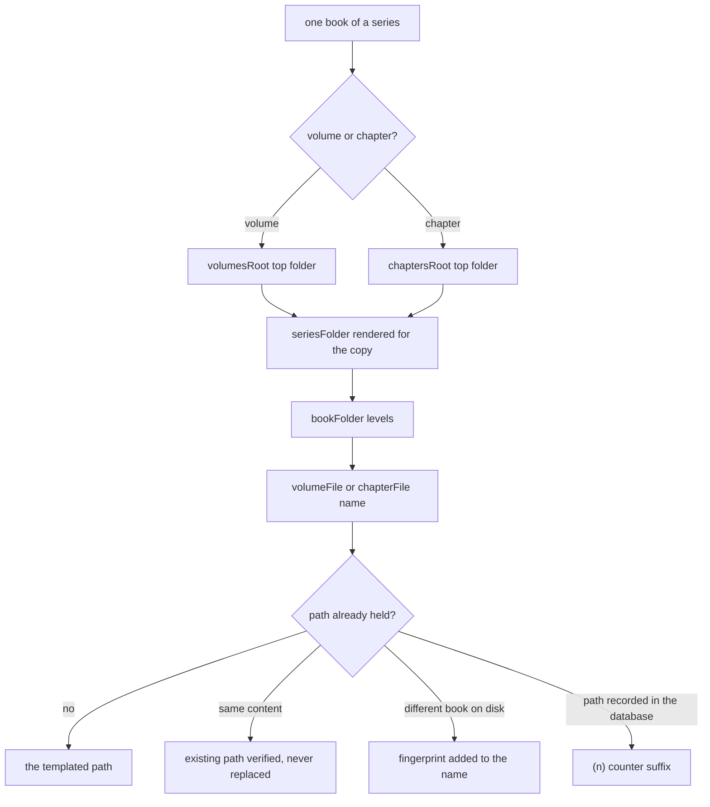
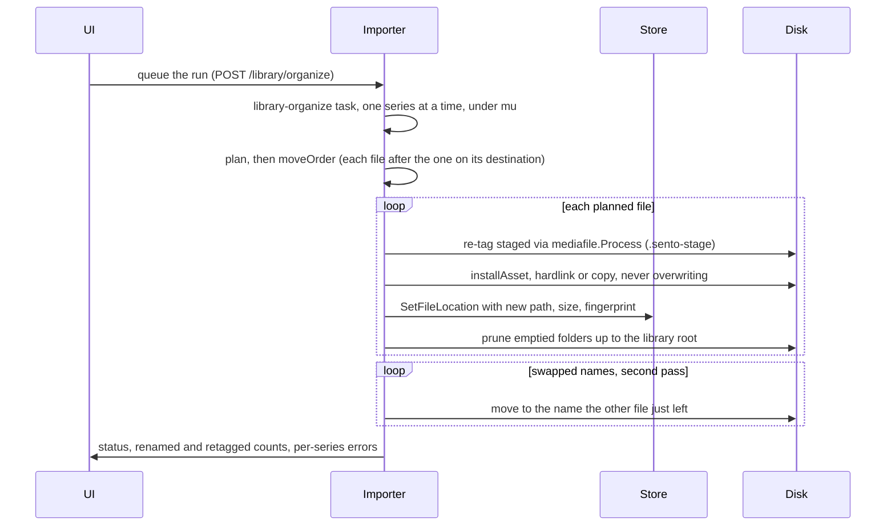

# Naming, folders and names in readers

Where a book's file goes, what it is called, and which series a reader
shows it under are all templates in Settings → Media, which groups them as
your reader's setup, what goes on disk, and what goes inside each book. New imports follow
them at once. Files already in the library change only when they are
[organized](#organizing-existing-files).

A **copy** below is one collected version of an edition: one box on the
series page. See [editions](editions.md) for what those are.

## Where a file lands

```
<library root>/<top folder>/<copy's folder>/<book folder>/<file name>
```

| Part | Setting | Default |
| --- | --- | --- |
| Top folder | `volumesRoot`, `chaptersRoot` | none |
| Copy's folder | `seriesFolder`, rendered for the copy | `{Series Title} [mangabaka-{seriesId}]` |
| Book folder | `bookFolder`, one level per `/` | `{edition} [{lang}] ({version})` |
| File name | `volumeFile` or `chapterFile` | `{Series Title} v{volume:00} [{edition}][{lang}].cbz`, `{Series Title} c{chapter:000} [{group}][{lang}].cbz` |

With the defaults a volume lands at
`ONE PIECE [mangabaka-377]/Standard Edition [en]/ONE PIECE v112 [Standard Edition][en].cbz`.

**Top folders** put the type above the series: `Volumes/<series>/…` and
`Chapters/<series>/…`. A series gets a separate chapter folder
(`series.chapter_path`) only when the two differ; both empty keeps one
folder per series. The `{type}` token puts the split inside the series
instead (`<series>/Volumes/…`). Scans cover both folders, and storage
availability is judged per folder, so an unreachable chapter tree does not
block volumes.

**The copy's folder** is the series folder template rendered for that
copy, with its edition, its version and its name in readers:

- A render equal to the series' own is the series folder. This is every
  copy under the default template.
- A different render is a sibling folder beside it. Copies that render the
  same folder share it.
- An edition's default version stays in the edition's folder.
- Where the render starts with the series' own, the folder is the series'
  current folder name plus what the copy adds, so a folder name the series
  kept or was adopted with survives.
- A series adopted from outside the library root stays in its one folder.

The series' own folder keeps the review area (`review/`). Scans walk it
and every copy's folder.

**The book folder** nests inside the copy's folder. An empty template puts
books directly in it.

**File names.** A file holding several books is named for its range
(`c001-008`). When a different book already holds the path, the content
fingerprint is added (` [<sha-256>]`); an occupied path is never
overwritten. "Add the content fingerprint to file names" adds it always.
With "Rename imported files" off, a file keeps the name it arrived with.

A series keeps its own folder name when settings change (the name is only
rendered when the folder is first created); a change of top folders
re-roots it. Moving the library root itself is a
[separate operation](../installation.md#moving-the-library).

One book becomes its path level by level: the ledger picks the top
folder, the copy's render of the series folder picks the folder beside it,
the book folder nests inside that, the file template names the file, and a
held path adds the fingerprint or a counter instead of overwriting.



## Media settings reference

Every key stored under the `media` settings key, with its default and what
it changes. Saving validates the templates first: see
[What is refused](#what-is-refused). The defaults come from
`DefaultMediaSettings`; a stored row that fails to unmarshal falls back to
them (`LoadMediaSettings`).

| Key | Default | Effect |
| --- | --- | --- |
| `seriesFolder` | `{Series Title} [mangabaka-{seriesId}]` | the series folder template, rendered per copy to place its files |
| `volumesRoot`, `chaptersRoot` | empty | top folders above the series folder; equal values (both empty by default) keep one folder per series |
| `bookFolder` | `{edition} [{lang}] ({version})` | folder levels inside the copy's folder, one per `/` |
| `volumeFile` | `{Series Title} v{volume:00} [{edition}][{lang}].cbz` | the volume file name; must hold `{volume}` |
| `chapterFile` | `{Series Title} c{chapter:000} [{group}][{lang}].cbz` | the chapter file name; must hold `{chapter}` |
| `chapterDir` | `chapters` | stored with the settings; no code reads it today |
| `hashInName` | off | the fingerprint enters every file name, not only on a collision |
| `renameImports` | on | new imports get the templated name; off keeps the name they arrived with |
| `alwaysCopy` | off | copy instead of hardlink when installing a file |
| `writeComicInfo` | on | archives are rewritten as tagged CBZ on import and organize |
| `readerFields` | `series` = `{Series Title} {version}`, `seriesGroup` = `{Series Title}` | the templates for the presented ComicInfo fields, per copy; an edition may override each |

## Tokens

Tokens are written `{name}`, in any case. Every token works in every path
template. The list lives in one place, `mediafile.Tokens`: it renders the
templates, backs the token table on the Media page
(`GET /settings/media/schema`) and names a misspelled token.

| Token | Renders |
| --- | --- |
| `{Series Title}`, `{Series TitleSlug}` | `ONE PIECE`, `one-piece` |
| `{seriesId}` | MangaBaka id |
| `{Reader Series}` | the copy's [series name in readers](#names-in-readers) |
| `{volume}`, `{chapter}` | the number; `{volume:00}` pads its whole part, `1102.5` keeps its fraction |
| `{edition}`, `{lang}`, `{publisher}`, `{medium}` | the edition's name, language, publisher and medium |
| `{type}` | `Volumes` or `Chapters` |
| `{version}` | the collected version's name; empty for an edition's default |
| `{group}`, `{isbn}`, `{year}` | release group, ISBN, the series' year |
| `{editionId}`, `{versionId}` | internal ids that never change |

A wrapper left empty disappears: `[{group}]` vanishes when there is no
group, and so does ` ({version})` for a default version. Values lose the
characters a path cannot hold. An older name still renders:
`{collectionId}` is an alias of `{editionId}`.

## What is refused

Saving is refused, and the preview says why under the field, when:

- a template uses a name that is not a token;
- the series folder template is empty, contains a path separator, or
  renders empty for a series on its own (every series would share it);
- the volume file template has no `{volume}`, or the chapter one no
  `{chapter}` (files would overwrite each other);
- the book folder leaves the series folder, or a top folder is not a plain
  folder name;
- a reader template uses `{volume}`, `{chapter}`, `{group}`, `{isbn}` (it
  holds for every book of a copy), uses `{Reader Series}` (the name it
  sets), or renders empty.

## Collisions, name limits and temporary files

A templated name is tamed before use: path-unsafe characters are removed
and the base name is cut to 120 bytes, rune by rune; a name cut to nothing
falls back to `book` (`assetPath`). The fingerprint enters the name as
` [<sha-256>]` before the extension.

An occupied path is never overwritten:

- On disk, `placeAsset` tries the plain name first (unless `hashInName`
  is on). When it exists, the existing file's fingerprint must match, or
  the fingerprinted name is used instead (`verifyDestination`).
- In the database, `files.path` is unique. When another row already
  records the destination, organize appends ` (2)`, ` (3)`, ... before
  the extension (`PathTaken`).

While a file is written it passes through temporary names in its folder:
`.sento-import-*` (the `Process` / `ImportCBZ` temp), `.sento-stage-*` (a
re-tag staged next to its destination) and `.sento-install-*` (a copy
staged before its exclusive link). Each is removed when its operation
ends; a leftover `.sento-import-*` older than one hour is swept on the
next import into that folder (`cleanStaleTemps`).

## Names in readers

A reader files a book under its ComicInfo `Series`, groups series by
`SeriesGroup`, or goes by folders. Both fields are templates
(`mediafile.PresentedFields`), rendered per copy:

| Field | Default | Result |
| --- | --- | --- |
| `Series` | `{Series Title} {version}` | `ONE PIECE`, and `ONE PIECE Colored` for the edition collected again as Colored |
| `SeriesGroup` | `{Series Title}` | `ONE PIECE` for every copy |

An edition can set its own `Series` template in Edit edition → In readers:
the library's, the series and edition name
(`{Series Title} {edition} {version}`), or a custom one. A template that
renders empty for a copy falls back to the default, so a copy always has a
name. The edition's box shows the name when it differs from the series title.

These fields are presentation, written exactly and never read back for
identity ([metadata](metadata.md), D18).

### Setting up for a reader

Readers decide what a series is differently:

- **Kavita** files a book under the `Series` name inside it, not its
  folder, but wants every series in a folder of its own: several series in
  one folder "is not supported but does work", and one series must not sit
  in two sibling folders of a library
  ([Kavita scanner](https://wiki.kavitareader.com/guides/scanner/)).
  `SeriesGroup` becomes a collection when the library's Manage Collections
  is on.
- **Komga** makes a series of every folder that holds books, at any depth,
  and titles it with the `Series` inside them when it imports ComicInfo;
  with "Append volume to series title" on, a manga volume's `Volume` turns
  the title into `ONE PIECE (12)`
  ([Komga scan](https://komga.org/docs/guides/scan-analysis-refresh)).
  `SeriesGroup` becomes a collection.

The Media page offers **setups** (`service.NamingSetups`, served with the
schema): a series folder, a book folder and the reader fields known to
work together. Picking one fills those settings, to be saved like any
edit; a setup is not stored, and the page recognises one by the settings
matching it. Top folders, file names and import options are left alone.

| Setup | Series folder | Book folder | Readers |
| --- | --- | --- | --- |
| Kavita or Komga (recommended) | `{Reader Series} [mangabaka-{seriesId}]` | none | each name in readers its own folder: both readers show a Colored copy as its own series |
| Sento's default | `{Series Title} [mangabaka-{seriesId}]` | `{edition} [{lang}] ({version})` | Kavita reads several series from one folder; Komga shows each edition folder as a series |

Under the setups the page says what Kavita and Komga would show for the
current settings (`service.CheckReaders`): the sample edition and the same
edition collected again as Colored, as two series or merged into one. To
show an edition as its own series, give it its own name in Edit edition.
Chapters kept apart from volumes by top folders belong in a second Kavita
library.

The page's tree draws three sample books (a volume, the same volume
collected again as Colored, and a chapter), level by level, each level
naming the setting that makes it (`service.PreviewPaths`). Below it, every
ComicInfo field Sento writes is listed with where its value comes from
(`mediafile.WrittenFields`; a test keeps it in step with the struct).

## Organizing existing files

Organize previews, then applies, what the current settings would change
in existing files: move and rename to the templated path, and rewrite
embedded metadata where the merge would change it.

- **Where**: one series (series → Files → Organize files), several
  (Library table → select → Organize files), or the whole library (Media →
  Organize existing files). Saving Media settings that change naming or
  metadata offers the preview, and so does saving an edition's new name in
  readers.
- **Preview**: each file's move, whether its metadata is rewritten, and
  why a file is left alone (not matched to a book yet, not on disk). The
  library preview lists the series it would change.
- **Apply**: always one background run, one series at a time, with
  progress and per-series failures. Closing the dialog does not stop it.
  A run cut short is resumed by starting it again; files already in place
  drop out of the plan. System → Tasks lists it as *Organize Library
  Files* without a Run button: files move only from a preview.
- **One run converges.** A file moves after the one sitting on its
  destination, and two files on each other's names are settled in a second
  step. The moved count is the files that actually moved. A file on its
  fingerprinted name because a different book keeps the plain one is in
  place and is not planned again.
- **Untouched**: fingerprints, coverage and pins. A seeding payload
  hardlinked to an old library file is never modified. A file whose
  books are all supplied by another file moves to `review/`. Emptied folders are removed.

Planning loads a series' catalog rows in bulk, so its query count is fixed
whatever the file count. Moving and re-tagging reuse a file's stored
fingerprint and only hash its pages when none is recorded.

### How a run plans

`organizePlans` works out every change for one series before anything
moves, in this order:

1. Load the media settings and the series, and preload the catalog cache
   in bulk (`catalogCache.preload`): a whole-series plan costs a fixed
   number of queries whatever the file count. A one-file pass (after a
   review confirmation) loads rows lazily instead.
2. Compute the series' volume and chapter folders and every copy's
   folder (`editionFolders`), plus the `review/` folders inside them.
3. Pick the placed file for each book of each collected version
   (`preferredFileOwners`: pin first, then score, then lower id).
4. For each file, list the books it holds (`fileBooks`), each filed under
   its edition's default version, else the oldest additional version
   that claims it.
5. Decide its fate (`skipReason`): not on disk, not matched to a book
   yet, or exiled to `review/` when another file is placed for all its
   books; otherwise compute the target path and name (`planTarget`) and
   whether its metadata would change (the current `ComicInfo` merged
   with the new one, compared field by field).
6. `settleFallbackNames` drops from the plan the files already sitting
   on their fingerprinted name because a different book keeps the plain
   one: planning them again would move nothing.

The per-pass cache is the `placement`: the folder map and each copy's
rendered reader names are built once per run and shared by every file.

### How a run applies

This diagram shows one organize run, from the queued request to the
status the dialog polls:



## API and code

| Route | Purpose |
| --- | --- |
| `GET`, `PUT /settings/media` | the settings |
| `POST /settings/media/preview` | sample paths level by level, reader names, what Kavita and Komga would show, and per-field errors for unsaved settings |
| `GET /settings/media/schema` | tokens, reader fields, ComicInfo sources and setups |
| `POST /series/{id}/reader-names` | each collected version's names in readers, optionally with an edition's unsaved templates |
| `GET /series/{id}/files/organize` | one series' preview |
| `GET /library/organize?series=1,2` | the preview across series (all when omitted) |
| `POST /library/organize` | start the run (`seriesIds`, `rename`, `retag`) |
| `GET /library/organize/status` | its progress and result |

| Code | Holds |
| --- | --- |
| `internal/mediafile/tokens.go`, `naming.go` | the token list and the renderer |
| `internal/mediafile/presented.go` | the reader fields |
| `internal/service/layout.go` | series and copy folders, token values |
| `internal/service/placement.go` | one series' folders, file names and ComicInfo for a pass |
| `internal/service/mediasettings.go`, `reader_fields.go` | settings, validation, previews |
| `internal/service/naming_setups.go` | the setups and the reader checks |
| `internal/service/organize.go`, `organize_library.go` | the plan, the run and its status |
