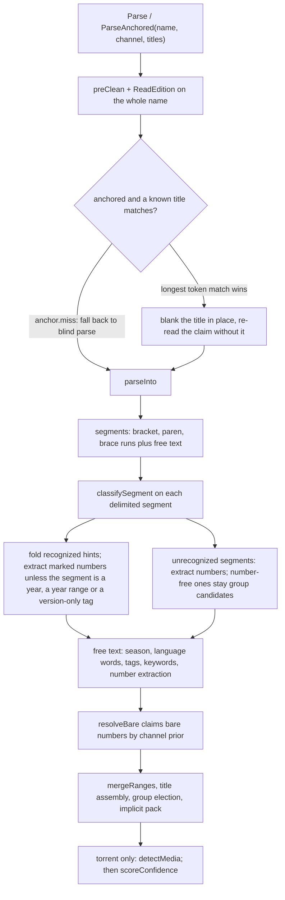
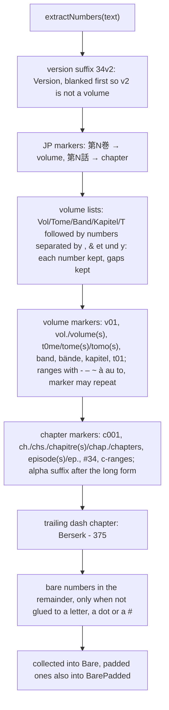
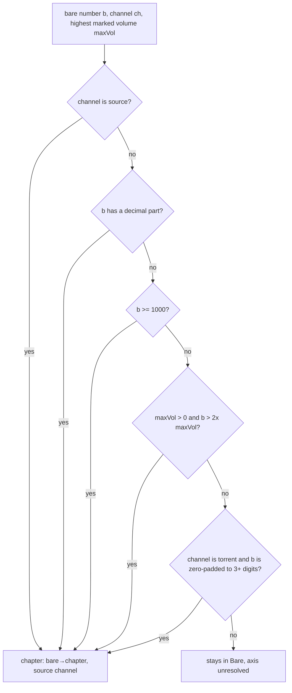
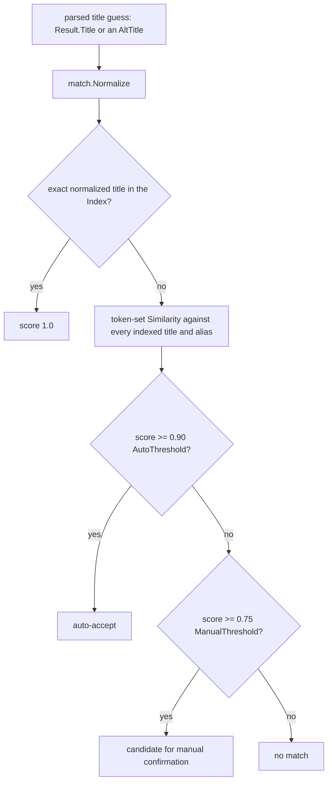

# The parser & title matching

Release parsing and title matching live in `internal/parse` and
`internal/match`. Every grab decision starts from an unstructured
release, file or chapter name; `parse` turns one name string into
structured facts, and `match` resolves a parsed title back to a library
series. The parser is the highest-risk component in Sento: the input
space is two decades of inconsistent human naming conventions. The
contract and decisions behind it are in [parser.md](../spec/parser.md).

## In the code

| File or package | What it holds |
| --- | --- |
| `internal/parse/parse.go` | entry points `Parse` and `parseInto`, the bare-number priors `resolveBare`, group election, the implicit pack, `scoreConfidence` |
| `internal/parse/preclean.go` | `preClean`, the canonicalization every pattern assumes |
| `internal/parse/segment.go` | `segments`, the delimited-run splitter |
| `internal/parse/tags.go` | segment classification: language, content-type, publisher, quality, year, version and resolution vocabulary; `scanLanguages`, `scanTags`, `fold` |
| `internal/parse/numbers.go` | the marker patterns and the extraction cascade `extractNumbers` |
| `internal/parse/num.go` | the number domain: `Num`, `Range`, `mergeRanges` |
| `internal/parse/edition.go` | `ReadEdition` and `EditionClaim`: the one edition vocabulary |
| `internal/parse/anchor.go` | `ParseAnchored`, `foldRunes`, leftover words |
| `internal/parse/media.go` | `detectMedia`, the other-media tokens |
| `internal/parse/result.go` | `Result`, `Channel`, the hint structs, `Inherit` |
| `internal/parse/label.go` | `Mentions` |
| `internal/match/match.go` | `Normalize`, `Index`, `Lookup`, `Similarity`, the thresholds |

## Design commitments

- **Purity.** `Parse(name, channel)` does no I/O and keeps no global
  state, which is what makes the regression corpus possible
  (`internal/parse/testdata/corpus/`, 12 `.jsonl` files, one case per
  line, partial expectations, CI gates on 100% pass).
- **Explainability.** Every rule that fires appends a `Step` to
  `Result.Trace`, so "why did it parse that way?" is always answerable.

The `Channel` (`torrent` / `source` / `file`, `result.go`) is the one
piece of context: it biases interpretation of ambiguous numbers and
enables other-media detection, but never changes the mechanics. Source
names are always parsed anchored; torrent and file names may be anchored
or blind.

## The result

One `Result` carries everything a name says: `Title` and `AltTitles`,
`Volumes` and `Chapters` as `[]Range`, unresolved `Bare` numbers and
their `BarePadded` padding fact, `Season`, `Year` and `YearRange`,
`Group`, `Languages` and the folded `Language` (`"multi"` when more than
one language is claimed), `ContentType` (`manga` by default), `Edition`
hints, the `Claim` the name makes about its numbering, `Quality` hints,
`Anchored` and `TitleLeftover`, the flags `Complete`, `CompleteInferred`,
`Ongoing` and `Extra`, the release `Version`, `Confidence`, and the
`Trace`. `Season`, `Year`, `YearRange`, `AltTitles` and `Ongoing` are
parser-internal facts: nothing outside `internal/parse` reads them.

## The pipeline

`Parse` and `ParseAnchored` share one pipeline; anchored mode only adds
a title-stripping step at the front. This diagram shows the stages of one
parse, in running order, each consuming what the previous one blanked out:

The text below fills in each stage.

## preClean (`preclean.go`)

`preClean` runs before any pattern: it strips one recognized archive
extension (`.cbz`, `.cbr`, `.cb7`, `.zip`, `.rar`, `.7z`, `.pdf`,
`.epub`; only a trailing extension that is a member of that list, so a
`.5` in "v1.5" survives), then canonicalizes: `_` → space, full-width
→ ASCII (`width.Fold`), Unicode NFKC (visually identical characters
become byte-identical), whitespace collapsed to single spaces. There is
no path split: the whole input string, path segments included, is the
name. Every later stage assumes this boring representation.

## Segments (`segment.go`)

`segments` splits the cleaned name into delimited runs and free text:

`[..]`, `(..)` and `{..}` each form one segment whose inner text is
kept with its delimiter and its order of appearance. The scan is flat,
no nesting: a segment ends at the first matching closer, and an opener
with no closer degrades to free text ("Berserk [incomplete"). Free-text
runs between segments are concatenated by `parseInto`, keeping the
first run's position.

## Segment tag tables (`tags.go`)

`classifySegment` inspects one delimited segment's text, whole-segment
matches first, then the shared vocabulary scanner `scanTags`. A segment
that hits nothing and carries no numbers stays a group candidate.
Recognized segments still yield their marked numbers, unless the segment
is a year, a year range, or a version tag with no resolution (a bare
`(v3)` or `(2003)` carries no book number).

| Family | Vocabulary | Produces |
| --- | --- | --- |
| Year | a whole segment `1800`–`2100` (`reYear`) | `Year` |
| Year range | a whole segment `1800-2100` style (`reYearRange`) | `YearRange` |
| Version | a whole segment `v` + one digit; `(F)` | `Version` (single digit; `(F)` = 2) |
| Language | table below | `Language` / `Languages` |
| Content type | `novel`, `ln`, `light novel` → novel; `audiobook`; `artbook`, `fanbook`, `anthology`, `guidebook` → artbook; `anime` | `ContentType` |
| Publisher | `viz`, `seven seas`, `seven seas siren`, `yen press`, `kobo`, `comixology`, `shonen jump`, `kodansha`, `dark horse`, `square enix`, `j-novel club`, `vertical`, `tapas`, `webtoon`, `manga plus`, `ize press`, `udon` | `Edition.Official` + verbatim `Edition.Names`; `webtoon`/`tapas` also set `Quality.Web` |
| Quality | `digital`; `scan`, `scans`, `scanlated`, `scanlation`, `c2c`; `premium`; noise-only: `compressed`, `jpeg`, `jpg`, `png`, `hq`, `lq`, `batch`, `oneshot`, `one-shot` | `Quality` flags |
| Completeness | `complete`, `end`, `completed`; `full` unless part of `full color` / `full colour` | `Complete` |
| Ongoing | `ongoing` | `Ongoing`, clears `Complete` |
| Extra | `side story` | `Extra` |
| Raw | `raw` | `Edition.Raw` and `Language` `ja` unless already set |
| Resolution | token forms below | `Quality.Resolution` |

Language vocabulary (`languageTags`, whole-segment or scanned in compound
segments):

| Language | Tags |
| --- | --- |
| `en` | `eng`, `english`, `en` |
| `fr` | `fr`, `vf`, `french`, `fre` |
| `ja` | `jp`, `ja`, `jap`, `japanese` |
| `es` | `es`, `esp`, `spanish` |
| `pt-BR` | `pt-br`, `brazilian portuguese` |
| `pt` | `pt` |
| `de` | `de`, `german`, `deutsch` |
| `it` | `it`, `italian`, `italiano` |
| `ru` | `ru`, `russian` |
| `pl` | `pl`, `polish` |
| `ko` | `kr`, `ko`, `korean` |
| `zh` | `zh`, `chinese` |
| `multi` | `multi`, `multilingual` |

In free text,
unambiguous words (`french`, `vf`, `vostfr`, `english`, `japanese`,
`spanish`, `korean`, `chinese`, `german`, `italian`, `portuguese`,
`russian`, `polish`, `multi`) count anywhere; bare two-letter codes
(`FR`, `JP`, `JA`, `KR`, `CN`, `RU`, `PL`) count only as standalone
UPPERCASE words (`sceneLangCodes`); `EN`/`DE`/`ES`/`IT` stay out because
they collide with shouting-case title words. A word followed by `name`,
`names`, `honorific`, `honorifics` or `sfx` ("Japanese Names", "JP
Honorifics", "Korean SFX") is a note about retained source style, not a
language claim, and never becomes the group; every other occurrence in
the same name still counts ("Japanese Names, Japanese" claims `ja`).

`pt-BR` suppresses a plain `pt` in the same scan. More than one
distinct language sets `Language` to `multi` and collects them sorted in
`Languages`; a conflicting second segment fold also yields `multi`.

Resolution tokens must match a whole token, so group names like
`2KScans` or `Team1800px` stay group candidates: `1800px`, `x3200`,
`2400px` (3–4 digits with optional `x` and `px`) give the pixel count
directly; integer `K` notation multiplies by 1024 (`2K` = 2048,
`4K` = 4096, `10K` = 10240). A `-Repack` suffix (`1800px-Repack`,
`2k-Repack`) also sets `Version` to at least 2 without replacing a
higher explicit revision. The highest stated resolution wins; names
without a resolution tag keep 0. Resolution tags never become the group
or book numbers. These facts feed custom format matching (High
Resolution is at least 1600) and imported file facts.

## Edition claims (`edition.go`)

An edition, for a downloader, is a numbering: which pages "volume 3"
holds. Release names and edition names say things about it in one
vocabulary, read by `ReadEdition` and nowhere else. `Parse` and
`ParseAnchored` store the result in `Result.Claim`; in anchored mode the
claim is re-read with the title blanked out, so a series called "Perfect
Blue Deluxe" claims nothing.

`EditionClaim` holds:

- `Regroup`: canonical keys of regroupings (the story cut into fewer,
  bigger books), sorted. The vocabulary: `omnibus` ("omnibus");
  `deluxe` ("deluxe"); `vizbig` ("vizbig", "viz big"); `perfect`
  ("perfect edition", "kanzenban"); `colossal` ("colossal edition");
  `collectors` ("collector's edition", "collectors edition");
  `all-in-one` ("all-in-one", "all in one"); `eternal` ("eternal
  edition"); `definitive` ("definitive edition"); `black` ("black
  edition"); `master` ("master edition", "masters edition",
  "masterpiece edition"); `ultimate` ("ultimate edition"); `n-in-1`
  ("in1 edition"). `3-in-1`, `3in1`, `2 in 1`, `two in one` (spelled
  `two`/`three`/`four` become digits) map to keys like `3-in-1`.
- `Own`: the lowercase name of a numbering the vocabulary does not
  explain, from `<word> Edition` with an optional ordinal ("35th
  Anniversary Edition" → `35th anniversary`), minus the plain words
  (`standard`, `digital`, `paperback`, `hardcover`, `print`, `english`,
  `first`…`fourth`, `new`, `revised`, `special`, `limited`, `set`,
  `box`) and minus words already explained by another claim.
- `Written`: the name as the source writes it ("Deluxe Edition",
  "Kanzenban Edition"); synthesized from the first regrouping phrase,
  with " Edition" appended when needed, when no own name was found.
- `Color`: a colorization of the original volumes. Phrases: `colored`,
  `coloured`, `color`, `colour`, `full color`, `full colour`, and the
  `digital colored comics` imprint.
- `ColorEdition`: the name names a color edition, a numbering of its
  own ("Full Color", "Color Edition", "Complete Color"). `Digital
  Colored Comics` is exempt: it colorizes the original volumes, so it
  sets `Color`, not `ColorEdition`.
- `Box`: `box set`, `boxset`, `box edition`.

`Named()` reports whether the claim names a numbering (a regrouping, an
own name, or a color edition); `Shares()` reports whether two claims
name the same one. In a delimited segment, a color word claims color
only when the whole segment is a color tag or carries the `Digital
Colored Comics` imprint; otherwise the color words are masked
(`maskGroupColor`), so a group name like `(Colored Council)` is the
group, not a color claim. In free text the words claim color wherever
they appear, because imprints sit mid-name. `scanTags` folds the claim
into `Edition`: regroupings set `Omnibus` (or `Deluxe` for the `deluxe`
key), `Color` → `Colored`, `Box` → `BoxSet`.

| Input | Claim |
| --- | --- |
| `Berserk Deluxe Edition v01` | `Regroup: [deluxe]`, `Written: "Deluxe Edition"` |
| `One Piece 3-in-1 v01` | `Regroup: [3-in-1]` |
| `Two-in-One Edition` | `Regroup: [2-in-1]` |
| `Fullmetal Edition v01` | `Own: "fullmetal"`, `Written: "Fullmetal Edition"` |
| `35th Anniversary Edition` | `Own: "35th anniversary"` |
| `Berserk v41 (Colored)` | `Color: true` |
| `Berserk v41 (Color Edition)` | `ColorEdition: true` |
| `Berserk v41 (Digital Colored Comics)` | `Color: true`, not `ColorEdition` |
| `Berserk v41 (Colored Council)` | no color claim; group `Colored Council` |
| `Box Set v01` | `Box: true` |

## Numbers

### The number domain (`num.go`)

`Num` is a fixed-point hundredths integer: chapter 34.5 = `Num(3450)`.

No floats anywhere (exact comparisons, exact DB round-trips); the only
float lives at the JSON boundary, immediately rounded. Alpha
sub-chapters follow the Mihon convention: `4a` → 4.1
(`alphaSuffixNum`: a→+10 … i→+90). `Range{From, To}` is inclusive; a
single number is `From == To`. Custom JSON renders `3450` as `34.5` and
ranges as `[from,to]`. `parseNum` rejects values above 2^40 but has no
negative check (`parseNum("-3")` returns -300); ranges stay non-negative
because the extraction patterns capture `\d+` and never a minus sign, so
ranges always satisfy `0 ≤ From ≤ To`.

### The extraction cascade (`numbers.go`)

`extractNumbers` runs over a mutable buffer, consuming each match by
blanking it. This diagram shows the number-extraction cascade in the fixed
order the patterns run; later passes only see what earlier ones left:

Rule tables, with examples from `internal/parse/testdata/corpus/`:

| Rule | Input → read |
| --- | --- |
| version suffix `NvM` | `Ch.34v2` → chapter 34, `Version` 2 |
| JP volume `第N巻` | `第01-10巻` → volumes [1,10]; `ワンピース 第98巻` → volume 98 |
| JP chapter `第N話` | `第12話` → chapter 12; `1167話 伊達之子` → chapter 1167 |
| volume list | `Tomes 2, 4 et 7` → volumes 2, 4, 7 (not 2–7); `Volumes 2 & 4` → 2 and 4; separators `,` `&` `et` `und` `y` |
| volume markers | `v41` → 41; `Vol. 106` → 106; `volume64` → 64; `Tome 12`, `T0me 7`, `Tomo 8` → volume; `T05`/`T02 au T05` → volume; `Band 3-6` → [3,6]; `Bände`; `Kapitel 4` → volume 4; `Tomes 2 à 5` → [2,5] |
| chapter markers | `c001`, `Ch.34`, `Chap 5`, `Chapter 1184`, `Chapitre 1090`, `chs`, `Episode 12`, `Ep. 45`, `#34` → chapter; `ch1.1 + ch1.3` → 1.1 and 1.3 |
| marker ranges | `v01-v38`, `v01-38`, `Vol. 102-105`, `c001-050`, `Chapters 12.5-14`; separators `-` `–` `~` |
| alpha suffix | `Chapter 4a` → 4.1 (only after the long marker form, or on bare numbers); `1150a` → 1150.1 |
| trailing dash | `[Kamizye] Berserk - 375` → chapter 375 |
| bare range | `One Piece v001-111 + 1134-1176` → volumes [1,111], chapters [1134,1176]; `Solo Leveling 164-169 (2021)` → stays `Bare` [164,169] |
| pure range segment | `[01-270]` → chapters [1,270] |
| glued digits rejected | `S2`, `1r0n`, `mp3`, `c0042` as bare (the `c` marker reads it), digits before/after a `.` or `#` never read bare |

A recognized tag segment still yields its marked numbers unless it is a
year, a year range, or a version-only tag: `(2022)`, `(2003-2026)`,
`(v3)` carry no book number, but `(v01 Digital 1800px-Repack)` does
(volume 1, resolution 1800, version 2), and `(3-in-1 Digital 2400px)`
carries the resolution. A bracketed pure range (`[01-270]`) reads as a
chapter range by convention.

### Range merging (`mergeRanges`)

After extraction, `Volumes` and `Chapters` are sorted and coalesced:
overlapping ranges fuse, and consecutive whole numbers fuse
(`[1,2]`, `[3,3]`, `[4,5]` → `[1,5]`), so `v1`, `v2`, `v3` become
`[1,3]`. Coalescing is transitive. Fractions never bridge a gap:
`1.1` and `1.3` stay two ranges.

### Bare-number resolution (`resolveBare`)

Bare numbers left over from the cascade get their axis from the channel
priors, in this order; the first rule that fires claims the number as a
chapter, and whatever remains stays in `Bare` with its axis deliberately
unresolved (nothing downstream reads `Bare` for book coverage). This diagram
shows the bare-number resolution cascade:

"Far above" is
strictly more than twice the highest marked volume, so `v05` with a
bare `11` resolves as chapter 11, and a 4-digit number in free text
becomes a chapter through the ≥1000 rule. The padding fact survives:

numbers written zero-padded to three or more digits (only digits before
the decimal point count, so `01.0` is not padded but `001.0` is) are
kept in `BarePadded` for whoever resolves the axis: `Solo Leveling
001 (Scanlated)` on the torrent channel becomes chapter 1, on the file
channel it stays `Bare` [1,1] with `BarePadded` [1,1].

## Keywords, flags and season in free text

After segment classification, the free text is scanned in order:

| Rule | Effect | Cuts the title? |
| --- | --- | --- |
| `S` + 1–2 digits word-bounded (uppercase `S` only), or `season N` any case | `Season` | yes |
| language words and scene codes (above) | `Language` / `Languages` | no |
| edition/quality vocabulary via `scanTags` | hints | no |
| `complete`, `completed` | `Complete` = true | yes |
| `batch`, `oneshot` | nothing, recognized | yes |
| `extra`, `omake`, `special` | `Extra` = true | yes, unless the marker is the first word and the parse is not anchored ("Special A" keeps its title; "One Piece Special" → "one piece") |
| `side story` (anywhere, also inside segments) | `Extra` = true | no |
| numbers (the cascade above) | volumes/chapters/bare | yes, at each consumed span |

`ongoing` anywhere (segment or free text) sets `Ongoing` and clears
`Complete`. Examples: `Solo Leveling Ragnarok S2 Complete` → title
"solo leveling ragnarok", season 2, complete; `One Piece 12 special`
→ chapter 12, extra; `Ch. 110.5 - Extra` → chapter 110.5, extra.

## Title assembly and group election

Free-text runs are concatenated; the title ends at the earliest consumed
span (season marker, keyword, number). Trailing ` -–~:|/+&` characters
are trimmed from the title. If the title contains ` / ` or ` | `, a
fixed preference order decides the split: ` / ` is always tried before
` | `, regardless of which appears earlier in the title ("A | B / C"
splits on ` / `); the first part becomes `Title`, the rest `AltTitles`
("Only I Level Up / Solo Leveling"
→ title "only i level up", alt "solo leveling"). Titles are lowercased.

Group election runs over the unrecognized, number-free segments: the
last trailing one wins; a `{...}` note is used only when nothing else
can ("Solo Leveling {2021-2023} {Digital} {Tapas} {4str0}" → group
`4str0`); a leading segment counts only when a title exists
(`[Kamizye] Berserk - 375` → group `Kamizye`). There is no known-group
list; brace text is a fallback, not a group claim.

The implicit whole-series pack: on the torrent channel, a name with no
numbers at all, not ongoing, not complete, with a title and a year range
sets `Complete` and `CompleteInferred` ("Solo Leveling (2021-2026)
(Digital) (1r0n)"). A bare numberless title is more likely a one-shot
than a pack, so no year range means no pack. The search funnel adds a
second inferred-pack rule for anchored, leftover-free torrents on the
volume ledger (`funnel.go`), offered for review but never grabbed
automatically (`rejected.pack_unverified`).

## Anchored mode (`anchor.go`)

`ParseAnchored(name, channel, titles)` finds the best known title in the
name before anything else: each candidate title is pre-cleaned and
folded with `foldRunes` (case and diacritics folded 1:1 rune-for-rune,
so byte offsets stay valid for blanking; that is why it is not
`match.Normalize`), located as a whole-token sequence, and the longest
match by joined token length wins ("Berserk of Gluttony" beats "Berserk").

The title is blanked in place and its last rune replaced by a private
use mark, the edition claim is re-read without it, and the rest parses
normally: numbers inside titles ("Mob Psycho 100", "86", "Steins;Gate 0")
can never leak into slots. On `anchor.miss` the parser falls back to
blind parsing.

`TitleLeftover` collects the unexplained words before the title region:
leftover stopwords (edition/quality words like `digital`, `colored`,
`edition`, `complete`) and one-character words are dropped, and a
dual-title part that overlaps another known title at ≥75% of the shorter
token count is excused ("Only I Level Up / Solo Leveling" leaves nothing).
What remains signals a different work that merely contains the title:

"WANTED! Eiichiro Oda Before One Piece" → leftover "wanted eiichiro oda
before"; "One Piece Party - Deluxe Edition" → "party". After the anchor,
an edition marker (`deluxe`, `omnibus`, `digital`, `colored`, `full
color`, `box set`, `edition`, …) ends the title region, so "One Piece -
Digital Colored Comics, cleaned and leveled v05" leaves no leftover.

## Other-media detection (`media.go`)

On the torrent channel only, `detectMedia` runs last and overrides the
content type when the name carries another medium's tokens, because a
general tracker answers a title search with films, episodes and games of
the same name, and none of those names say "anime". Video tokens win
first, then software, then audio:

- **video**: codecs (`x264`, `h265`, `hevc`, `avc`, `av1`, `xvid`,
  `divx`), sources (`blu-ray`, `bdrip`, `dvdrip`, `web-rip`, `web-dl`,
  `hdtv`, `hdrip`, `remux`, `hdlight`, `4klight`), video resolutions
  (`480p`…`2160p`), `S01E02`, audio tracks (`eac3`, `ac3`, `dts`,
  `truehd`, `ddp`), `vostfr`, `subfrench`, containers (`mkv`, `mp4`,
  `avi`), `fhd` → `ContentVideo`
- **software**: three-part versions (`v1.4.1`), `nsp`, `xci`, `nsw`,
  `dlc`/`dlcs`, `denuvoless`, `clonecd`, `fitgirl`, `elamigos` →
  `ContentSoftware` ("REPACK" is deliberately absent: scene book and
  video releases both use it)
- **audiobook**: `m4b`, `mp3`, `flac`, `audiobook`, `NNN kbps`,
  `NN.N khz` → `ContentAudiobook`

"WEB", "Digital" and bare resolutions are deliberately absent from the
video list, so real comics stay manga. Examples:
`Hunter.X.Hunter.2011.INTEGRALE.MULTI.VFF.1080p.BluRay.AAC.2.0.x265-Phoenix`
→ video; `[SWITCH] HUNTER×HUNTER.NEN×IMPACT.Update.v1.3.1 [JP - MULTi]
NSP` → software; `Primal.Hunter.T04.Zogarth.FR.[M4B.63.kbps]-SGFx` →
audiobook; `Hunter x Hunter v38 (2026) (Digital) (JKO)` stays manga.

## Confidence

`scoreConfidence` starts at 1.0 and subtracts: 0.05 per unexplained
segment (unrecognized, number-free, and not the elected group), 0.1 if
any bare number remains unresolved, 0.3 when there is no title, 0.2 when
there are no numbers at all and the release is not complete; the floor
is 0. There is no extra penalty for a bare number that could be part of
the title.

## Listing inheritance (`result.go`)

`Result.Inherit(listing)` fills what a release's own name leaves unsaid
from the name of the listing it sits in ("Vol. 001 (Digital)" inside
"One Piece - Digital Colored Comics"): the claim's regrouping, own name,
color edition and written name (only when the release's own claim names
nothing), color and box, the edition hints (OR), the verbatim edition
names (merged), the quality hints (OR, resolution max), the group, and
the language, each only where the release itself is empty. What the
release says of itself always wins. The search funnel calls it for
source releases that carry a listing name (`funnel.go`): `rc.Parse.Inherit(parse.ParseAnchored(cand.Source.Listing, channel, run.titles))`.

## Parser version and stale facts

`parse.Version` is the parser revision, currently 2, stamped on every
file whose filename-derived facts were read from its name
(`store.File.ParserVersion`, migration 0035). Bump it whenever parser
output for existing names may change: a scan re-reads the name those
facts came from with the current parser when the stored stamp is older
(`scan.go`, `rederiveFacts`), replacing only what a name says (flags,
resolution, revision, digital, and a name-read language or group); the
download's provenance, claims, bytes and manual corrections stand.

Revision 2 exists because 0.7.0 stamped reviewed files as read by
revision 1 without re-reading them. `Result.Mentions(phrase)` reports
whether the cleaned name contains a phrase as whole words (phrase must
be lowercase); the edition fitter uses it to test a claim's own name
against the release name.

## Title matching (`internal/match`)

The reverse direction: which library series does a parsed title belong
to? `Normalize` folds a title for comparison: NFKC, lowercase,
diacritics stripped (NFD base rune), apostrophes dropped entirely
("journey's" → "journeys"), `&` → " and ", `×`/`✕` → " x ", all other
punctuation → space, whitespace collapsed. Articles are never trimmed.

`Similarity(a, b)` is an order-tolerant token-set score: each token of
the shorter title is matched to its best unused Jaro-Winkler counterpart
in the other (Winkler prefix bonus up to 4 characters, applied when the
Jaro score is at least 0.7), and the sum is averaged over the longer
token count, so extra tokens dilute the score. Equal strings score 1.

`Index` holds every normalized series title and alias; `Lookup` scores 1.0
for exact normalized hits and otherwise returns every entry at or above
`ManualThreshold` (0.75), sorted by score descending with ties broken to
the longest title (the containment rule: "Berserk of Gluttony" beats
"Berserk"). Thresholds: `AutoThreshold` 0.90, `ManualThreshold` 0.75. This
diagram shows the title-matching flow from a parsed guess to a decision:

Where production uses it: binding auto-resolution gates on
`match.Similarity` + `match.AutoThreshold` (a source auto-binds at
score ≥ 0.90 against any known title: at most 3 queries, at most 5
bindings, a 20 s budget, an "unmatched" sentinel when nothing reaches
0.90, `search_bindings.go`), while bulk import never uses
`match.AutoThreshold`: `ProposeImports` scores each search candidate
with `match.Similarity` and keeps the best as the proposal's
`Confidence`, starting from 0, for the user to confirm (`bulkimport.go`).
The 0.75–0.90
manual-confirm band is not used in production; `Index`/`Lookup` are used
only by the build-tagged manual tool `cmd/matchcheck` (`go run -tags
matchcheck ./cmd/matchcheck`, never built by CI). `match.Normalize` also
builds the text query sent to indexers (`textQuery`), since trackers
index "Hunter x Hunter", not "HUNTER×HUNTER".
