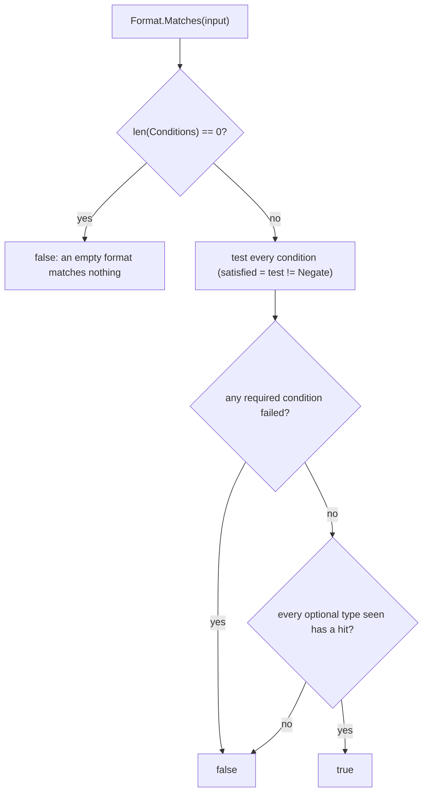
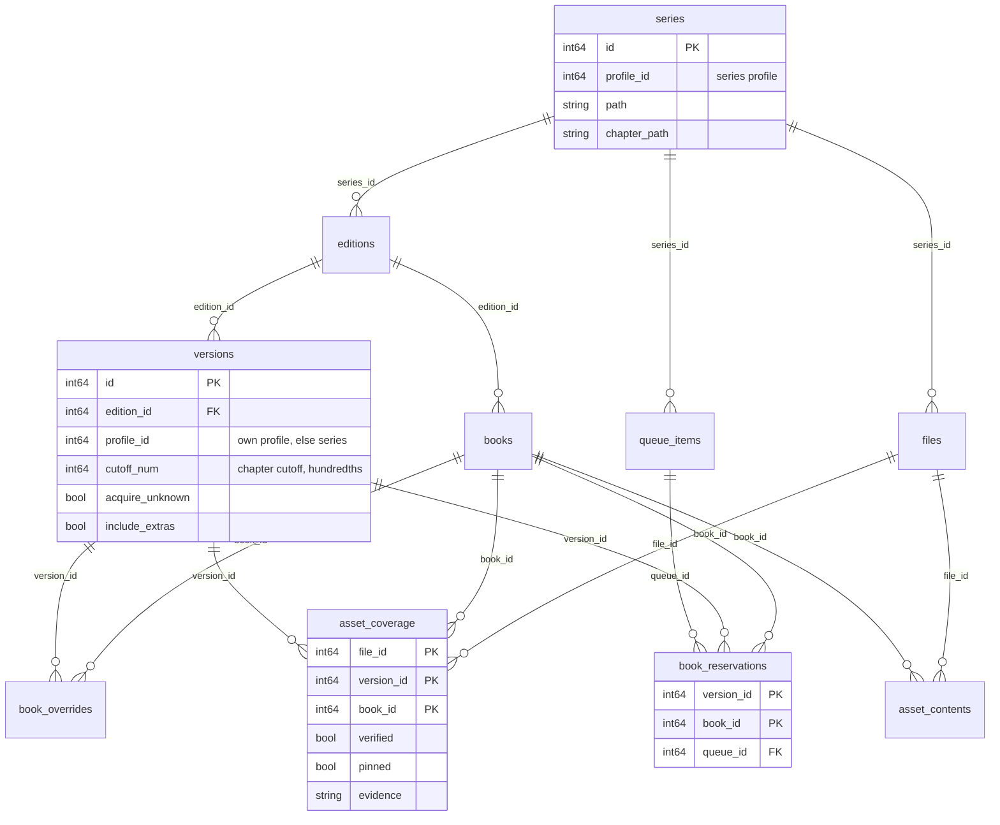
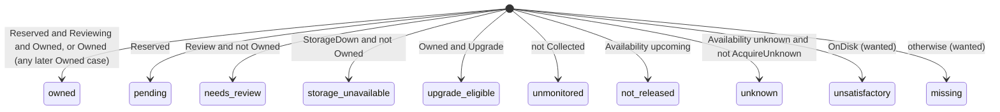

# Profiles and acquisition state

Profiles decide which releases are acceptable; the shared service ledger decides
which books need a copy. Both search and the UI use the same evaluation. See
[the edition model](editions.md) for identity and recovery rules.

## `internal/profile`

### Custom formats: Sonarr's matching semantics

A `Format` is a named list of `Condition`s. The matching rule (`Format.Matches`)
is the subtle part and worth stating precisely:

- **AND across condition *types*, OR within a type.** For each condition
  *type* that has non-required conditions, at least one must hit; every such
  type must be satisfied. So "(title~digital OR title~webrip) AND
  (protocol=torrent)".
- **Required conditions are hard**: any required condition that fails rejects
  the whole format immediately, regardless of the OR groups.
- **Negate inverts** a single condition (`satisfied = test() != Negate`).
- **An empty format matches nothing**: it can't mean "everything" (guard at
  the top of `Matches`).

Condition types (`CondTitle`, `CondGroup`, `CondLanguage`, `CondFlag`,
`CondProtocol`, `CondSite`, `CondResolution`) each have a `test`:
title/group/site are case-insensitive regex; language is base-language equality
(`fr` matches `fr-ca` via `baseLang`), or `*` for any stated language; flag
looks up a boolean parse fact; protocol is case-insensitive equality; resolution
is a minimum. `Validate` rejects malformed conditions before persistence (bad
regex, unknown flag, non-torrent/source protocol, non-positive resolution).

`Input` is the candidate's view a format matches against. Note it is the
already-parsed facts (Title, Group, Language, Flags…), not a raw name. This is
the clean layer boundary: `parse` produces facts, `profile` matches facts. (It
does NOT re-tokenize names, which is why `profile` does not depend on I/O.)

`Format.Matches` decides in three steps: an empty condition list matches
nothing, every required condition must be satisfied (a failed one rejects
immediately), and each condition type that has non-required conditions must have
at least one hit:

This diagram shows the matching rule as a flow; the bullets at the top of this
section state it in words. Title, group and site conditions are case-insensitive
regexes (compiled once into a process-wide `regexCache`; a failed compile is
cached too and never matches). Language is base-language equality via `BaseLang`
(`fr` matches `fr-ca`), or `*` for any stated language. Protocol is
case-insensitive equality with `torrent` or `source`.

Resolution is a minimum pixel height.

### The flag list

Flag conditions reference boolean parse facts. The list is `profile.Flags` (11
flags), read from a parsed release by `parseFlags` and carried on a file by
`store.FactFlags` (the same list), so search, scan and the file dialog all test
the same names:

| Flag | Comes from |
| --- | --- |
| `digital` | `parse.Result.Quality.Digital` |
| `scan` | `parse.Result.Quality.Scan` |
| `web` | `parse.Result.Quality.Web` |
| `premium` | `parse.Result.Quality.Premium` |
| `colored` | `parse.Result.Edition.Colored` |
| `omnibus` | `parse.Result.Edition.Omnibus` |
| `deluxe` | `parse.Result.Edition.Deluxe` |
| `boxset` | `parse.Result.Edition.BoxSet` |
| `official` | `parse.Result.Edition.Official` (a publisher tag) |
| `raw` | `parse.Result.Edition.Raw` |
| `complete` | `parse.Result.Complete` |

For a release, the funnel builds the flags with `parseFlags(c.Parse)`; for a
source release the title matched against is the listing name plus the release
title, and the group is the parse group, falling back to the scanlator.
`Validate` rejects malformed conditions before persistence (bad regex, unknown
flag, non-torrent/source protocol, non-positive resolution), and
`ProfileService` refuses formats with no name or no conditions.

### Profiles: scores + funnel knobs

A `Profile` does three jobs:

1. **Scores formats**: `FormatScores` maps format id → score; the funnel
   sums the scores of every format a candidate matches. Below `MinFormatScore`
   is a *soft* reject (force-grab overrides); `MinScoreOff` (-10000) disables
   the floor.
2. **Requires or refuses formats**: every ID in `Required` must match, and no
   ID in `Refused` may match. These are hard restrictions that force-grab
   cannot override. `Profile.Judge` supplies both the score and the first
   broken rule to search, import, and existing-file fulfillment. Scores remain
   independent per profile, including for required formats.
3. **Parameterizes the funnel per ledger**: `Volume` and `Chapter`
   `LedgerRules` carry size min/max, min seeders, and a preferred protocol (a
   +200 scoring bonus, not a hard filter; both protocols stay eligible).
   `DefaultRules` are the constants that applied before profiles existed:
   volumes 20–1500 MB / prefer torrent, chapters 2–200 MB / prefer source.

### `Judge`, `Apart` and the shipped default

`Profile.Judge` is the one place a profile's scores and rules meet a
candidate or a file: it returns a `Judgement` with the summed score of every
matching format (in list order), the matched formats, and `Broken`, the first
hard rule in words ("does not match \"X\", which Y requires" / "matches \"X\",
which Y refuses"), empty when none breaks. A nil profile judges nothing: score
0, no matches, no broken rule, and the built-in `DefaultRules` apply at the call
sites.

Search, the ledger and the importer all ask here, so a release and a file are
always judged the same way.

`Apart(a, b)` reports whether no release can satisfy both profiles: one
refuses a format the other requires. `ListProfiles` fills `ApartFrom` with those
profiles (never stored). When two profiles are not apart, a release both accept
fills each collected version's display, and a file both accept counts for both.

A fresh instance is seeded by `EnsureDefaults` with one profile, "Standard",
whose `MinFormatScore` is `MinScoreOff` (minus 10000, floor disabled), plus the
shipped scored formats: Digital +100, Premium +50, Official +50, High Resolution
(at least 1600 px) +25, Colored −500, Known digital groups +150, Low Quality
−100, Compressed −50, Watermarked −50, PDF −50, EPUB −25, Upscaled −100, Raw
−1000.

Profiles export and import as a self-contained JSON doc (`ProfileDoc`,
recyclarr-style): formats travel with their scores and a
`required`/`refused` rule, matched by name on import.

## Upgrades

A book owned by a confirmed file can qualify for a better one. Its state is
`upgrade_eligible` when the collected version's profile has upgrades enabled,
the file's facts are known, the mapping is not pinned, the current score is
below the profile's `UpgradeUntilScore` ceiling (0 means no ceiling), and the
book is otherwise owned (`book_state.go`).

`autoUpgrade` (`upgrade.go`) is the rule for displacing the current owner
without a person asking: upgrades enabled, the owner's facts known (its own
facts or its release's claims say enough to judge it), the owner not pinned, the
owner below the until-score ceiling, and the incoming file beating it by at
least `max(MinUpgradeScore, 1)`. Automatic replacement never touches pinned
holds; `force`, a person's explicit choice in review, overrides both the pin and
the score rule.

`DisplaceOwners` enforces one owner per collected version's book: when another
verified, present file already holds a claimed book, the better-scoring file
takes the hold and the other is released and moved out of the final directory to
`review/` (`exileToReview`; its bytes stay, nothing is deleted). A file that
does not outscore the holder gives up that version's selection, preserving its
verified contents and other selections (`Kept` claims).

In the funnel, the same rule filters coverage: with upgrades enabled, a
candidate whose format score does not beat the owned file's by the minimum gain
gets `rejected.no_upgrade`, so scheduled sweeps only hunt real improvements.

## Shared ledger

The ledger view (`loadLedger`, `internal/service/ledger.go`) is loaded once per
series and shared by search and UI evaluation. It batches the series, its
editions, collected versions, books, per-book overrides, file coverage and
contents, presence, pending jobs and effective profiles; then `cardBooks`
evaluates each version/book pair. GETs never initialize chapters or check paths.
These are its inputs:

This diagram shows the rows `loadLedger` reads for one series and how they
relate; `profiles` and `custom_formats` are loaded alongside by
`ProfileService.seriesProfiles`. Reservations from active queue jobs feed the
`Reserved`/`Reviewing` facts below.

On-disk contents are independent of fulfillment. A confirmed archive can satisfy
multiple versions of the same edition when it meets each version’s language,
group, and profile requirements. Policy changes may leave an existing copy
unsatisfactory. Pins prevent upgrades; changing or deleting edition preferences
does not delete knowledge of an archive’s contents.

The book's Files tab and file-matching dialog show each file's current
custom-format score, effective profile, and matched formats with their
individual scores. This uses the same stored facts, release claims, and
confirmed edition context as fulfillment and upgrade decisions, evaluated
against today's profile settings.

The matching dialog evaluates the selected collected version; unsaved
corrections do not change the displayed current score. Its separate copy-choice
preview scores proposed corrections before Apply choices, which saves the facts
and selections together. A zero score is displayed explicitly, and unknown facts
are identified as potentially incomplete.

Acquisition identity is `(version ID, book ID)`, never the displayed
volume/chapter number. The earlier number-keyed slot model (`internal/ledger`,
`/series/{id}/slots`, number-only search requests) has been removed.

### Book states

`bookState` (`book_state.go`) derives where one book stands for one collected version, in a fixed order: the first case that holds decides. `Wanted` says whether acquisition may look for it.

| State | Meaning | Wanted |
| --- | --- | --- |
| `pending` | a download or import already holds the book | no |
| `needs_review` | a file holds it but its mapping is not confirmed, and no confirmed file does | no |
| `owned` | a confirmed file the profile accepts holds it | no |
| `upgrade_eligible` | owned, and the profile wants a better file | yes |
| `storage_unavailable` | the library folder cannot be checked | no |
| `unmonitored` | the collected version does not collect this book | no |
| `not_released` | publication date is in the future | no |
| `unknown` | no publication date, and searching undated books is disabled | no |
| `unsatisfactory` | a file on disk holds it, but not one this version accepts | yes |
| `missing` | wanted, nothing holds it | yes |

The guard cascade, in the order `bookState` checks it, decides the state:

This diagram shows the ten states and the guard that selects each; the table
above gives each state's meaning. The order matters: a reserved book that is
also owned reads as `owned` with the note "a verified file is available; the
download is awaiting review", and a reserved book reads as `pending` before any
ownership is weighed.

### What a collected version collects

Whether a book is in scope (`cardBooks` in `ledger.go`) is decided by the first
refusal, from the series down to the book: series not monitored ("automatic
downloads are paused for this series"), edition stale in the catalog, book stale
or retired, version not monitored ("collecting is paused for this edition"), or
the book outside what the version collects.

In scope means: a main book (`CountType` `main`), or any book when the version's
`IncludeExtras` is on; and on the chapter ledger, only books past the version's
chapter cutoff (`SequenceNum > CutoffNum`; books without a known number are not
cut). A per-book override replaces the computed scope. Availability is
`released`, `upcoming` or `unknown` from the book's release date against today;
unknown dates follow the version's `AcquireUnknown` policy. Monitoring is
therefore gated by the series, edition, book, version, extras rule, cutoff, and
individual overrides; retired or catalog-missing publications stop automation.

### How a file is judged

A file mapped to a book is judged by `judgeMappedFile` (`file_score.go`) under
the collected version's effective profile.

First `backedFacts` merges the release's stored claims into the file's own facts
for every field the facts do not carry (group, language, site, protocol,
resolution, and the boolean flags), so a file renamed after its books ("Volume
1.cbz") does not lose the digital/group/resolution evidence its release had; a
field the facts do carry always wins.

Anything a person set by hand
(`Sources` = `manual`, kept across re-reads by `KeepingManual`) is never
replaced.

With `manual` mapping evidence, the file takes the edition's language,
and gains the `colored` flag when the edition's name says color. A stated
language that is not the edition's (and not `multi`) refuses the file; then
`assetJudgement` runs `Profile.Judge` over the facts, and a broken
required/refused rule or, when the facts are known, a summed score below
`MinFormatScore`, refuses it too. The Files tab and file-matching dialog show
exactly this: current custom-format score, effective profile, matched formats
with their individual scores, `FactsKnown`, and the refusal reason; a zero score
is displayed explicitly, and unknown facts are identified as potentially
incomplete. The dialog evaluates the selected collected version, and its
copy-choice preview scores proposed corrections before Apply saves facts and
selections together.

### Which file an edition uses

`preferredFileOwners` (`ownership.go`) chooses a placed file independently for
each collected version's book, among the mappings that are verified and whose
file is present and not in review: a pinned mapping wins, then the higher
profile score, then the lower file ID. A pin holds whether or not the pinned
file is confirmed yet. A shared asset may win several versions; incompatible
profiles may choose different files for the same underlying book.

On-disk contents are independent of fulfillment: a confirmed archive can
satisfy multiple versions of the same edition when it meets each version's
language, group and profile requirements, and policy changes may leave an
existing copy unsatisfactory without deleting what is known about it.

### Overview and progress counts

`EditionOverview` (`edition_view.go`) summarizes one series: per collected
version a `VersionSummary` with `Total` books, `Owned` (books with an accepted
file), `OnDisk` (books with any present file), `Wanted`, `Review` (`needs_review`
or `storage_unavailable` books), and the effective profile's name and source
(`collected version` → `series` → `instance default`); plus `BooksOnDisk`
(distinct books with a file on disk), `WantedCopies` (sum of wanted over all
versions) and `ReviewFiles` (files needing review).

`Progress` counts, for every series, `Owned` (books in state `owned` or
`upgrade_eligible`) of `Collected` (all books except `unmonitored` and
`not_released`), which the Library draws under each poster: a file a version
refuses, or a download still running, is not owned yet.

Pending downloads and jobs awaiting review keep reservations. Storage
uncertainty blocks acquisition. Wanted therefore means the book is collectible,
available under policy, lacks a satisfactory copy (or qualifies for an enabled
upgrade), and has no pending claim or unresolved storage/content issue.

Upgrade eligibility alone never drives an unattended search: Sento's own
scheduled sweeps plan only missing and unsatisfactory books, and a better copy
is grabbed when a person searches the book or the edition.
