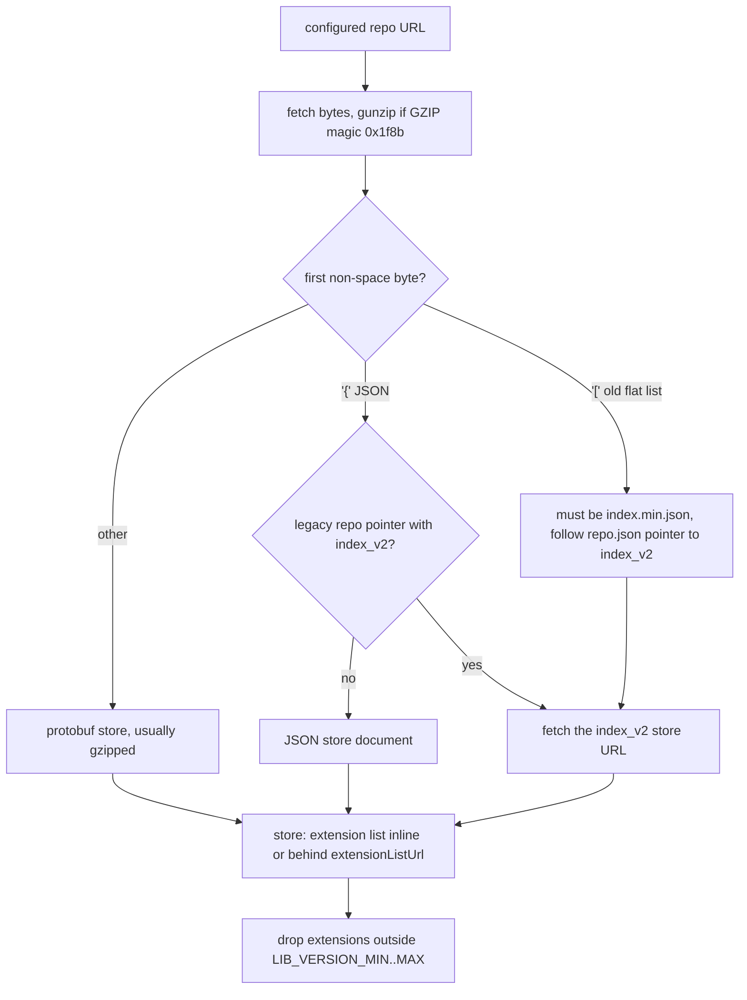
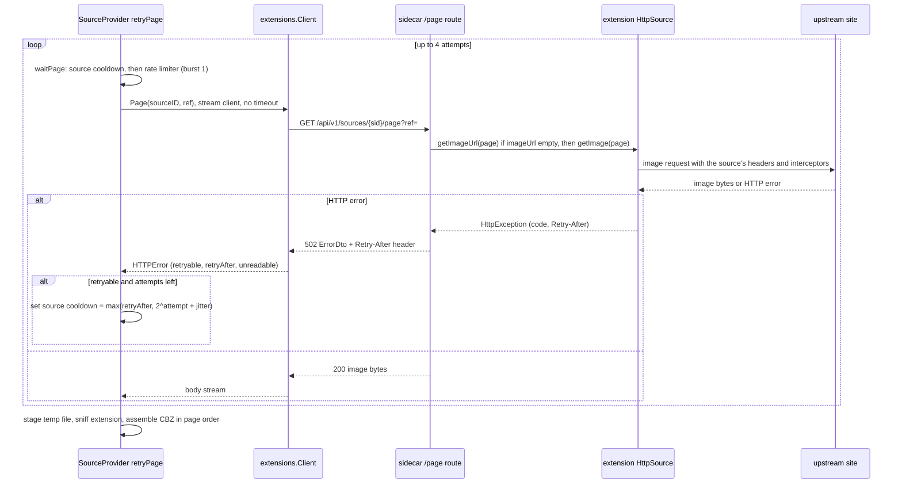

# The extensions sidecar: HTTP contract

The `sento-extensions` sidecar (`extensions/`) is a thin JVM app that runs
Tachiyomi/Mihon extension APKs and exposes them over a small HTTP API shaped
like Sento's `internal/extensions.Host` contract: sources, manga search,
chapter lists, page refs, page bytes, plus repo and extension management.

Sento owns queueing, pacing, CBZ assembly and import; the sidecar is a
stateless protocol adapter. Build, run and licensing are in
[extensions/README.md](../extensions/README.md) and
[NOTICE.md](../extensions/NOTICE.md); how Sento drives the sidecar from its
side is in [connections](domain/connections.md).

## In the code

| File | What it holds |
| --- | --- |
| `extensions/app/src/main/kotlin/sento/extensions/Api.kt` | the Javalin routes, DTOs and key envelopes |
| `.../ExtensionManager.kt` | repo index resolution, install/uninstall, `installed.json` |
| `.../SourceErrors.kt` | the `ErrorDto` and the retry classification |
| `.../SourcePrefs.kt` | the preference form serialized to typed JSON and back |
| `.../ChapterRequests.kt` | shares overlapping chapter requests per (source, manga) |
| `.../DirectoryListings.kt` | child-directory listings for directory sources |
| `.../SidecarConfig.kt` | the sidecar's environment variables |
| `internal/extensions/extensions.go` | the Go-side contract: `Host`, `ExtensionManager`, `PreferenceManager` |
| `internal/extensions/client.go` | the Go `Client`: timeouts, read caps, route calls |
| `internal/extensions/errors.go` | `responseError`: maps a sidecar error body to `HTTPError` |
| `internal/provider/source_retry.go`, `source_fetch.go` | Sento's retry loop, limiter and page staging |

## Routes

All routes are relative to the sidecar's base URL. Success codes and bodies:

| Method | Path | Query / body | Success |
| --- | --- | --- | --- |
| GET | `/health` | | 200, body `ok` |
| GET | `/api/v1/sources` | | 200, `[SourceDto]` (installed sources: `id`, `name`, `lang`, `nsfw`) |
| GET | `/api/v1/sources/{sid}/search` | `q` | 200, `[MangaDto]` (page 1, empty filter list) |
| GET | `/api/v1/sources/{sid}/chapters` | `manga` (a `MangaKey`) | 200, `[ChapterDto]` |
| GET | `/api/v1/sources/{sid}/listings` | `manga` (a `MangaKey`) | 200, `[MangaDto]` (direct child listings) |
| GET | `/api/v1/sources/{sid}/pages` | `chapter` (a `ChapterKey`) | 200, `[string]` (ordered page refs) |
| GET | `/api/v1/sources/{sid}/page` | `ref` (a `PageRef`) | 200, image bytes; `Content-Type` from upstream, default `image/jpeg` |
| GET | `/api/v1/sources/{sid}/preferences` | | 200, `[PreferenceDto]` |
| POST | `/api/v1/sources/{sid}/preferences` | `{key, value}` | 204 |
| GET | `/api/v1/repos` | | 200, `{"urls": [...]}` (env extras plus pushed repos, distinct) |
| PUT | `/api/v1/repos` | `{"urls": [...]}` | 204 (replaces the pushed set) |
| GET | `/api/v1/repos/status` | | 200, `[RepoStatusDto]` |
| GET | `/api/v1/extensions` | | 200, `[ExtensionDto]`, available merged with installed, sorted by `pkgName` |
| GET | `/api/v1/extensions/{pkg}/sources` | | 200, `[SourceDto]` of an installed extension |
| POST | `/api/v1/extensions/{pkg}` | | 201, the installed `ExtensionDto` |
| DELETE | `/api/v1/extensions/{pkg}` | | 204 |

Input problems get their own codes with `retryable: false`: 404 for an
unknown source id, 400 for a missing query parameter or a source that is not
an `HttpSource` on `page`. Every other exception, including bad input inside
a handler, becomes a 502 with an `ErrorDto` body and a `Retry-After` header
when the error carries one.

## Keys and payloads

Keys and page refs are opaque JSON envelopes minted by the sidecar. Sento
stores and round-trips them (bindings, queue items) without interpreting
them:

| Envelope | Fields | Carried by |
| --- | --- | --- |
| `MangaKey` | `url`, `title` | the `key` of search and listing results; the `manga` query parameter |
| `ChapterKey` | `url`, `name` | the `key` of chapter results; the `chapter` query parameter |
| `PageRef` | `index`, `url`, `imageUrl` (optional) | one entry of the `pages` answer; the `ref` query parameter |

`ChapterDto` adds `name`, `scanlator`, `webUrl` (computed without network
when possible) and `number`, parsed with the same `ChapterRecognition`
rule Suwayomi applies, because sources often leave `chapter_number` unset
and the name carries the number. Concurrent chapter requests for the same
(source, manga url) share one extension call (`ChapterRequests`).

Directory listings (`listings`) exist for directory-style sources: only a
source named `Madokami` qualifies, and the adapter reads child directories
from its index table using the extension's own authenticated HTTP client.
Only direct children count: same scheme, host and port, no query or
fragment, path depth exactly parent+1. Parent, sibling, external and
archive links are excluded. Every other source returns an empty list.

`PreferenceDto` is the typed JSON form of an extension's preference screen:
`key`, `type` (the preference widget class), `title`, `summary`, `valueType`
(`String`, `Boolean` or `Set<String>`), `default`, `current`, and
`entries`/`entryValues` for list widgets. Setting one (`POST .../preferences`)
writes into the source's fake-Android shared preferences and reloads the
source instance.

## Errors and retry classification

The error body is `ErrorDto`:

| Field | Meaning |
| --- | --- |
| `error` | the exception message (or class name) |
| `retryable` | whether asking again can help |
| `upstreamStatus` | the HTTP status the source returned, when there was one |
| `retryAfter` | the source's `Retry-After` value, preserved as a string |
| `unreadable` | the source served bytes that cannot be read (a damaged archive); asking again gets the same bytes |

The sidecar classifies (`sourceError`) by walking up to 16 cause frames:

| Cause chain | `retryable` | `unreadable` |
| --- | --- | --- |
| `HttpException` with code 408, 425, 429 or 500-599 | true | false |
| any other `HttpException` | false | false |
| `IOException` with no `HttpException` and no `ZipException` | true | false |
| `ZipException` with no `HttpException` | false | true |

The Go side mirrors this in `responseError`: any non-200 answer becomes an
`HTTPError` whose `StatusCode` prefers `upstreamStatus` over the gateway's
own 502, whose `Retryable` defaults to "408, 425, 429 or >= 500, unless
unreadable" but follows the body's `retryable` flag when present, and whose
`RetryAfter` comes from the `Retry-After` header or the body, parsed as
seconds or an HTTP date. Two more rules live in

`internal/provider/source_retry.go`: `sourceDead` treats 404, 410 or
`unreadable` as "the source cannot give this release, now or later", and
`sourceRetry` otherwise maps the error to retryable plus wait.

## Extension repos and installs

A repo is added by its index URL. The sidecar resolves whatever document
that URL serves into the current store format:

At most 3 index hops (`MAX_INDEX_HOPS`); the old flat `index.min.json`
list itself is never read, because repos that moved on serve only
"update your app" placeholders there. The resolved catalogue is cached for
5 minutes. `repos()` is the env-provided extras plus the list Sento pushed,
deduplicated; the pushed list is volatile and Sento reconciles it. When a
repo publishes a ready-built jar per extension it is used instead of

converting the APK with dex2jar. Install picks the highest `versionCode`
across all repos; the installed set lives in `installed.json` next to the
jars under the data root.

## Page fetching

Sento fetches pages itself, through the sidecar. Per chapter: `Pages` lists
the refs, then up to `pageConc` pages (default 3,
`SENTO_DOWNLOADS_PAGE_CONCURRENCY`) are fetched concurrently, each through
`retryPage`: at most 4 attempts, every attempt passing the same per-source
cooldown and rate limiter (default 4 requests/second per source,
`SENTO_DOWNLOADS_PAGE_RATE`, burst of 1; 0 disables), at most 2 chapters in

flight at once. A retryable failure sets a source-wide cooldown of
`max(retryAfter, 2^attempt + jitter)`; a dead failure (404, 410, unreadable)
stops immediately. Each page streams to a temp file whose extension is
sniffed from its first 512 bytes (`png`/`gif`/`webp`, else `jpg`); the CBZ
is then assembled in page order as `0001.ext`, `0002.ext`, ... and moved
into the staging dir.

This sequence shows one page attempt, from Sento's limiter through the
sidecar to the source, and the error mapping back:

On the Go side, plain API calls use a 60-second client timeout and a 64 MiB
read cap; install/uninstall writes get their own 3-minute client; the page
stream uses a client with no timeout (the context governs); error bodies are
read up to 16 KiB. See [acquisition](domain/acquisition.md) for how a
finished CBZ enters the library.

## Sento-side routes for this area

The Sento API routes that drive all of this (connections, indexers,
extensions, repos, preferences, health) are listed in
[api.md](api.md#settings-and-extensions) and [api.md](api.md#health-checks);
the behavior behind them is in [connections](domain/connections.md).

