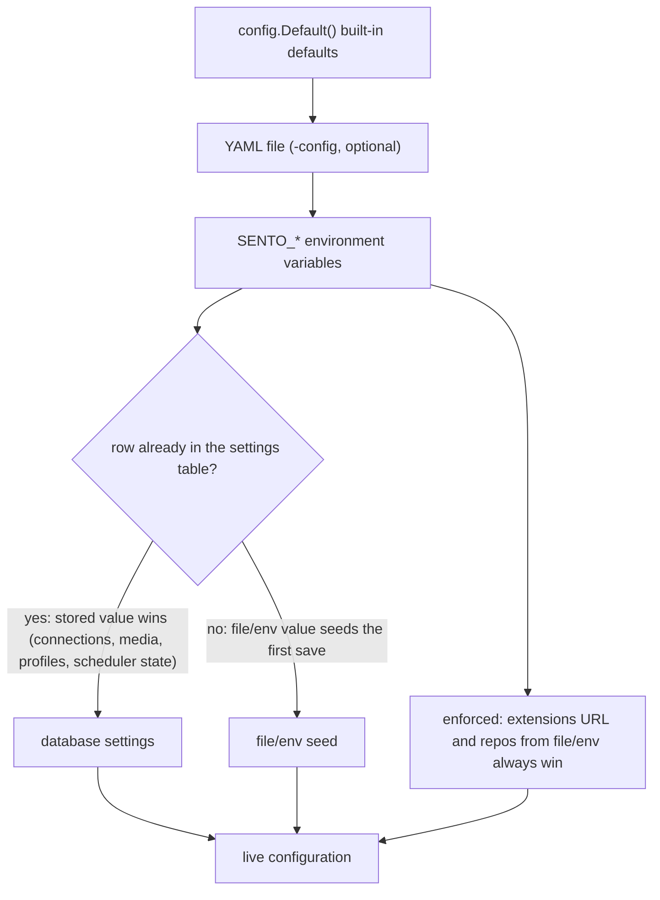

# Installation and configuration

## Containers

[The Compose file](../deploy/docker-compose.yml) starts Sento and its extension
sidecar. It publishes Sento on port 8484 and keeps the sidecar on the private
Compose network. No extension repositories are bundled.

```sh
cd deploy
docker compose up -d
```

The default `edge` tag follows main and can contain unfinished changes.
For a released version, set `SENTO_VERSION` in your shell or in `deploy/.env`
so **both** images use the same version. Copy a version from the
[releases page](https://github.com/h-wb/sento/releases). `latest` tracks stable
releases once the first release has been published.

Configure qBittorrent and Torznab indexers in the UI. To use extension sources,
add a Mihon-compatible repository under Connections and add a source under
Indexers. The first connection may take time while extensions install.

Sento does not enforce authentication. Put it behind an authenticating reverse
proxy or restrict it to a trusted network. Do not publish the sidecar's port.

## Storage

| Container path | Purpose |
| --- | --- |
| `/config` | SQLite database and optional `config.yml` |
| `/library` | Imported CBZ files |
| `/downloads` | Staging directory for extension downloads |
| Additional torrent mount | qBittorrent's completed downloads, visible to Sento |

For torrents, Sento must be able to read the actual files, not just connect to
qBittorrent's API. Put the completed-download mount and library on the same
filesystem for hardlinks. If qBittorrent reports `/downloads/book.cbz` but Sento
sees it at `/torrents/book.cbz`, set:

```yaml
environment:
  SENTO_PATH_MAPPINGS: /downloads=/torrents
```

The Compose example includes a commented mount for this case. Ensure the
container can write to the library and staging directories.

## Configuration

Configuration loads in three layers: built-in defaults, then an optional
YAML file, then `SENTO_*` environment variables, which win over the file.

The binary takes `-config <path>` (default `config.yml`); the image runs
`sento -config /config/config.yml` and sets `SENTO_DB_PATH=/config/sento.db`,
`SENTO_LIBRARY_PATH=/library`, `SENTO_DOWNLOADS_DIR=/downloads` and
`SENTO_STATIC_DIR=/app/web/dist` in the [Dockerfile](../Dockerfile), with
`/config`, `/library` and `/downloads` as volumes. A missing YAML file is
not an error. An environment value that does not parse as a number is
ignored, keeping the file value. The full set with defaults is in
[config.go](../internal/config/config.go).

This diagram shows the precedence for one setting: defaults, file, env,
then the database for the settings Sento stores there.



| YAML key | Environment variable | Default | Effect |
| --- | --- | --- | --- |
| `server.host` | `SENTO_HOST` | `0.0.0.0` | HTTP listen host |
| `server.port` | `SENTO_PORT` | `8484` | HTTP listen port |
| `server.api_key` | `SENTO_API_KEY` | empty | Not enforced: startup logs a warning; use a reverse proxy for auth |
| `server.static_dir` | `SENTO_STATIC_DIR` | `web/dist` | Built web UI directory |
| `database.path` | `SENTO_DB_PATH` | `data/sento.db` | SQLite database file |
| `database.url` | `SENTO_DB_URL` | empty | PostgreSQL URL; wins over `database.path` when set |
| `library.path` | `SENTO_LIBRARY_PATH` | `library` | Library root; required, made absolute at startup |
| `library.path_mappings` | `SENTO_PATH_MAPPINGS` | empty | Comma-separated `remote=local` download-client path translations |
| `downloads.dir` | `SENTO_DOWNLOADS_DIR` | `data/downloads` | Staging for in-progress source downloads |
| `downloads.page_concurrency` | `SENTO_DOWNLOADS_PAGE_CONCURRENCY` | `3` | Parallel page fetches per chapter; keep at or below 4 (the sidecar's HTTP client allows 5 per host) |
| `downloads.page_rate_per_second` | `SENTO_DOWNLOADS_PAGE_RATE` | `4` | Page requests per second per source (token bucket); `0` disables |
| `extensions.url` | `SENTO_EXTENSIONS_URL` | empty | Sidecar URL; enforced (read-only in the UI) when set |
| `extensions.repos` | `SENTO_EXTENSIONS_REPOS` | empty | Extension repo URLs, comma- or space-separated; enforced when set |
| `prowlarr.url`, `prowlarr.api_key` | `SENTO_PROWLARR_URL`, `SENTO_PROWLARR_API_KEY` | empty | Seed the Prowlarr connection for the Add Indexer browse assist |
| `qbittorrent.url`, `.username`, `.password`, `.category` | `SENTO_QBITTORRENT_URL`, `SENTO_QBITTORRENT_USERNAME`, `SENTO_QBITTORRENT_PASSWORD`, `SENTO_QBITTORRENT_CATEGORY` | empty, category `sento` | Seed the default download client connection |
| `mangabaka.base_url` | `SENTO_MANGABAKA_BASE_URL` | `https://api.mangabaka.org/v1` | Metadata provider base URL |

qBittorrent and Prowlarr environment settings seed their initial connections
only: once settings are saved in the UI, the stored values win. Extension
settings are different: `SENTO_EXTENSIONS_URL` and `SENTO_EXTENSIONS_REPOS`
stay in force, are reported as managed, and are read-only in the UI. Note
the separator differs on the two sides of the sidecar link: the Go side
splits `SENTO_EXTENSIONS_REPOS` on commas or any whitespace and enforces the
list, while the sidecar itself splits on commas only and treats the variable
as an additive extra.

### Sidecar environment

The extension sidecar (`extensions/`, a JVM app, no config file) reads:

| Variable | Default | Effect |
| --- | --- | --- |
| `SENTO_EXTENSIONS_PORT` | `8901` | Listen port |
| `SENTO_EXTENSIONS_DATA` | `data` | Data root for installed extensions |
| `SENTO_EXTENSIONS_REPOS` | empty | Extra repo index URLs, comma-separated (Sento pushes its configured list on connect) |
| `SENTO_EXTENSIONS_FLARESOLVERR_URL` | empty | Optional FlareSolverr for Cloudflare-protected sources |

### Settings stored in the database

Runtime-editable state lives in the `settings` table, not in the YAML file:

| Key | Holds |
| --- | --- |
| `connections` | Prowlarr, download clients (including passwords) and sidecar URL; legacy keys `sourceHost` and `qbittorrent` are migrated on load |
| `extension_repos` | The extension repository URL list |
| `source_prefs` | Per-source preferences pushed to the sidecar |
| `default_profile_id` | The instance default release profile |
| `media` | Media (naming) settings |
| `scheduler` | Each background task's last-run time, for cadence resume |
| `library_root` | The recorded library root, used to rewrite paths when it moves |

The `SENTO_API_KEY` configuration field currently does not protect routes;
do not rely on it for authentication.

## Moving the library

Start the updated Sento once with its current library path so it records
the root. Then stop every Sento instance and back up the database before
moving library files or changing their container mount paths. Move the complete tree,
including `review/` and `.sento-trash/`, then set `SENTO_LIBRARY_PATH` to the
new root as seen inside the Sento container. Sento remembers its root and
rewrites stored series, chapter, file, trash and root-folder paths at startup,
before the API and background tasks start. This updates references; it does
not move files on disk.

For example, after moving `/library/Managed/Volumes` and
`/library/Managed/Chapters` up one level, change the root to:

```yaml
environment:
  SENTO_LIBRARY_PATH: /library
```

Every relocated live archive and trash archive must exist at its destination
and be a regular file. Records already marked missing keep that state; empty
series folders need not exist. Validation errors or database path collisions
abort startup and roll back all path changes. Restore the files/configuration
and retry. The new root is recorded in the same transaction, so restarting
does not repeat the rewrite.

Only paths inside the old root are rewritten. Torrent payload paths, source
download staging, and series adopted outside it remain unchanged. Update
reader library paths and other applications' mount/configuration separately.

## Empty indexer searches

If an indexer connects but its searches find no manga, see
[empty indexer searches](domain/connections.md#empty-indexer-searches).

## Server binaries

Release archives contain `sento` and `web-dist/`. Extract the archive and run
from that directory:

```sh
SENTO_STATIC_DIR=./web-dist ./sento
```

The extension runtime is a separate JVM application; the simplest way to run
it is the matching `ghcr.io/h-wb/sento-extensions` container. Point Sento at its
private URL with `SENTO_EXTENSIONS_URL`. There is no standalone native sidecar
binary in the server archive.

## Backups and upgrades

Stop Sento before copying a SQLite database; copy the config volume and library,
and preserve your original download files. Use PostgreSQL's own backup tools
when using that backend. Backups can include source credentials and should be
kept private.

Read the release notes, take a backup, then change `SENTO_VERSION` for both
containers and run:

```sh
docker compose pull
docker compose up -d
```

Database migrations run at startup. Downgrading an image does not reverse a
migration; restore a compatible database backup when rolling back. Pre-1.0
minor releases may contain breaking changes.
