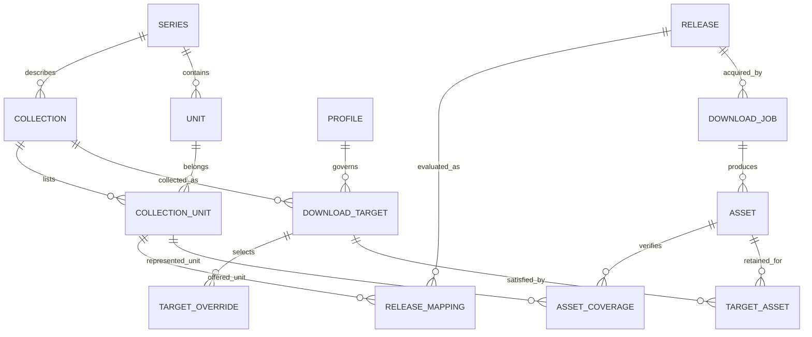

# Collections, profiles, and releases: domain model review

Investigated October 5, 2026. This records the original investigation and proposal. The implementation has since adopted the model described in [the domain guide](../domain/editions.md); findings below describe the pre-change behavior.

## Recommendation

Keep Series → Collections, including local collections. Make a collection describe an edition/publication run, and give it explicit units and stable local identity. Separate that catalog description from the acquisition target: what the user wants to keep. Profiles decide release eligibility, preferences, and optional upgrades. Releases describe downloadable offers; assets describe the actual imported bytes. Numbering is a label within a collection, never universal book identity.

This preserves the useful existing architecture rather than replacing it wholesale. The decisive improvements are identity, confident edition matching, non-colliding storage, and separating “I own a file” from “this file satisfies my target.”

## Evidence and limits

Read the metadata adapter, migrations, collection/refresh store, library service, ledger, profiles, parser, search/funnel/grab, importer, disk scanner, queue, calendar, provider interface, and collection UI. Compared implementation with existing specifications and tests rather than assuming the specifications were current.

Fetched MangaBaka’s published OpenAPI document and live One Piece collections and two sample works. Ran the existing domain/service tests and live contract tests successfully. Temporary Go probes reproduced five behaviors below; they were removed afterward so the suite does not enshrine undesirable behavior.

Sources:

- [API overview](https://mangabaka.org/data/api): explicitly says the schema remains unstable.
- [API explorer](https://mangabaka.org/data/api/explorer), backed by [OpenAPI JSON](https://mangabaka.org/api.json): collections/works endpoints are now listed, with beta/internal labels.
- [Live collections for One Piece, series 377](https://api.mangabaka.org/v1/series/377/collections).
- [Two sample works](https://api.mangabaka.org/v1/series/377/works?limit=2).
- [Development roadmap](https://mangabaka.org/pages/announcements/23-roadmap): chapter-level metadata and volume contents remain evolving areas; do not assume exhaustive coverage.

The JSON requests succeeded through curl; the web browser tool could read the documentation but not the JSON endpoints. Samples establish actual shapes and examples, not universal completeness or permanent upstream identifiers. No authenticated user data was requested.

## MangaBaka alignment

The live sample contains four English volume collections: Standard Edition/digital, Standard Edition/paperback, Omnibus Edition/paperback, and Box Set Edition/paperback. Two collections can therefore share edition name, language, and publisher while differing in medium. The sampled omnibus volume 1 is described as containing the first three standard volumes: its number is not interchangeable with standard volume 1.

The schema gives collections their own language, publisher, edition, type, medium, format, reading direction, publication status, and optional related collection. Works have their own identifiers and metadata, plus a collections array. Treat that array as a many-to-many membership, even when sampled works have only one membership. A generic edition label such as Standard Edition is not sufficient to identify a publication run.

Sento maps enough of this to begin, but loses useful distinctions:

| Concept | Existing implementation | Implication |
| --- | --- | --- |
| Series | Local ID plus unique MangaBaka series ID | Good ownership boundary; local-only series would require nullable/provider-neutral external refs. Not necessary to implement now. |
| Collection | Edition name, language, publisher, medium, type; monitoring and profile on the same row | Closely aligned with publication collections, but mixes descriptive metadata and user intent. |
| Work | One row per collection/number/count type | Flattens upstream membership and overwrites distinct works sharing those coordinates. |
| Slot | Computed view keyed by type/collection/number | Useful derivation, but cannot distinguish main and extra works at the same number. |
| Profile | Custom-format score floor and per-volume/chapter size, seeders, protocol preference | Good reusable policy foundation; no automatic comparison with an owned asset or upgrade cutoff. |
| Release | Parsed candidate, transient score and routed collection | Download offer and target-specific evaluation are combined; one offer can only carry one routed collection. |
| Asset/file | Path, size, parse JSON, provenance, numbered links | Multiple links are possible, but quality/version identity and verified coverage are not first-class. |
| Source match | Series ↔ source listing | Useful series resolution, but does not guarantee that the listing represents a particular translation/edition. |

Retain the anti-corruption adapter. MangaBaka should supply catalog facts and external references, not define Sento’s acquisition or storage identity.

## Current correctness findings

### Address before expanding parallel versions

1. **Cross-collection greedy selection.** `internal/service/grab.go:GrabBest` uses `taken[number]`. Two candidates covering volume 1 in different collections produce one queued release in the corrected probe. Use full target/unit coordinates; all collection languages and editions must coexist in a single search pass.
2. **Path collisions can replace another version.** Default chapter names omit the edition, and import does not populate the group token. Different English chapter collections generate identical names in the probe. Volume names include edition/language but omit publisher, medium, and a stable ID, so the two English standard collections can also collide. Import helpers atomically replace destinations, and `AddFile` upserts by path while adding links. Consequently, collision can replace bytes yet retain links suggesting both collections are owned. Stable identity must be enforced even when the user chooses a short naming template.
3. **Disk volume routing ignores language.** `Scanner.linksFor` routes volumes by edition-name hints/default and ignores the parsed language. The probe links an FR volume to EN Standard Edition. Volume scan also considers only monitored volume collections, conflating ownership with acquisition. Route imports against all relevant collections and leave unresolved matches for review.
4. **Targeted search bypasses edition compatibility.** `funnel` directly adopts `target.CollectionID`; it does not check that the release represents that edition. A plain release passes into a targeted omnibus collection in the probe. Choosing where to search does not establish what the found release contains.
5. **Slot identity loses count type.** Works allow main and extra at the same sequence; links and overrides do not include work ID/count type. The probe shows one link marking both rows owned. Use unit identity, with explicit main/extra classification.

### Model and lifecycle gaps

- **Descriptor identity is mutable.** Refresh matches the exact descriptor tuple first, not the known external reference. A name/publisher correction creates another collection even if the provider ID remains unchanged. Descriptor matching is useful evidence, not a primary key. Missing rows are retained without an explicit stale/removed status.
- **Local metadata can be silently adopted.** Exact descriptor match turns a local collection into `custom=false` on refresh. That changes edit/delete rights and may blend generated numbering with new upstream works. Offer an explicit catalog link with a preview; preserve local identity and overrides.
- **Work refresh uses number as identity.** Same-number revisions/ISBNs can collapse, and a numbering correction can leave old rows while introducing new rows. `sequence_string` is not updated on conflict. Preserve distinct upstream refs and reconcile membership/number changes deliberately.
- **Collection pagination is missing.** `GetWorks` follows `pagination.next`; `GetCollections` fetches one page. The current published schema paginates collection results with a default of 25. The four-row live sample does not trigger the bug.
- **Sparse metadata can disable acquisition.** Chapter slots derive only integer 1..series total_chapters. Unknown total creates no slots; fractional chapters are parsed but range loops round up to integers. Sources cannot describe legitimate new/local chapters. Conversely, deriving every integer from a count assumes contiguous numbering. “Unknown,” “special,” and “not released” need different states.
- **Release dating is heuristic.** Undated units can be marked released simply because there are no dates or they precede the highest dated number, including a future dated number. Generated custom volumes consequently look available. Preserve unknown availability and make acquisition behavior a policy.
- **Owned is not satisfactory.** Any file link satisfies Wanted regardless of current quality/language compatibility. Changing a profile does not trigger an upgrade. Existing specs explicitly exclude automatic upgrades; adding them is a product change, not a missing field alone.
- **One release routes to one collection.** `routeCollection` uses name substrings and stable-but-arbitrary fallback. Edition hint Names, publisher identity, and medium are not evaluated. Packs and shared works need explicit candidate-to-unit mapping.
- **Merge assumes equal numbering.** Merge permits different languages/editions of the same type and moves links by number. Standard 1 → omnibus 1 is not a safe merge. Missing target units are reported after moving, leaving links outside the visible grid. In-flight queue expected slots are not remapped by merge/delete.
- **Intent can be surprising.** Default selection gives a “standard” name more weight than preferred language. A standard in another language can beat a preferred-language special edition. Add with Monitor none still creates/adopts a monitored chapter collection. These choices need explicit product semantics.
- **Specs are partly aspirational/outdated.** The domain tour says chapters are series-scoped, but migration 0013 makes them collections. The specification describes fallback metadata, collection drift warnings, and a collectionId naming token that the inspected implementations do not fully provide. Reconcile documents before using them as acceptance criteria.

## Proposed logical model

These are domain boundaries, not a demand for twelve tables immediately. Join/evaluation objects may initially be structs. IDs can remain integer local IDs; adopting UUIDs does not solve the semantic problems.

### Catalog: series, collection, and units

A **series** is the bibliographic title. A **collection** describes one coherent edition/publication run: language, publisher, edition traits, source medium, numbering scheme, and optional relation to another collection. All local and provider-linked collections use the same domain type and capabilities. Origin is provenance, not a separate class with permanently reduced functionality.

A **unit** is a specific volume/chapter/special/revision in that publication context. It has stable ID, kind, display label, nullable numeric sort value, release availability, identifiers, and provenance. A work can have more than one collection membership. Membership carries collection-specific ordering/labels where needed. Separate main/extra/other from identity. Do not use 0 to mean both an unparseable label and a genuine volume zero; model the collection-wide search scope explicitly instead of reserving number zero.

Do not attempt to build a canonical chapter-by-chapter story graph upfront. Keep optional, evidenced content relationships: contains, alternate edition, revision of, or equivalent content. “Omnibus 1 contains standard 1–3” can be a useful explicit relation, but is not a rule inferred from its number or the word omnibus. Relationships must never automatically claim that one physical/file edition is owned because equivalent content is available elsewhere.

Keep publication medium separate from file encoding and source quality. A CBZ scan of a paperback represents the paperback collection; CBZ does not turn it into the publisher’s digital edition. “Digital edition,” “digital rip,” and “digital file” answer different questions.

### Intent: download target and profile

A **download target** is the user’s choice to keep a variant of a collection: monitor scope, effective profile, retention/upgrade mode, optional source/group constraints, and storage identity. Ordinary users get one default target per selected collection, presented as “Collect this edition.” A second target is an advanced “Keep another version” operation.

Examples:

- French standard and English omnibus: two collections, each with one target.
- Missing French publication: one local collection, optional catalog link later.
- English fan-colored translation: local collection when content/translation differs.
- Higher-resolution rip of the same publication: same collection, preferred release policy; upgrade within one target.
- Keep both Group A and Group B translations of the same catalog edition: separate targets with explicit constraints, or separate local collections if they represent distinct translation/content identities. A group tag alone is not reliable evidence of a publication edition.

A **profile** is reusable acquisition policy, not another edition. Preserve custom-format matching and whole-profile inheritance. Effective policy is target override → collection default → series default → instance default. Avoid implicit field-by-field merging of profiles. Expose both the assigned source and resolved effective policy.

Split rules conceptually into:

- Identity compatibility: correct series, unit coverage, edition/translation, and target language. These cannot be corrected by boosting a score.
- Acquisition eligibility: readable format, size, seeders, blocked release, required attributes, and explicit unknown-evidence policy.
- Preferences: group, source quality, resolution, revision, protocol, custom formats.
- Optional upgrades: enable flag, sufficient quality/cutoff, minimum improvement, pinned assets, and replacement retention.

Default to one acceptable copy per target with upgrades off, preserving current behavior. Alternative targets opt into coexistence. A strict French target should not accept a known English release through the ordinary “download anyway” quality override. Offer a separate explicit import/reassignment operation if the user deliberately wants to correct identity. Treat unknown language as unknown; allow a trusted source binding or user decision to supply evidence. Represent multi-language as a set where verified, not a universal bypass.

### Offers, jobs, and assets

A **release** is a discoverable offer with provider/site identity, external key, raw title, parsed facts, source/group/languages/quality/version, and observed timestamps. The same release can be evaluated differently for different targets. An **evaluation** records matched collection/units, confidence and reasons, effective profile version, and decision breakdown. Persist the decision snapshot with the download job so a later metadata/profile refresh cannot rewrite why it was acquired.

A **download job** owns provider identity and remote handle, reserves full target/unit keys, and carries planned mappings. Download the same offer once when several verified target mappings can share it. Use explicit idempotency and reservations across concurrent searches; current pending-slot checks alone do not make the search-to-grab sequence atomic.

An **asset** is immutable imported content identity: digest, actual format, size, observed facts, acquisition provenance, and one or more paths/locations when needed. Coverage is explicit and many-to-many. One archive containing three books is one asset linked to three verified units, not three pretend single-book archives. Conversely, a publisher omnibus volume is one edition unit even when its content relates to three standard volumes.

A target is satisfied only by a present, verified asset accepted for that target. Display Owned, Pending, Missing, Upgrade available, Not released, and Needs review separately. Unknown release date is not Not released. Pausing collection monitoring never removes ownership. Shared assets require reference-aware deletion; deleting a target cannot remove bytes still needed by another target or torrent seeding.

## Custom collections and uncertain metadata

Local collections need more than a generated 1..N count: create/edit/remove units, append newly known volumes, retain specials/fractional labels, correct dates, and map imported files. Cloning another collection should mean “use this numbering as a starting point,” not “these editions are equivalent” or “follow future updates automatically.” Show whether the clone is independent.

Store external references separately from local identity, with provider, entity kind, external ID, previous aliases, last seen, and sync state. Match an already-known external reference first. If it disappears or changes, use normalized descriptor/ISBN/source evidence for a reconciliation suggestion. Ambiguous matches enter review. Names and publishers are editable facts. Do not auto-merge two local collections just because descriptors match.

Keep provider snapshots and local overrides separate. Refresh updates the snapshot; local overrides stay intact and can be reset per field. A local collection can become provider-linked without changing its local ID, numbering mappings, files, targets, or permissions. Missing catalog records become stale, not deleted. A partial/failed page fetch must not mark unseen records removed.

For chapters, retain a metadata-led mode by default, but support explicitly enabled local/source discovery. Store observations with source provenance; promote a unit only after corroboration, a trusted configured binding/numbering scheme, or user acceptance. This deliberately revises D15 if adopted. Do not revive the naive “largest observed number becomes total chapters” rule. An errant source chapter 999999 must never generate a huge ledger.

## Matching pipeline

1. Resolve the series from trusted bindings or anchored titles.
2. Identify publication/translation evidence: external work/ISBN, verified binding, publisher, edition traits, language, source medium.
3. Produce possible collection/unit mappings with explicit ambiguity. Existing collection ID supplied by a UI is a desired target, not evidence.
4. Reject known incompatible identity; send ambiguous mappings to review unless a configured binding resolves them.
5. Evaluate profile eligibility and rank preferences within a target.
6. Reserve the target/unit set, record the evaluation, and queue an idempotent job.
7. Inspect actual payload files and validate their coverage before satisfaction. Mark unmatched files for review. A partly imported pack must not silently claim all expected units are complete.

Separate pack selection utility from intrinsic quality: number of newly covered units is useful for choosing downloads, but cannot be the quality metric for replacing an existing copy. Calculate size per represented unit where meaningful, not per missing unit; current size division by wanted coverage penalizes packs containing already-owned books.

## User experience

Keep one series page. Present collections as recognizable edition rows/cards: “English · Standard · Shonen Jump · Digital” and “French · Local edition”, with their own progress, policy, and missing units. Show local/catalog/stale provenance as details. A single raw “Standard Edition” heading cannot distinguish the two real English publication collections.

Creation should start with purpose: choose a catalog edition, add a missing edition, or keep another version. Local edition creation supports existing numbering or explicit units. Additional-version creation reuses catalog units and asks for the differences to retain. Profiles remain on Settings and selectable at the target; they should never appear to create a new edition.

Import review shows file facts and proposed collection/unit mappings, including confidence and correction. Merge/link operations require a preview of changed identities, numbering mappings, profiles, overrides, assets, and pending jobs. “Link to MangaBaka” and “merge duplicate local editions” are different operations. Do not migrate units between languages or omnibus layouts merely by equal numbers.

## Staged implementation

1. **Correctness and data protection first:** complete collection pagination; key greedy coverage by collection/unit; validate targeted edition compatibility; route scan language correctly; distinguish main/extras; protect destination collisions; block/remap collection mutations with pending jobs. Add regressions for each reproduced behavior.
2. **Stable catalog identity:** introduce external refs/provenance/sync state and work IDs in links. Backfill current work rows into memberships, preserving local IDs and all files. Detect ambiguous same-number links for review instead of guessing. Update refresh reconciliation and local metadata editing.
3. **Targets and preserved assets:** backfill one default target per existing collection, retaining monitoring, cutoff, profile assignments, and paths. Add explicit asset facts/coverage, safe path namespaces, additional targets, and duplicate-download handling. Existing paths remain valid until an explicit planned move.
4. **Acquisition policy:** introduce tri-state availability/evidence, explicit strictness, target satisfaction, and optional upgrades. Upgrade stored facts and decision snapshots before enabling replacement. Add chapter observation review behind an explicit mode.
5. **Coverage relationships and usability:** support evidenced omnibus/content relationships, better import review and reconciliation, and target-based progress. Defer a comprehensive story ontology until there is real catalog data to justify it.

Example storage: `Series/Collections/English Standard Digital [collection-42]/Targets/Default [target-81]/v01 [asset-231].cbz`. Pretty names can vary, but effective paths must remain distinct after sanitization, case folding on supported filesystems, and template changes. IDs in folders are an implementation choice; no-clobber validation is the invariant.

Migration must be additive and reversible until verification. Preserve existing paths and assets; keep a mapping report. Do not auto-adopt local collections, remove vanished metadata, rewrite files, or enable upgrades during migration. Audit path collisions and stranded links before reporting library ownership as trustworthy.

## Acceptance scenarios

| Scenario | Required result |
| --- | --- |
| EN standard v1 and FR standard v1 | Both can queue/import in one pass; neither satisfies the other. |
| Standard v1 and omnibus v1 | Different units; plain numbering is insufficient to cross-map. |
| Digital and paperback Standard Edition | Distinct collections; scans/rips match with explicit evidence or review. |
| Two retained variants of one edition | Shared catalog units; separate target satisfaction and storage. |
| Better release appears | Upgrades off: no action. Upgrades on: compare stored quality, honor pins, import transactionally, and retain earlier copies. |
| Catalog collection renamed | Existing local identity, files, monitoring, and profile survive. |
| Local collection appears in catalog | Suggest linking; retain local overrides and unit identity after acceptance. |
| One file contains v1–v3 | One asset with verified coverage; never pretend to split its bytes. |
| Extra 1 and main 1 | Independent unit identity and ownership. |
| Chapter 0, 12.5, Special A | Representable labels; no zero/search-scope collision or integer rounding loss. |
| Unknown total chapters | No fabricated bound; optional trusted observations can add specific units. |
| Source returns absurd numbering | Isolated observation/review; no massive automatic expansion. |
| Existing files while collection paused | Ownership remains discoverable; monitoring changes only acquisition intent. |
| Collection merge with active jobs | Block or explicitly remap before mutation; never leave dangling expected slots. |
| Failed/partial metadata pagination | Preserve snapshot and mark incomplete sync; no false removals. |
| Two sanitized names produce one path | Import refuses collision or assigns unique destination; no unrelated replacement. |

## Decisions proposed for the next implementation

Use collections for edition/publication identity, local collections as first-class records, download targets for intentionally retained variants, and profiles for reusable acquisition policy. Preserve the computed ledger, but derive it from stable units, target intent, asset satisfaction, pending jobs, and explicit availability. Start by fixing the concrete cross-version bugs, then introduce the minimum schema changes supporting these boundaries. The implementation is documented in [Editions, units, collected versions, and files](../domain/editions.md), including migration behavior and deliberate limits. This review preserves the findings and proposed rationale from before implementation.
