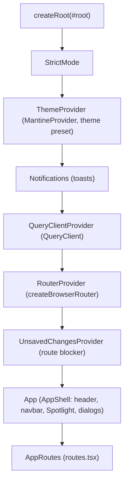
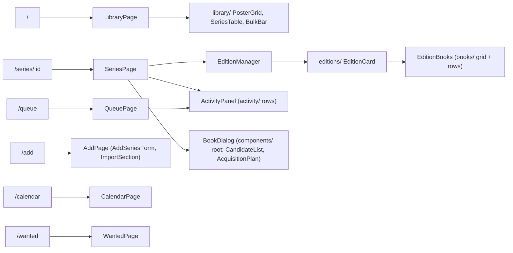
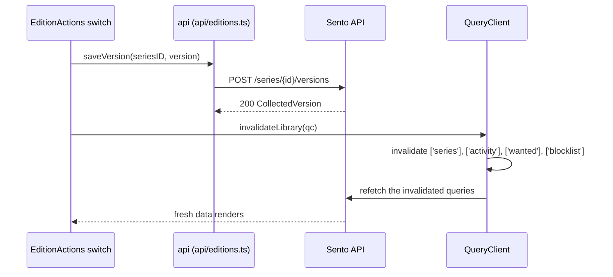
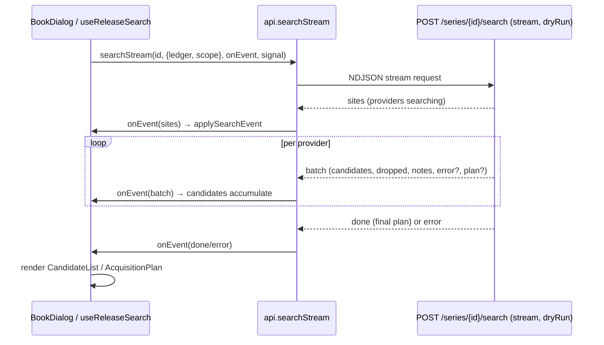
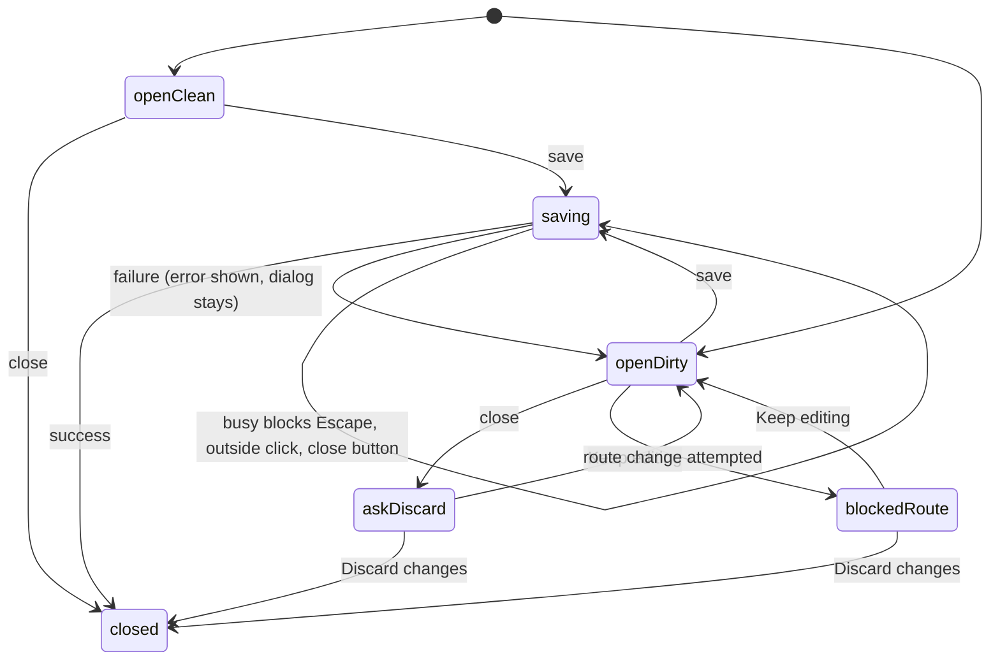
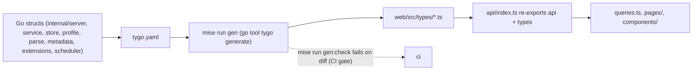

# Web app

The web app is a single-page application in `web/`: a React 19 + Vite + Mantine
UI that talks only to the Sento HTTP API (`/api/v1`), holding all server state
in TanStack Query and all transient state in the browser. This page describes
how the code is laid out and how a request flows from a click to the server
and back. The HTTP contract itself is in [api.md](api.md); generated types
come from the Go structs, see [architecture](architecture.md).

| File or folder | What it holds |
| --- | --- |
| `web/src/main.tsx` | Entry point: builds the query client and router, mounts the provider stack |
| `web/src/ThemeProvider.tsx`, `web/src/theme.ts`, `web/src/theme.module.css` | Color scheme and accent presets, Mantine theme construction |
| `web/src/App.tsx`, `web/src/App.module.css` | The shell: header, navbar, badges, Spotlight, global dialogs |
| `web/src/routes.tsx` | Route table; every page except Library is a lazy chunk |
| `web/src/shell/` | Navigation config, keyboard shortcuts, Spotlight actions, badges, appearance menu |
| `web/src/api/` | Typed API client: `request.ts` plus one module per resource, re-exported by `index.ts` |
| `web/src/types/` | TypeScript types generated from the Go structs by tygo |
| `web/src/queries.ts` | Query-key factories and the invalidation groups |
| `web/src/format.ts`, `web/src/ui.ts` | Display formatting, notifications, error text, page titles |
| `web/src/pages/` | One component per route |
| `web/src/components/` | Feature folders (`editions/`, `books/`, `search/`, `activity/`, `library/`, `media/`, `profiles/`, `indexers/`, `connections/`, `extensions/`) plus shared pieces (`EditorModal`, `useEditor`, `usePaged`, …) |
| `web/src/UnsavedChangesProvider.tsx`, `web/src/useUnsavedChanges.ts` | The global dirty-form guard for route changes and tab close |
| `web/vite.config.ts` | Dev server: `/api` proxy and allowed hosts |

## Stack and entry

`main.tsx` mounts the app in a fixed provider order. Reading the tree from the
outside in:

1. `StrictMode` (double-invoked effects in development).
2. `ThemeProvider`: the Mantine provider, color scheme and accent preset, persisted in the browser.
3. `Notifications`: toast area, bottom-right, at most 4 toasts.
4. `QueryClientProvider`: one `QueryClient` for the whole app, with `retry: 1` and `refetchOnWindowFocus: false` as the query defaults.
5. `RouterProvider`: a browser router whose single `*` route wraps `App` in `UnsavedChangesProvider`.

This provider and component tree is the whole skeleton of the app:

## Routing and URL state

`routes.tsx` declares the routes. Every page except the landing page is a
`lazy()` import, so each route loads as its own chunk on first visit; `App`
wraps the routes in a `Suspense` boundary with a centered loader. `/sources`
is kept as a redirect to `/connections` so old bookmarks still work.

| Path | Page | Notes |
| --- | --- | --- |
| `/` | `LibraryPage` | Eager (landing page): series grid or table |
| `/add` | `AddPage` | `?tab=import` opens the Import from disk tab directly |
| `/series/:id` | `SeriesPage` | Remounted per path (`key={location.pathname}`); see below |
| `/calendar` | `CalendarPage` | Release calendar |
| `/queue` | `QueuePage` | Global Activity |
| `/wanted` | `WantedPage` | Missing books per collected version |
| `/connections` | `ConnectionsPage` | Download clients and extension sources |
| `/sources` | redirect to `/connections` | Legacy path |
| `/indexers` | `IndexersPage` | Torznab indexers and extension manager |
| `/profiles` | `ProfilesPage` | `?profile=<id>` opens that profile's editor |
| `/media` | `MediaPage` | Naming templates and metadata settings |
| `/system` | `SystemPage` | Status, health checks, background tasks |

URL query parameters carry UI state so it survives a reload and can be linked
to:

| Parameter | Where | Meaning |
| --- | --- | --- |
| `?view=` | `SeriesPage` | Open tab: `editions` (default), `files`, `activity`; the legacy values `review` and `history` open the Activity tab with the attention or history filter; `sources` opens the Sources dialog |
| `?sources=1` | `SeriesPage` | Opens the Sources dialog |
| `?activity=` | `ActivityPanel` | Activity tab: `progress`, `attention` or `history` (default: attention when anything needs it, else progress) |
| `?profile=<id>` | `ProfilesPage` | Opens the profile editor for that profile |
| `?tab=import` | `AddPage` | Opens the Import from disk tab |

## Shell

`App.tsx` plus `web/src/shell/` form the persistent frame around every page.

`shell/navigation.ts` holds the nav items in two groups. Day-to-day pages:
Library (`g l`), Calendar (`g c`), Activity (`g a`), Wanted (`g w`). Setup
pages, ordered to mirror the pipeline (search, download, quality, import):

Indexers (`g i`), Connections (`g o`), Profiles (`g p`), Media (`g m`), and
System (`g s`) at the bottom. `shell/useShortcuts.ts` binds the keys: `g`
followed within one second by a page's letter navigates to it, `g n` opens the
global Add series dialog, `/` or Cmd/Ctrl+K opens Spotlight, `?` opens the
shortcuts help (`shell/ShortcutsHelp.tsx`). Shortcuts are ignored while typing
in an input, textarea or contenteditable element, and when a modifier key is

held. The `⌘`/`Ctrl` prefix is chosen per platform in `navigation.ts`.

`shell/useSpotlightActions.tsx` builds the Spotlight actions: Add series, every
page (grouped Pages/Configure), and every library series under Library, fed by
the same `['series']` query `LibraryPage` uses. Spotlight shows at most 8
results and highlights the query text.

Badges come from `shell/useNavBadges.ts` and `components/activityModel.ts`:

- The Activity nav link shows the count of attention groups, falling back to
  active downloads when nothing needs attention (`activityCounts`).
- The System nav link shows a dot badge with the health issue count, red when
  any issue is an error, yellow otherwise.
- The navbar footer shows the server connection dot (green when
  `status.database.ok`, polled every 60 s) and the version label
  (`v0.7.0` for release versions, otherwise version plus short commit).

`shell/AppearanceMenu.tsx` switches light/dark/system mode and picks one of
the accent presets (see [Styling](#styling)). A top progress bar
(`@mantine/nprogress`) runs while any query is fetching (`useIsFetching`).

Any page can open the global Add series dialog through `useAddSeries()`
(`addSeries.ts`); the dialog lives in `App` and navigates to the new series on
success.

## Pages and components

Each route renders one page from `web/src/pages/`, which composes the feature
components from `web/src/components/`. The two busy pages are worth naming:

- `SeriesPage` shows the series hero, the Editions/Files/Activity tabs
  (the tab lives in `?view=`), and hosts the dialogs: `EditionManager` (both
  the Editions and the Files tab), `BookDialog`, `AddEdition`, `SeriesSources`,
  cleanup and organize. `EditionManager` renders one `EditionCard` per
  collected version (`components/editions/`), each holding `EditionBooks`;
  the Files tab shows `SeriesFiles`.
- `QueuePage` renders `ActivityPanel`, which groups downloads into In
  progress, Needs attention and History (`components/activity/` rows and
  `useDownloadActions`), and also appears scoped to one series on the series
  page.

The route to page mapping, with the main components of the two busiest pages:

The configuration routes each render a single page: `/indexers` →
`IndexersPage` (components `indexers/` and `extensions/`),
`/connections` → `ConnectionsPage` (`components/connections/`), `/profiles` →
`ProfilesPage` (`components/profiles/`), `/media` → `MediaPage`
(`components/media/`), `/system` → `SystemPage`, and `/sources` redirects to
`/connections`.

## Server state: the API client, queries and invalidation

All HTTP goes through `api/request.ts`: `request<T>(path, init)` prefixes
`/api/v1`, sends and reads JSON, treats an empty body (204, 202) as a valid
void response, and on a non-OK status throws an `Error` whose message is the
response body's `error` field, or `HTTP <status>` when the body has none
(`readError`). One `api` object is assembled in `api/index.ts` from one module
per resource, and the generated types are re-exported alongside it so

components import both from `./api`:

| Module | Covers |
| --- | --- |
| `api/series.ts` | Series CRUD, monitoring, profile, bindings, books, versions, coverage, scans, organize |
| `api/editions.ts` | Editions, collected versions, catalog link and merge |
| `api/files.ts` | Files, review previews and apply, mapping, cleanup, trash |
| `api/acquisition.ts` | Search and the NDJSON search stream, queue retry/cancel/try-another, activity, history, blocklist |
| `api/settings.ts` | Profiles, formats, connections, extensions, media settings, indexers, Prowlarr browse |
| `api/system.ts` | Status, health checks, background tasks, lookup, calendar, wanted |

`api/acquisition.ts` also holds the streaming search: `searchStream` POSTs
`/series/{id}/search` with `{ stream: true, dryRun: true }` and reads the
response body as NDJSON, one event per line. The events are `sites` (which
providers are searching), `batch` (one provider's results, possibly with an
error or a fresh provisional plan), `done` and `error`. If the stream ends
without a `done` or `error`, the client raises "Search ended before all

sources replied…" so an incomplete result is never mistaken for a complete
one. Review requests are batched in `request.ts`: `reviewBatchSize` is 500 and
`batched()` slices long id lists, so previews and bulk actions share the
limit.

Queries live in `queries.ts` as `queryOptions` factories, so every call site
shares one key definition:

| Factory | Query key | Endpoint |
| --- | --- | --- |
| `seriesQueries.list()` | `['series']` | `GET /series/` |
| `seriesQueries.detail(id)` | `['series', id]` | `GET /series/{id}/` |
| `seriesQueries.versions(id)` | `['series', id, 'versions']` | versions |
| `seriesQueries.overview(id)` | `['series', id, 'edition-overview']` | edition overview |
| `seriesQueries.coverage(id)` | `['series', id, 'coverage']` | coverage |
| `seriesQueries.readerNames(id)` | `['series', id, 'reader-names']` | reader names |
| `seriesQueries.versionBooks(id)` | `['series', id, 'version-books']` | all books of all versions |
| `seriesQueries.files(id)` | `['series', id, 'files']` | files |
| `seriesQueries.books(id, versionId)` | `['series', id, 'books', versionId]` | one version's books |
| `activityQuery(seriesID)` | `['activity', seriesID]` | `GET /activity?seriesId=` |
| `connectionsQuery` | `['connections']` | connections settings |
| `extensionsQuery` | `['extensions']` | extension view |
| `profilesQuery` / `defaultProfileQuery` / `formatsQuery` | `['profiles']` / `['default-profile']` / `['formats']` | profiles and formats |

Per-series keys deliberately sit under `['series']`, so invalidating the list
refreshes everything about every series. Polling intervals:

| Query | Interval | Condition |
| --- | --- | --- |
| `['status']`, `['health']` (in `App`) | 60 s | always |
| `['activity', seriesID]` (`useActivity`) | 10 s | always |
| `['library', 'organize', 'status']` (`useOrganizeRun`) | 1.5 s | only while a run is `running` or `queued` |
| connection probe (`ConnectionsPage`) | 60 s | always |

After a mutation, the call sites invalidate by group (`queries.ts`):

| Helper | Invalidates |
| --- | --- |
| `invalidateLibrary(qc)` | `['series']`, `['activity']`, `['wanted']`, `['blocklist']`; with `keepReviewChoices`, skips keys containing `review-choices` so open review editors keep their snapshot |
| `invalidateExtensions(qc)` | `['extensions']`, `['extension-repos']`, `['indexers']`, `['health']` |
| `invalidateProfiles(qc)` | `['profiles']`, `['formats']`, `['default-profile']` |

A mutation therefore looks the same everywhere: run the request, then
invalidate its group and let the queries refetch.

The interactive search streams instead: each provider batch renders as it
lands, reduced into one result object by the pure `applySearchEvent` reducer in
`components/search/useReleaseSearch.ts`.

Closing the dialog aborts the search through its `AbortController`, and a
stream that ends without `done` or `error` raises the incomplete-search error,
so a partial result is never shown as complete.

## Forms and dialogs

Editor dialogs share one guard. `EditorModal` wraps a Mantine `Modal`: while
`busy` it ignores Escape, outside clicks and the close button; on close it
closes immediately when the form is clean, and asks first ("Discard unsaved
changes?") through `useConfirmAction` when `dirty` is set. `dirty` also
registers with the global `UnsavedChangesProvider` (`useUnsavedChanges`), which
blocks route changes (`useBlocker`) and tab close (`useBeforeUnload`) while any

form is dirty, with the same confirm dialog. `useEditor` gives an editor its
`run`/`busy`/`error` triple: `run` sets busy, keeps the error message to show
in the dialog (via `errorMessage`, without the "Error: " prefix) and always
clears busy. `useConfirmAction` keeps its confirm dialog open when the action
fails, so the same action can be retried. The small shared pieces:

`QueryFeedback` (pending skeleton or error with retry), `EmptyState`,
`PageHeader`, `usePageTitle` (`ui.ts`), and `usePaged` for client-side paging.

Closing an editor with unsaved changes goes through these states:

## Styling

The look comes from Mantine plus a small theme layer. `theme.ts` defines five
accent presets (`minimal`, `aurora`, `nightwalker`, `emerald`, `sunset`); each
is a 10-shade `brand` color tuple (index 6 is the primary), a radius, and an
optional `darkFill` override. A neutral preset's dark-scheme fill would be
nearly the page color, so `darkFill` substitutes a light fill with dark text
for filled primary controls in dark mode. `buildTheme` sets `primaryColor:

'brand'`, the Inter font stack, and per-component class names from
`theme.module.css` (table headers, inputs, modal titles, tab lists, badges).
`cssVariables` maps light and dark schemes to body and border colors and
applies the `darkFill` variables. `ThemeProvider` defaults to dark, persists
the chosen preset under the `sento-theme` localStorage key, and the header's
`AppearanceMenu` switches mode and preset.

Global styles live in `index.css`: the color scheme follows
`data-mantine-color-scheme`, body backgrounds per scheme, tabular numbers for
tables, a visible focus outline, reduced-motion support, and the shared
utility classes (`.formFields`, `.settingsLayout`, `.emptyStateIcon`,
`.tabCount`, `.dataTable`, and `details.more` for quiet expandable sections).

Components style themselves with a sibling `*.module.css`, using `light-dark()`
where a color depends on the scheme.

## Generated types

The API schema lives in the backend: `tygo.yaml` maps each Go package to one
file under `web/src/types/`, with `type_mappings` for cross-package types:

| Go package | Generated file |
| --- | --- |
| `internal/parse` | `types/parse.ts` (numbers and ranges get custom frontmatter) |
| `internal/scheduler` | `types/scheduler.ts` |
| `internal/metadata` | `types/metadata.ts` |
| `internal/store` | `types/store.ts` |
| `internal/extensions` | `types/extensions.ts` |
| `internal/profile` | `types/profile.ts` |
| `internal/service` | `types/service.ts` |
| `internal/server` | `types/server.ts` (request/response DTOs) |

`mise run gen` runs `go tool tygo generate`; after changing Go API structs the
generated files are committed in the same change, and `mise run gen:check`
regenerates and fails on any diff (CI runs it). The client re-exports the types
from `api/index.ts`, and components import them from there or from
`../types/…` directly. This diagram shows the flow from Go structs to
components:

## Browser-stored settings and the dev proxy

A few UI choices persist in localStorage:

| Key | Written by | Meaning |
| --- | --- | --- |
| `sento-theme` | `theme.ts` | Chosen accent preset id |
| `sento.bookOrder.volume` / `sento.bookOrder.chapter` | `EditionBooks` | Book list order, remembered per ledger |
| `library-view` | `LibraryPage` | Poster grid or table |

In development, `vite.config.ts` proxies `/api` to `SENTO_API_URL` (default
`http://localhost:8484`, the Go backend's port; Paseo services set it to the
worktree's API port) and allows the host named by `PASEO_URL`, because requests
arrive with the proxy's hostname and Vite's DNS-rebinding check would reject
them otherwise. `mise run web:dev` starts this server; `mise run dev` or the
Paseo `web` service starts it alongside the backend.

## Checks

| Command | What it does |
| --- | --- |
| `mise run web:install` | `npm ci` in `web/` |
| `mise run web:dev` | Vite dev server (`npm run dev --`, arguments go to Vite) |
| `mise run web:build` | `tsc -b && vite build`: the type check plus the production bundle |
| `mise run lint:web` | `npm run lint`: ESLint only, it does not type-check |
| `mise run gen` / `mise run gen:check` | Regenerate / verify the TypeScript types from the Go structs |
| `mise run e2e` | Playwright browser tests against a real backend with simulated upstreams |

See [testing](testing/README.md) for the browser-test harness and
[development](development.md) for the full task list.

